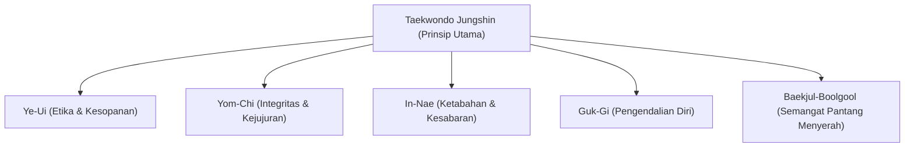

# Bab 1.1: Filosofi, Etika Dojang, dan Terminologi Dasar

Sebagai praktisi yang baru memulai perjalanan di tingkatan **Geup 10 (Sabuk Putih)**, pemahaman terhadap etika, filosofi, dan terminologi bahasa Korea merupakan syarat utama sebelum menguasai teknik fisik. Sabuk putih melambangkan kesucian, kepolosan, dan lembaran kosong yang siap diisi oleh ilmu dan kedisiplinan.

---

## 1. Prinsip Dasar Taekwondo (Taekwondo Jungshin)

Seluruh praktisi Taekwondo wajib memegang teguh lima prinsip utama (*5 Tenets of Taekwondo*):



1. **Ye-Ui (Etika & Kesopanan):** Menghormati senior, pelatih, sesama rekan, dan masyarakat.
2. **Yom-Chi (Integritas):** Memiliki kesadaran moral untuk membedakan yang benar dan salah serta mengakui kesalahan.
3. **In-Nae (Ketabahan):** Kesabaran dalam menghadapi kesulitan selama latihan intensif maupun kehidupan sehari-hari.
4. **Guk-Gi (Pengendalian Diri):** Kemampuan mengontrol emosi, dorongan fisik, dan agresi di luar arena pertarungan.
5. **Baekjul-Boolgool (Semangat Pantang Menyerah):** Keberanian untuk bangkit kembali menghadapi rintangan semurni apa pun.

---

## 2. Tata Krama Dojang (Dojang Etiquette)

Dojang adalah tempat berlatih yang disucikan untuk pengembangan fisik dan mental. Tata tertib berikut wajib diterapkan:

| Skenario | Prosedur Etika |
| :--- | :--- |
| **Masuk/Keluar Dojang** | Berdiri tegap (*Charyeot*), memberi hormat (*Gyeongnye*) ke arah bendera dan Sabeum. |
| **Menyapa Pelatih (Sabeum)** | Mengucapkan *"Annyeonghaseyo Sabeumnim"* sambil membungkuk 45 derajat. |
| **Merapikan Dobok** | Berbalik arah membelakangi pelatih/bendera saat merapikan seragam atau mengikat sabuk. |
| **Penggunaan Peralatan** | Merawat dan mengembalikan pemukul (*target pad*) atau protector ke tempat semula dengan kedua tangan. |

---

## 3. Terminologi Bahasa Korea (Kibon Eon-eo)

Perintah dan istilah teknis dalam Taekwondo menggunakan bahasa Korea standar Kukkiwon.

### A. Perintah Dasar dalam Latihan
- **Charyeot (차렷):** Perhatian / berdiri tegap.
- **Gyeongnye (경례):** Hormat.
- **Junbi (준비):** Siap / posisi siap awal.
- **Shijak (시작):** Mulai.
- **Geuman (그만):** Selesai / berhenti.
- **Kalyeo (갈려):** Memisah (saat Kyorugi).
- **Kyesok (계속):** Lanjutkan pertarungan.
- **Shio (쉬어):** Istirahat.

### B. Hitungan Korea Standar (1 - 10)
```text
1: Hana (하나)      6: Yeosot (여섯)
2: Dool (둘)        7: Ilgop (일곱)
3: Set (셋)         8: Yeodol (여덟)
4: Net (넷)         9: Ahop (아홉)
5: Dasot (다섯)    10: Yeol (열)
```

### C. Pembagian Target Tubuh (Body Targets)
- **Ogul / Olgul (얼굴):** Target area atas (leher ke atas hingga kepala).
- **Momtong (몸통):** Target area tengah (bahu hingga pinggang).
- **Are (아래):** Target area bawah (pinggang ke bawah).

---

## 4. Evaluasi Mandiri Sabuk Putih

Sebelum melanjutkan ke teknik fisik, pastikan Anda dapat menjawab checklist berikut:
- [ ] Memahami arti warna Sabuk Putih.
- [ ] Mampu menyebutkan 5 Prinsip Taekwondo (*Taekwondo Jungshin*).
- [ ] Mampu melakukan sikap *Charyeot*, *Gyeongnye*, dan *Junbi* dengan posisi tubuh yang presisi.
- [ ] Menghafal hitungan Korea 1 sampai 10 dengan lafal yang benar.

---
[Daftar Isi](../_index.md) | [Bab 1.2: Kuda-kuda & Pukulan Dasar →](02-kuda-kuda-dan-pukulan-dasar.md)
