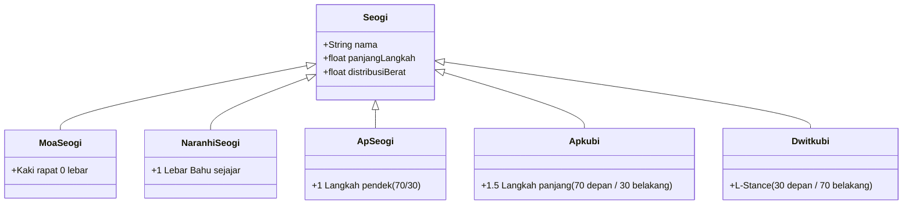
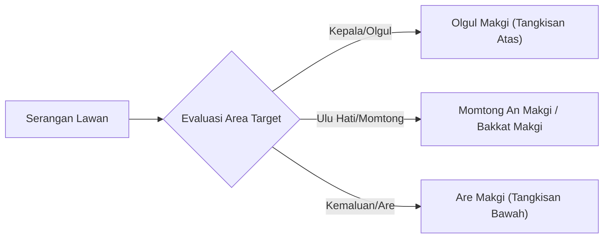

# Bab 1.2: Kuda-kuda (Seogi), Pukulan (Jiringi), & Tangkisan (Makgi) Dasar

Teknik gerakan dasar (*Kibon Dongjak*) adalah fondasi paling krusial dalam Taekwondo. Ketepatan posisi kuda-kuda (*Seogi*), distribusi berat badan, dan rotasi pinggul menentukan efektivitas tenaga (*Power*) dan keseimbangan pertahanan.

---

## 1. Spesifikasi Kuda-kuda Dasar (Seogi)

Setiap kuda-kuda memiliki jarak kaki dan distribusi berat badan yang terukur secara geometris:



### Detail Penjelasan Kuda-kuda:

1. **Moa Seogi (모아서기):**
   - Kedua kaki tertutup rapat, tumit dan jemari bersentuhan. Kaki lurus, digunakan untuk sikap awal penghormatan/berdoa.
2. **Naranhi Seogi (naranhi-seogi / 평행서기):**
   - Kaki dibuka sejajar selebar bahu. Berat badan terbagi rata 50% di kaki kiri dan 50% di kaki kanan. Posisi standar *Gibon Junbi Seogi*.
3. **Ap Seogi (Jalan Pendek / 앞서기):**
   - Langkah alami sepanjang 1 tapak kaki. Kaki depan mengarah lurus, kaki belakang membentuk sudut 30 derajat. Berat badan 60% di depan, 40% di belakang.
4. **Apkubi (Kuda-kuda Panjang / 앞굽이):**
   - Panjang langkah sekitar 1.5 lebar bahu. Kaki depan ditekuk hingga lutut sejajar tegak lurus dengan tumit. Kaki belakang lurus terkunci. Berat badan 70% di depan, 30% di belakang.
5. **Dwitkubi (Kuda-kuda L / 뒷굽i):**
   - Bentuk kaki membentuk huruf L (90 derajat). Kaki belakang ditekuk, memikul 70% berat badan; kaki depan memikul 30% berat badan.

---

## 2. Teknik Pukulan Lurus (Jiringi)

Pukulan Taekwondo memfokuskan tenaga pada dua buku jari depan (*Pyeong Jumeok*) dengan memutar pergelangan tangan pada saat impact (sentuhan akhir).

```text
[Awal Gerakan] -> Tarik tangan di pinggang (telapak menghadap atas)
     │
     ▼
[Progresi]   -> Dorong lurus sejajar garis tengah tubuh (Myeongchi)
     │
     ▼
[Impact]     -> Putar pergelangan 180 derajat (telapak menghadap bawah)
```

### Klasifikasi Pukulan Berdasarkan Target:
- **Olgul Jiringi:** Pukulan lurus ke arah dagu/hidung lawan.
- **Momtong Jiringi:** Pukulan lurus ke ulu hati (*Myeongchi*).
- **Are Jiringi:** Pukulan lurus ke arah kemaluan/perut bawah.

---

## 3. Teknik Tangkisan Dasar (Makgi)

Tangkisan bertujuan menangkis atau memotong arah serangan lawan menggunakan tulang pengumpil/hasta lengan (*Anpalmok / Bakkatpalmok*).



### A. Are Makgi (아래막기 - Tangkisan Bawah)
- **Fungsi:** Menangkis tendangan lurus atau pukulan ke arah bawah.
- **Mekanisme:** Tangan menangkis dimulai dari bahu berlawanan, menyapu bawah sejajar paha dengan jarak 1-2 kepalan tangan di atas paha depan.

### B. Momtong An Makgi (몸통안막기 - Tangkisan Tengah dari Luar ke Dalam)
- **Fungsi:** Menangkis pukulan atau tendangan yang menuju ulu hati.
- **Mekanisme:** Lengan diayunkan dari posisi luar tubuh melingkar ke dalam tengah dada, menghentak di depan ulu hati.

### C. Olgul Makgi (얼굴막기 - Tangkisan Atas)
- **Fungsi:** Menangkis pukulan atau tendangan atas menuju kepala.
- **Mekanisme:** Lengan diangkat dari pinggang menyeberangi dada naik ke atas kepala membentuk sudut 45 derajat, berjarak 1 kepalan dari dahi.

---

## 4. Latihan Kombinasi Dasar (Kibon Dongjak 1-5)

Cobalah mengombinasikan gerakan berikut dalam posisi *Apkubi*:
1. *Apkubi Are Makgi* -> Maju *Apkubi Momtong Jiringi*.
2. *Apkubi Momtong An Makgi* -> Maju *Apkubi Olgul Jiringi*.
3. *Apkubi Olgul Makgi* -> Mundur *Apkubi Are Makgi*.

---
[← Bab 1.1: Filosofi & Etika](01-filosofi-dan-etika.md) | [Daftar Isi](../_index.md) | [Bab 1.3: Taegeuk Il Jang →](03-taegeuk-il-jang.md)
