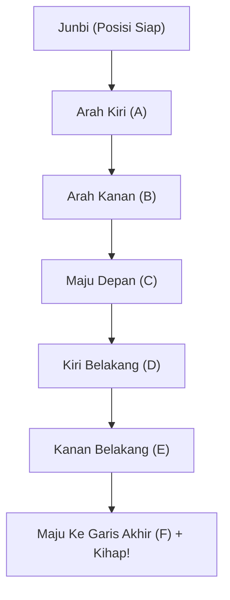

# Bab 1.3: Poomsae: Taegeuk Il Jang (1 Jang)

**Taegeuk Il Jang** merepresentasikan simbol **Keon (건)** dalam Palgwe, yang melambangkan Langit (*Surga/Air*) dan Keagungan. Jurus ini melambangkan awal mula penciptaan alam semesta dan awal perjalanan seorang Taekwondoin.

---

## 1. Spesifikasi Poomsae

- **Simbol Trigram:** ☰ (Keon - Langit & Cahaya)
- **Jumlah Gerakan:** 18 Gerakan (20 Langkah eksekusi)
- **Kuda-kuda Utama:** *Ap Seogi*, *Apkubi*
- **Teknik Utama:** *Are Makgi*, *Momtong An Makgi*, *Olgul Makgi*, *Momtong Jiringi*, *Ap Chagi*
- **Kihap (Teriakan):** Pada gerakan terakhir (Langkah ke-18, *Momtong Jiringi*).

---

## 2. Diagram Jalur Gerakan (Poomsae Line / Yeon-mu Seon)

Jurus Taegeuk berstruktur garis huruf **I** (atau lambang Wang / Raja 👑):

---

## 3. Urutan Gerakan Lengkap (Step-by-Step Execution)

| No | Arah | Kuda-Kuda (*Seogi*) | Teknik Tangan/Kaki | Keterangan |
| :---: | :---: | :--- | :--- | :--- |
| **0** | Tengah | *Naranhi Seogi* | *Gibon Junbi Seogi* | Tarik nafas tenang |
| **1** | Kiri | *Ap Seogi* (Kiri depan) | *Are Makgi* (Kiri) | Menoleh kiri 90° |
| **2** | Depan | *Ap Seogi* (Kanan depan) | *Momtong Jiringi* (Kanan) | Maju 1 langkah |
| **3** | Kanan | *Ap Seogi* (Kanan depan) | *Are Makgi* (Kanan) | Putar badan 180° ke kanan |
| **4** | Depan | *Ap Seogi* (Kiri depan) | *Momtong Jiringi* (Kiri) | Maju 1 langkah |
| **5** | Tengah | *Apkubi* (Kiri depan) | *Are Makgi* (Kiri) | Belok 90° ke arah tengah |
| **6** | Diam | *Apkubi* (Kiri depan) | *Momtong Jiringi* (Kanan) | Pukulan susulan tanpa ubah kaki |
| **7** | Kanan | *Ap Seogi* (Kanan depan) | *Momtong An Makgi* (Kiri) | Menoleh 90° ke kanan |
| **8** | Depan | *Ap Seogi* (Kiri depan) | *Momtong Jiringi* (Kanan) | Maju 1 langkah |
| **9** | Kiri | *Ap Seogi* (Kiri depan) | *Momtong An Makgi* (Kanan)| Putar 180° ke kiri |
| **10**| Depan | *Ap Seogi* (Kanan depan) | *Momtong Jiringi* (Kiri) | Maju 1 langkah |
| **11**| Tengah | *Apkubi* (Kanan depan) | *Are Makgi* (Kanan) | Belok 90° ke arah tengah |
| **12**| Diam | *Apkubi* (Kanan depan) | *Momtong Jiringi* (Kiri) | Pukulan susulan tanpa ubah kaki |
| **13**| Kiri | *Ap Seogi* (Kiri depan) | *Olgul Makgi* (Kiri) | Menoleh 90° ke kiri |
| **14**| Kiri | *Ap Seogi* -> Kick | *Ap Chagi* (Kanan) + *Momtong Jiringi* (Kanan) | Tendang dulu baru mendarat *Ap Seogi* |
| **15**| Kanan | *Ap Seogi* (Kanan depan) | *Olgul Makgi* (Kanan) | Putar 180° ke kanan |
| **16**| Kanan | *Ap Seogi* -> Kick | *Ap Chagi* (Kiri) + *Momtong Jiringi* (Kiri) | Tendang dulu baru mendarat *Ap Seogi* |
| **17**| Tengah | *Apkubi* (Kiri depan) | *Are Makgi* (Kiri) | Belok 90° ke arah belakang |
| **18**| Tengah | *Apkubi* (Kanan depan) | *Momtong Jiringi* (Kanan) | **KIHAP!** (Maju & Teriak) |

---

## 4. Kesalahan Umum pada Taegeuk 1 Jang

1. **Lebar Kuda-kuda Tertukar:** Membedakan antara *Ap Seogi* (langkah pendek alami) dan *Apkubi* (langkah panjang terkunci).
2. **Ketinggian Tangkisan:** *Olgul Makgi* terlalu rendah (menutupi mata) atau terlalu tinggi (di atas kepala jauh).
3. **Mendarat Kaki Setelah Ap Chagi:** Setelah menendang *Ap Chagi*, kaki mendarat terlebih dahulu baru melakukan pukulan, bukan mendarat bersamaan dengan pukulan.

---
[← Bab 1.2: Kuda-kuda & Pukulan Dasar](02-kuda-kuda-dan-pukulan-dasar.md) | [Daftar Isi](../_index.md) | [Bab 1.4: UKT Sabuk Putih →](04-materi-dan-standar-ukt-sabuk-putih.md)
