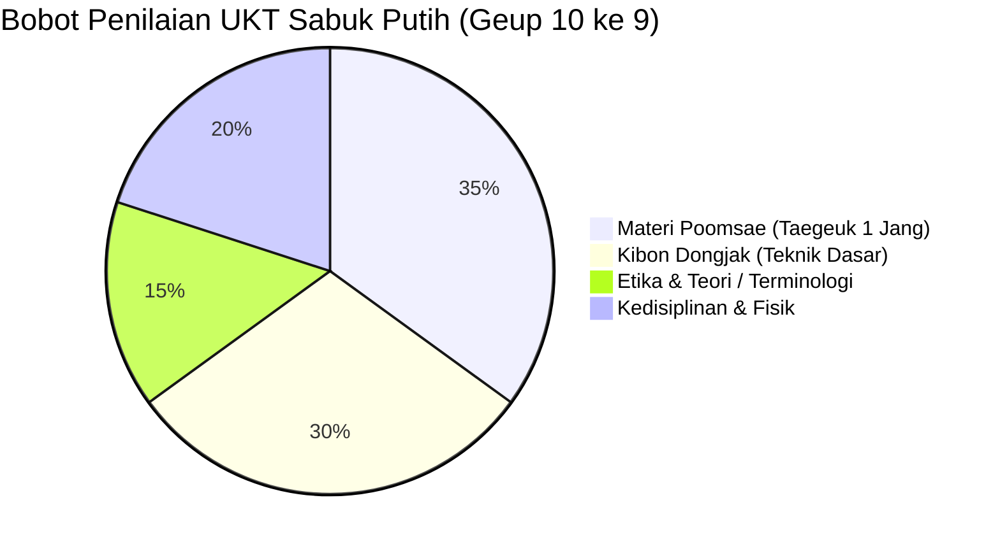
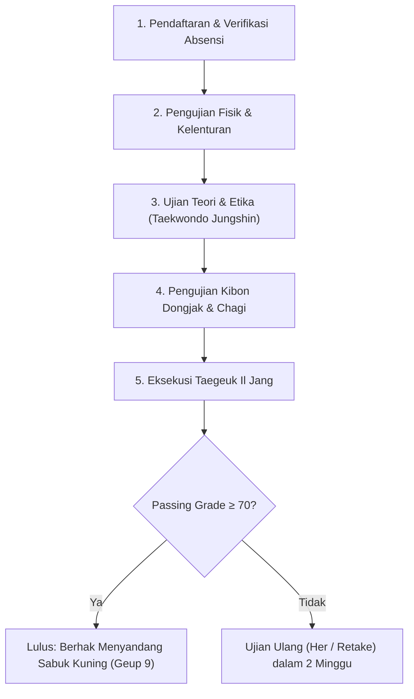

# Bab 1.4: Materi dan Standar UKT Sabuk Putih (Geup 10 ke Geup 9)

**Ujian Kenaikan Tingkat (UKT)** bagi Taekwondoin ber-**Sabuk Putih (Geup 10)** merupakan evaluasi kelulusan perdana menuju **Sabuk Kuning (Geup 9)**. Tujuan ujian ini adalah menguji tingkat disiplin, penguasaan etika dojang, pemahaman kuda-kuda dasar, ketepatan tangkisan, serta presisi jurus dasar pertama (*Taegeuk 1 Jang*).

---

## 1. Persyaratan Administratif & Fisik Minimal

| Parameter | Standar Kelulusan (Geup 10 → Geup 9) |
| :--- | :--- |
| **Masa Latihan Active** | Minimal 2 - 3 Bulan (24 Sesi latihan terverifikasi) |
| **Persentase Kehadiran** | Minimal 80% dari total sesi reguler |
| **Kondisi Fisik** | Push-up 15x, Sit-up 20x, kelenturan dasar cium lutut |
| **Kelengkapan Seragam** | Dobok standar WT lengkap dengan Sabuk Putih resmi dojang |

---

## 2. Struktur & Bobot Penilaian UKT Sabuk Putih

Penguji (*Examiner / Sabeum*) melakukan penilaian menggunakan skala 1-100 dengan bobot komponen sebagai berikut:

---

## 3. Rincian Materi Pengujian (Checklist Evaluasi)

### A. Etika & Terminologi Korea (Sikap & Teori)
- **Janji Taekwondoin (Taekwondo Pledge):** Menghafal dan mengikrarkan 5 prinsip Taekwondo (*Ye-Ui*, *Yom-Chi*, *In-Nae*, *Guk-Gi*, *Baek-Jul-Bool-Gool*).
- **Penghormatan & Aba-aba:**
  - *Charyeot* (Sikap Siap Tegak), *Gyeongne* (Hormat 45°), *Junbi* (Sikap Siap Bertarung/Jurus).
  - *Shijak* (Mulai), *Keuman* (Selesai), *Dwiro Dora* (Balik Badan), *Shio* (Istirahat).

### B. Teknik Dasar (Kibon Dongjak) & Tendangan (Chagi)
1. **Kuda-kuda (Seogi):** *Ap Seogi* (Langkah pendek alami), *Apkubi* (Langkah panjang 3.5 telapak kaki, kaki depan ditekuk 90°), *Juchum Seogi* (Kuda-kuda duduk/menunggang kuda).
2. **Pukulan & Tangkisan:**
  - *Momtong Jiringi* (Pukulan lurus ulu hati).
  - *Are Makgi* (Tangkisan bawah melindung kemaluan/paha).
  - *Momtong An Makgi* (Tangkisan dada dari luar ke dalam).
  - *Olgul Makgi* (Tangkisan atas melindung dahi).
3. **Tendangan Dasar (Chagi):**
  - *Ap Chagi* (Tendangan lurus depan menggunakan *Apchuk* / bantalan telapak kaki depan).
  - *Ap Chooligi* (Ayun kaki lurus ke atas untuk fleksibilitas).

### C. Poomsae Wajib: Taegeuk Il Jang (1 Jang)
- Eksekusi 18 gerakan *Taegeuk 1 Jang* tanpa terhenti atau lupa urutan jalur (*Yeon-mu Seon*).
- Penilaian fokus pada:
  - Keseimbangan (*Balance*) saat transisi kuda-kuda.
  - Kekuatan letupan (*Snap*) pada tangkisan dan pukulan.
  - **Kihap** pekak di gerakan ke-18 (*Momtong Jiringi* akhir).

---

## 4. Rubrik Penilaian UKT Sabuk Putih

| Skor Penilaian | Kategori | Deskripsi Kualifikasi |
| :---: | :--- | :--- |
| **85 - 100** | Sangat Memuaskan (*Distinction*) | Gerakan sangat presisi, kuda-kuda kokoh, Kihap mantap, Poomsae lancar tanpa ragu. |
| **70 - 84** | Lulus (*Pass*) | Menguasai urutan gerakan dan teknik dasar, terdapat kelalaian kecil pada sudut kuda-kuda. |
| **< 70** | Tidak Lulus (*Fail*) | Lupa urutan Taegeuk 1 Jang, kuda-kuda tidak stabil, atau gagal melakukan *Ap Chagi* dengan benar. |

---
[← Bab 1.3: Taegeuk Il Jang](03-taegeuk-il-jang.md) | [Daftar Isi](../_index.md) | [Bab 2.1: Tendangan Dasar →](../02-sabuk-kuning-dan-kuning-strip/01-tendangan-dasar-dan-tangkisan.md)
