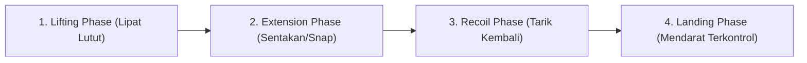
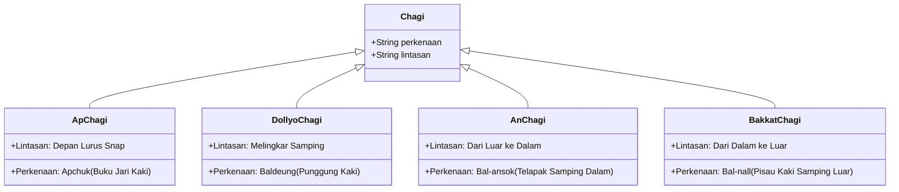

# Bab 2.1: Tendangan Dasar (Chagi) & Kombinasi Tangkisan

Pada tingkatan **Sabuk Kuning (Geup 9)** dan **Kuning Strip (Geup 8)**, praktisi mulai memfokuskan dominasi senjata utama Taekwondo: **Tendangan (Chagi)**. Sabuk kuning melambangkan bumi, tempat akar tanaman (fondasi) mulai tertanam kuat.

---

## 1. Mekanisme Kinetik Tendangan (Biomechanic Phases)

Seluruh tendangan Taekwondo wajib mengikuti 4 fase biomekanika kinetik:



- **Fase 1 (Chool-bal / Angkat Lutut):** Lutut ditekuk rapat dan diangkat tinggi ke arah dada sebelum kaki dilepaskan.
- **Fase 2 (Pyeo-gi / Ekstensi):** Melepaskan tendangan dengan rotasi pinggul dan lecutan persendian lutut/pergelangan kaki.
- **Fase 3 ( 접기 / Recoil):** Mengembalikan kaki ke posisi terlipat setelah sentuhan target (mencegah ditangkap lawan).
- **Fase 4 ( 착지 / Mendarat):** Menempatkan kaki mendarat ke tanah dengan sikap kuda-kuda kokoh.

---

## 2. Katalis Teknik Tendangan Geup 9 - 8



### A. Ap Chagi (앞차기 - Tendangan Depan)
- **Target:** Ulu hati (*Momtong*) atau Dagu (*Olgul*).
- **Perkenaan Kaki:** *Apchuk* (Buku-buku jari bawah telapak kaki depan). Jari-jari kaki harus ditarik ke belakang.

### B. Dollyo Chagi (돌려차기 - Tendangan Memutar Samping)
- **Target:** Rusuk lawan (*Momtong*) atau Pelipis/Kepala (*Olgul*).
- **Perkenaan Kaki:** *Baldeung* (Punggung kaki) atau *Apchuk*.
- **Mekanisme Rotasi:** Kaki tumpuan memutar 130-180 derajat ke belakang saat lutut diangkat sejajar pinggul.

### C. An Chagi & Bakkat Chagi (안차기 & 바깥차기 - Tendangan Ayunan Kipas)
- **An Chagi:** Mengayunkan kaki lurus dari arah luar melingkar ke dalam untuk menampar wajah atau menangkis tangan lawan.
- **Bakkat Chagi:** Mengayunkan kaki lurus dari arah dalam melingkar ke luar.

---

## 3. Tangkisan Lanjutan Sabuk Kuning

### A. Hansonnal Momtong Bakkat Makgi (한손날 몸통 바깥막기)
Tangkisan menggunakan satu pisau tangan (*Hansonnal*) di mana telapak tangan terbuka dan ditegakkan untuk menangkis serangan ke arah dada.

```text
       [Posisi Awal]                   [Eksekusi Akhir]
Tangan menangkis di belakang ears  --> Lengan menyapu ke depan dada,
Telapak menghadap luar                 Pisau tangan berdiri tegak 90°
```

### B. Olgul Bakkat Makgi (얼굴 바깥막기)
Tangkisan area atas dari arah dalam menangkis ke luar sisi kepala.

---

## 4. Evaluasi Latihan Kombinasi (Kibon Chagi & Makgi)

Lakukan latihan beruntun berikut:
1. *Apkubi Are Makgi* -> *Ap Chagi* -> Mendarat *Apkubi Momtong Jiringi*.
2. *Dwitkubi Hansonnal Makgi* -> *Dollyo Chagi* -> Mendarat *Apkubi Momtong Jiringi*.

---
[← Bab 1.4: UKT Sabuk Putih](../01-fondasi-dan-sabuk-putih/04-materi-dan-standar-ukt-sabuk-putih.md) | [Daftar Isi](../_index.md) | [Bab 2.2: Taegeuk 2 & 3 Jang →](02-taegeuk-ee-jang-dan-sam-jang.md)
