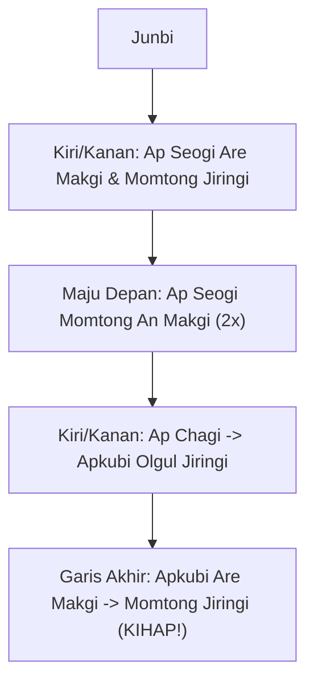
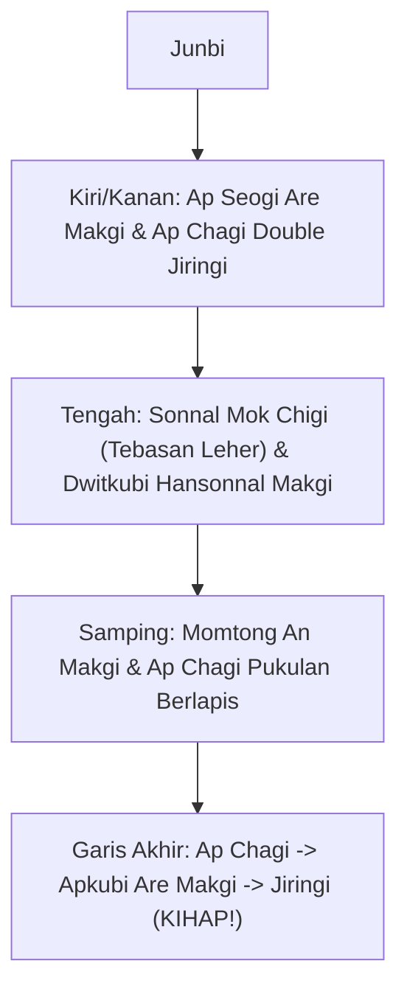

# Bab 2.2: Poomsae: Taegeuk Ee Jang (2 Jang) & Taegeuk Sam Jang (3 Jang)

Bagi praktisi pemegang **Sabuk Kuning (Geup 9)** dan **Kuning Strip (Geup 8)**, penguasaan jurus berlanjut ke **Taegeuk Ee Jang** dan **Taegeuk Sam Jang**. Kedua Poomsae ini memperkenalkan dinamika kelembutan serta letupan tenaga (*Inner firmness & External expression*).

---

## 1. Taegeuk Ee Jang (태극 2장)

- **Simbol Trigram:** ☱ (Tae - Danau / Sukacita)
- **Filosofi:** Menggambarkan ketenangan luar seperti permukaan air danau, namun menyimpan ketegasan di dalam.
- **Jumlah Gerakan:** 18 Gerakan
- **Elemen Baru:** Penggunaan *Olgul Jiringi* yang dikombinasikan dengan tendangan *Ap Chagi*.



### Tabel Gerakan Kunci Taegeuk Ee Jang:
| No | Kuda-kuda | Teknik Utama | Catatan Penting |
| :---: | :--- | :--- | :--- |
| **1-4** | *Ap Seogi* | *Are Makgi* -> *Momtong Jiringi* | Gerakan ritmis kiri dan kanan |
| **5-6** | *Ap Seogi* | *Momtong An Makgi* (Kanan & Kiri) | Maju di garis tengah |
| **7-10**| *Ap Seogi* & *Apkubi* | *Are Makgi* -> *Ap Chagi* -> *Olgul Jiringi* | Perhatikan perbaikan ketinggian pukulan ke dagu |
| **17-18**| *Apkubi* | *Are Makgi* -> *Momtong Jiringi* | **KIHAP!** pada langkah 18 |

---

## 2. Taegeuk Sam Jang (태극 3장)

- **Simbol Trigram:** ☲ (Ri - Api / Kebijaksanaan)
- **Filosofi:** Api melambangkan antusiasme, kecerahan, dan kehangatan. Gerakan harus tegas, cepat, dan penuh semangat.
- **Jumlah Gerakan:** 20 Gerakan
- **Elemen Baru:** Introduksi *Sonnal Mok Chigi* (Tebasan pisau tangan ke leher) dan kuda-kuda *Dwitkubi*.



### Detail Teknik Kunci Taegeuk Sam Jang:

1. **Sonnal Mok Chigi (손날 목치기):**
   - Tebasan pisau tangan menuju leher lawan. Tangan menebas dari arah samping bahu luar ke dalam leher dengan sudut 45 derajat.
2. **Dwitkubi Hansonnal Momtong Makgi (뒷굽이 한손날 몸통막기):**
   - Kuda-kuda L (*Dwitkubi*) dengan tangkisan pisau tangan tunggal melindung ulu hati.

---

## 3. Komparasi Evaluasi Taegeuk 1, 2, dan 3

```mermaid
quadrantChart
    title Pemetaan Karakteristik Poomsae 1 - 3
    x-axis Lambat/Stabil --> Cepat/Dinamis
    y-axis Sederhana --> Kompleks
    quadrant-1 Taegeuk 3 Jang (Api)
    quadrant-2 Transisi Tingkat Menengah
    quadrant-3 Taegeuk 1 Jang (Langit)
    quadrant-4 Taegeuk 2 Jang (Danau)
    Taegeuk 1 Jang: [0.2, 0.2]
    Taegeuk 2 Jang: [0.4, 0.4]
    Taegeuk 3 Jang: [0.85, 0.8]
```

---
[← Bab 2.1: Tendangan Dasar & Tangkisan](01-tendangan-dasar-dan-tangkisan.md) | [Daftar Isi](../_index.md) | [Bab 2.3: UKT Sabuk Kuning →](03-materi-dan-standar-ukt-sabuk-kuning.md)
