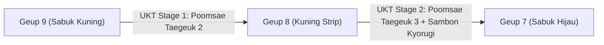
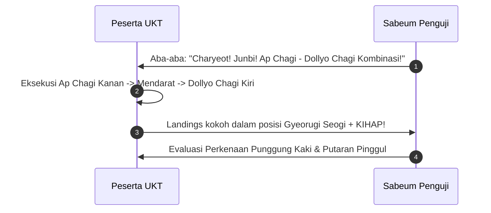

# Bab 2.3: Materi dan Standar UKT Sabuk Kuning & Kuning Strip (Geup 9 ke 8 & 8 ke 7)

Praktisi **Sabuk Kuning (Geup 9)** dan **Sabuk Kuning Strip (Geup 8)** menempuh evaluasi Ujian Kenaikan Tingkat (UKT) untuk melangkah menuju tingkatan menengah (**Sabuk Hijau / Geup 7**). Pada tahap ini, penguji memprioritaskan kelancaran kombinasi tendangan memutar, penggunaan kuda-kuda *Dwitkubi*, serta koordinasi dua Poomsae beruntun: **Taegeuk Ee Jang** dan **Taegeuk Sam Jang**.

---

## 1. Matriks Persyaratan Jenjang Tingkatan Sabuk Kuning



| Parameter Evaluasi | Ujian Geup 9 → Geup 8 | Ujian Geup 8 → Geup 7 |
| :--- | :--- | :--- |
| **Masa Latihan Active** | Minimal 3 Bulan teratur | Minimal 3 Bulan sejak Geup 8 |
| **Syarat Poomsae** | *Taegeuk Ee Jang (2 Jang)* | *Taegeuk Sam Jang (3 Jang)* + Review *Taegeuk 1-2* |
| **Teknik Kuda-Kuda Baru** | *Apkubi* & *Ap Seogi* Lanjutan | Introduksi *Dwitkubi* (Kuda-kuda L) |
| **Teknik Tangkisan/Tebasan** | *Olgul Jiringi*, *Momtong An Makgi* | *Sonnal Mok Chigi*, *Hansonnal Makgi* |
| **Simulasi Pertarungan** | Sambon Kyorugi 2 Pola | Sambon Kyorugi 4 Pola + Step Kyorugi |
| **Ujian Fisik** | Push-up 20x, Sit-up 25x | Push-up 25x, Sit-up 30x, Spaghat 120° |

---

## 2. Rincian Penilaian Materi Ujian

### A. Evaluasi Poomsae (Jurus)
- **Taegeuk 2 Jang (Geup 9 → 8):** Ketepatan *Olgul Jiringi* setelah *Ap Chagi*, ritme transisi dari *Are Makgi* ke *Momtong Jiringi*.
- **Taegeuk 3 Jang (Geup 8 → 7):** Penguasaan *Sonnal Mok Chigi* (tebasan leher) dengan sudut pisau tangan 45°, serta keseimbangan pada kuda-kuda *Dwitkubi Hansonnal Makgi*.

### B. Teknik Tendangan (Chagi) & Kombinasi
- **Dollyo Chagi (Tendangan Memutar):** Perkenaan tepat pada *Padtosung* (punggung kaki), pinggul diputar penuh 90°-180°.
- **Yeop Chagi Dasar:** Tendangan samping dengan perkenaan *Balnal* (pisau telapak kaki).
- **Naeryeo Chagi:** Tendangan mencangkul/menurun menghantam sasaran atas.



### C. Sambon Kyorugi (Pertarungan Tiga Langkah)
Simulasi pertarungan teratur 3 langkah tanpa perlengkapan body protector:
1. **Penyerang:** Maju 3 langkah *Apkubi Momtong Jiringi* dengan teriakan.
2. **Bertahan:** Mundur 3 langkah *Ap Seogi / Dwitkubi Makgi* (Tangkisan bawah/dada) lalu diakhiri serangan balasan (*Counter Attack*) pukulan/tebasan pisau tangan ke leher lawan.

---

## 3. Lembar Rubrik Penilaian Sabuk Kuning

```mermaid
quadrantChart
    title Kriteria Kelulusan UKT Sabuk Kuning
    x-axis Akurasi Rendah --> Akurasi Tinggi
    y-axis Tenaga Lemah --> Tenaga Meledak/Fokus
    quadrant-1 Lulus Sangat Memuaskan (Score 85-100)
    quadrant-2 Perbaiki Teknik Kuda-kuda (Score 70-84)
    quadrant-3 Gagal / Her (Score < 70)
    quadrant-4 Perbaiki Letupan Tenaga (Score 70-84)
    Kombinasi Geup 8: [0.8, 0.85]
    Kombinasi Geup 9: [0.65, 0.7]
```

---
[← Bab 2.2: Taegeuk Ee Jang & Sam Jang](02-taegeuk-ee-jang-dan-sam-jang.md) | [Daftar Isi](../_index.md) | [Bab 3.1: Teknik Samping & Memutar →](../03-sabuk-hijau-dan-hijau-strip/01-teknik-samping-dan-memutar.md)
