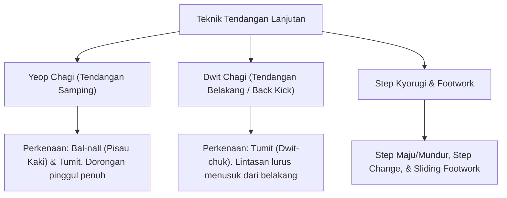
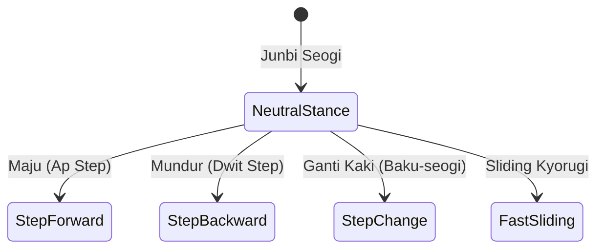

# Bab 3.1: Teknik Tendangan Samping, Memutar, & Step Kyorugi Dasar

Tingkatan **Sabuk Hijau (Geup 7)** dan **Hijau Strip (Geup 6)** menandai transisi penting dari gerakan linear menuju variasi pergerakan lateral (samping) dan putaran 180-360 derajat. Sabuk hijau melambangkan pertumbuhkan tanaman yang semakin rimbun dan kuat.

---

## 1. Analisis Biomekanika Tendangan Lanjutan



### A. Yeop Chagi (옆차기 - Tendangan Samping)
- **Target:** Ulu hati, rusuk, atau dahi lawan.
- **Perkenaan:** *Bal-nall* (Sisi pisau luar telapak kaki) atau *Dwit-chuk* (Tumit).
- **Mekanisme:** Lutut diangkat ke dada dengan melipat kaki secara horisontal, pinggul diputar 180 derajat ke belakang bersama tumpuan kaki, lalu sentakkan kaki lurus menusuk target.

### B. Dwit Chagi (뒷차기 - Tendangan Belakang / Back Kick)
- **Target:** Ulu hati atau dada lawan (*Momtong*).
- **Perkenaan:** *Dwit-chuk* (Tumit).
- **Mekanisme:**
  1. Putar bahu dan kepala melihat target dari atas bahu (180 derajat).
  2. Tarik lutut rapat mengarah ke bawah.
  3. Sentakkan tumit lurus ke belakang sejajar garis tengah tubuh.

---

## 2. Sistem Footwork & Step Kyorugi (Gyeorugi Seogi)

Sikap siap bertarung (*Gyeorugi Junbi Seogi*) mensyaratkan kelincahan kaki (*Footwork*) agar praktisi dapat menjaga jarak ideal (*Distance Control*).



| Nama Step | Fungsi Taktis | Cara Eksekusi |
| :--- | :--- | :--- |
| **Ap Step (Step Maju)** | Menutup jarak serangan | Melompat kecil menyelimuti lantai ke depan |
| **Dwit Step (Step Mundur)** | Menghindari serangan (*Evade*) | Melompat kecil ke belakang |
| **Baku-seogi (Step Change)** | Mengubah sudut & posisi serang | Menukar posisi kaki depan dan belakang di tempat |
| **Sliding Step** | Serangan kejutan cepat | Kaki belakang mendorong kaki depan meluncur cepat |

---

## 3. Latihan Kyorugi Dasar (One-Step / Sambon Kyorugi)

Pada tingkatan Geup 6, siswa dikenalkan pada simulasi pertarungan 1 langkah (*Han-beon Kyorugi*):

```text
[Penyerang]  Apkubi Momtong Jiringi (Maju Pukulan)
     │
     ▼
[Bertahan]   Mundur Dwitkubi Hansonnal Makgi -> Counter Dwit Chagi / Yeop Chagi!
```

---
[← Bab 2.2: Taegeuk 2 & 3 Jang](../02-sabuk-kuning-dan-kuning-strip/02-taegeuk-ee-jang-dan-sam-jang.md) | [Daftar Isi](../_index.md) | [Bab 3.2: Taegeuk 4 & 5 Jang →](02-taegeuk-sa-jang-dan-oh-jang.md)
