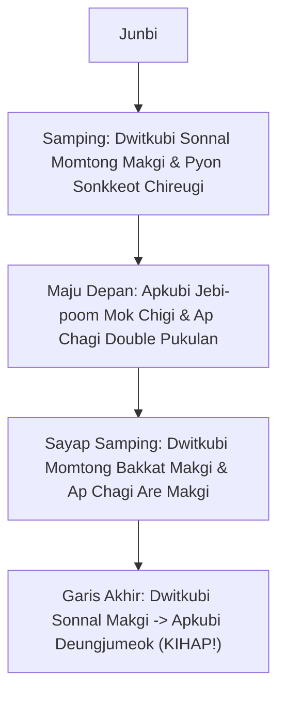
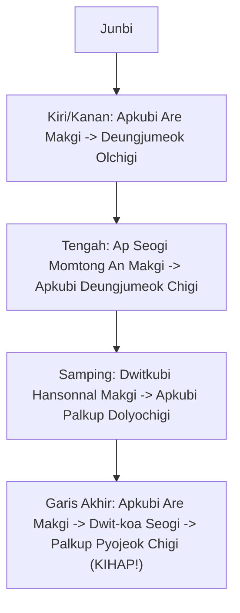

# Bab 3.2: Poomsae: Taegeuk Sa Jang (4 Jang) & Taegeuk Oh Jang (5 Jang)

Memasuki tingkatan **Sabuk Hijau (Geup 7)** dan **Hijau Strip (Geup 6)**, intensitas Poomsae meningkat signifikan dengan diperkenalkannya teknik tangkisan ganda, serangan siku (*Palkup*), dan sabetan punggung kepalan (*Deungjumeok*).

---

## 1. Taegeuk Sa Jang (태극 4장)

- **Simbol Trigram:** ☳ (Jin - Guntur / Ketenangan & Kekuatan)
- **Filosofi:** Guntur memancarkan kegagahan, daya letup tinggi, dan keberanian.
- **Jumlah Gerakan:** 20 Gerakan
- **Elemen Baru:** *Sonnal Momtong Makgi* (Tangkisan ganda pisau tangan), *Pyon Sonkkeot Chireugi* (Tusukan ujung jari), *Jebi-poom Mok Chigi*.

### Penjelasan Teknik Spesifik Taegeuk Sa Jang:

1. **Sonnal Momtong Makgi (손날 몸통막기):**
   - Tangkisan dua tangan terbuka (pisau tangan). Tangan depan menangkis ulu hati, tangan belakang melindungi ulu hati/dada tengah dalam posisi *Dwitkubi*.
2. **Jebi-poom Mok Chigi (제비폼 목치기):**
   - Gerakan simultan serentak: Tangan kiri melakukan *Olgul Makgi* terbuka melindung dahi, sedangkan tangan kanan menebas leher lawan (*Sonnal Mok Chigi*) dalam posisi *Apkubi*.
3. **Pyon Sonkkeot Chireugi (편손끝 치르기):**
   - Tusukan ujung jari lurus ke ulu hati lawan, ditopang oleh telapak tangan lainnya di bawah siku.

---

## 2. Taegeuk Oh Jang (태극 5장)

- **Simbol Trigram:** ☴ (Seon - Angin / Kelembutan & Fleksibilitas)
- **Filosofi:** Angin dapat bertiup lembut tak terlihat, namun sanggup berubah menjadi badai dahsyat. Gerakan harus fleksibel namun bertenaga.
- **Jumlah Gerakan:** 20 Gerakan
- **Elemen Baru:** *Deungjumeok Olchigi* (Sabetan punggung kepalan ke atas), *Palkup Dolyochigi* (Hantaman siku memutar), *Koa Seogi* (Kuda-kuda silang).

### Penjelasan Teknik Spesifik Taegeuk Oh Jang:

1. **Deungjumeok Eolgul Olchigi (등주먹 얼굴 앞치기):**
   - Hantaman punggung kepalan tangan diayunkan dari bawah menyabet hidung/dagu lawan.
2. **Palkup Dolyochigi (팔굽 돌려치기):**
   - Serangan siku memutar horizontal ke arah rahang/wajah lawan dalam posisi *Apkubi*.
3. **Koa Seogi (Dwit-koa Seogi - 뒷꼬아서기):**
   - Kuda-kuda silang di mana kaki belakang menyilang di belakang kaki depan dengan tumit diangkat.

---
[← Bab 3.1: Teknik Samping & Memutar](01-teknik-samping-dan-memutar.md) | [Daftar Isi](../_index.md) | [Bab 3.3: UKT Sabuk Hijau →](03-materi-dan-standar-ukt-sabuk-hijau.md)
