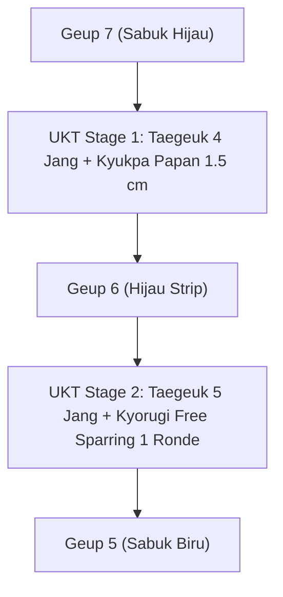
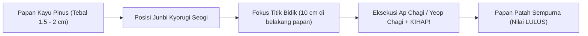

# Bab 3.3: Materi dan Standar UKT Sabuk Hijau & Hijau Strip (Geup 7 ke 6 & 6 ke 5)

Pada tingkatan **Sabuk Hijau (Geup 7)** dan **Hijau Strip (Geup 6)**, Taekwondoin memasuki transisi penting dari teknik fondasi dasar menuju aplikasi pertarungan nyata dan ketangkasan menengah. Evaluasi Ujian Kenaikan Tingkat (UKT) menguji penguasaan **Taegeuk Sa Jang (4 Jang)**, **Taegeuk Oh Jang (5 Jang)**, simulasi *Ilbon Kyorugi* (pertarungan 1 langkah), pengenalan *Free Sparring (Kyorugi)* berpelindung, serta pengujian pemecahan benda keras (*Kyukpa*).

---

## 1. Skema Pengujian Tingkatan Sabuk Hijau

| Komponen Pengujian | Ujian Geup 7 → Geup 6 (Hijau Strip) | Ujian Geup 6 → Geup 5 (Sabuk Biru) |
| :--- | :--- | :--- |
| **Masa Latihan Active** | Minimal 3 - 4 Bulan | Minimal 3 - 4 Bulan |
| **Poomsae Utama** | *Taegeuk Sa Jang (4 Jang)* | *Taegeuk Oh Jang (5 Jang)* |
| **Teknik Tangan Spesifik** | *Sonnal Momtong Makgi*, *Jebi-poom Mok Chigi*, *Pyon Sonkkeot* | *Deungjumeok Olchigi*, *Palkup Dolyochigi*, *Palkup Pyojeok* |
| **Kuda-kuda Khusus** | *Dwitkubi* presisi, *Apkubi* lurus | *Dwit-koa Seogi* (Kuda-kuda silang) |
| **Pemecahan (Kyukpa)** | 1 Bilah papan kayu pinus (1.5 cm) dengan *Ap Chagi* | 1 Bilah papan kayu pinus (2.0 cm) dengan *Yeop Chagi* |
| **Kyorugi (Pertarungan)** | Ilbon Kyorugi (1 Langkah - 3 variasi) | Free Sparring 1 Ronde (1.5 menit, Hogu lengkap) |

---

## 2. Detail Spesifikasi Ujian & Kriteria Penilaian

### A. Evaluasi Jurus (Poomsae Taegeuk 4 & 5 Jang)
1. **Taegeuk Sa Jang (4 Jang):**
   - Penilaian difokuskan pada ketepatan posisi pisau tangan ganda (*Sonnal Momtong Makgi*), eksekusi serentak *Jebi-poom Mok Chigi*, dan tusukan ujung jari lurus (*Pyon Sonkkeot Chireugi*).
2. **Taegeuk Oh Jang (5 Jang):**
   - Penilaian menekankan sabetan punggung kepalan (*Deungjumeok Olchigi*), hantaman siku memutar (*Palkup Dolyochigi*), dan kelincahan melangkah ke *Dwit-koa Seogi*.

### B. Pemecahan Benda Keras (Kyukpa - 격파)
Peserta wajib memecahkan papan kayu pinus standar WT:

### C. Free Sparring (Kyorugi) & Ilbon Kyorugi
- **Ilbon Kyorugi (Pertarungan 1 Langkah):** Lawan melangkah maju dengan pukulan lurus; peserta wajib mengelak ke samping, melakukan tangkisan pisau tangan, dan membalas dengan kuncian atau serangan siku/lutut.
- **Kyorugi Bebas (1 Ronde):** Menggunakan seragam pelindung dada (*Hogu*), pelindung kepala (*Headgear*), pelindung kemaluan (*Gromet*), dan pelindung tangan/kaki (*Shin/Forearm Guard*). Evaluasi dinilai dari keberanian menyerang, variasi *Step*, dan kombinasi tendangan *Narae Chagi*.

---

## 3. Matriks Kelulusan UKT Sabuk Hijau

| Rentang Skor | Status Kelulusan | Catatan Evaluator |
| :---: | :--- | :--- |
| **85 - 100** | Lulus Istimewa | Kyukpa patah sekali tebas/tendang, Taegeuk 4/5 sangat bertenaga, Kyorugi agresif dan sportif. |
| **70 - 84** | Lulus Standar | Kyukpa patah pada percobaan kedua, Poomsae lancar dengan minor koreksi kuda-kuda. |
| **< 70** | Tidak Lulus | Kyukpa tidak patah dalam 3x percobaan, lupa gerakan Taegeuk 4/5 Jang, atau pasif dalam Kyorugi. |

---
[← Bab 3.2: Taegeuk Sa Jang & Oh Jang](02-taegeuk-sa-jang-dan-oh-jang.md) | [Daftar Isi](../_index.md) | [Bab 4.1: Teknik Tingkat Menengah →](../04-sabuk-biru-dan-biru-strip/01-teknik-tingkat-menengah.md)
