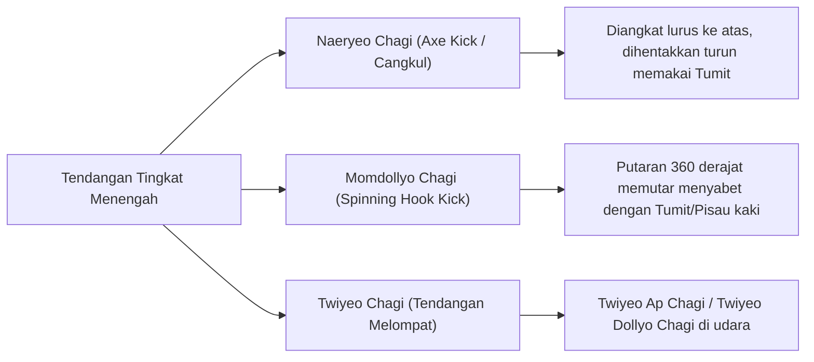
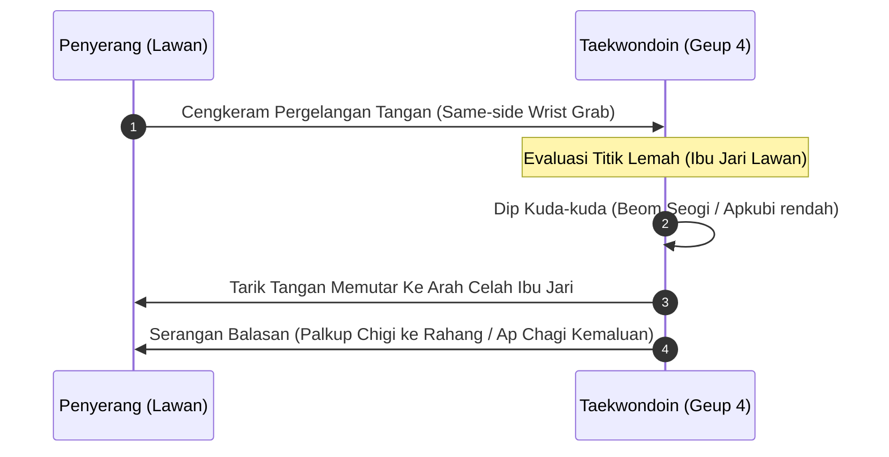

# Bab 4.1: Teknik Tingkat Menengah, Kombinasi Serangan, & Hosinsool

Praktisi **Sabuk Biru (Geup 5)** dan **Biru Strip (Geup 4)** memasuki tingkatan menengah (*Intermediate Level*). Sabuk biru melambangkan tingginya langit tempat pohon tumbuh menjulang. Pada tahap ini, praktisi dituntut menguasai tendangan tingkat tinggi (*High Kicks*), kombinasi melompat/memutar, dan aplikasi pertahanan diri praktis (*Hosinsool*).

---

## 1. Tendangan Tingkat Menengah (High-Level Kicks)

### A. Naeryeo Chagi (내려차기 - Tendangan Cangkul / Axe Kick)
- **Target:** Ubun-ubun kepala, hidung, atau bahu lawan.
- **Perkenaan:** *Dwit-chuk* (Tumit) atau *Bal-badak* (Telapak kaki).
- **Mekanisme:** Kaki diangkat lurus setinggi mungkin melampaui kepala lawan, lalu dihentakkan turun secara vertikal tegak lurus bagaikan cangkul menembus pertahanan lawan.

### B. Momdollyo Dollyo / Hueryeo Chagi (몸돌려 후려차기 - Tendangan Kait Memutar)
- **Target:** Pelipis atau rahang lawan.
- **Perkenaan:** *Dwit-chuk* (Tumit).
- **Mekanisme:** Memutar tubuh 360 derajat ke belakang, mengayunkan kaki membentuk kail/sekop menyabet wajah lawan dari samping.

---

## 2. Fondasi Bela Diri Praktis (Hosinsool - 호신술)

Hosinsool adalah seni melepaskan diri dari cengkeraman, kuncian, atau serangan senjata lawan tanpa mengandalkan aturan pertandingan arena.

### Prinsip Utama Hosinsool:
1. **Leverage & Angle:** Memanfaatkan kelemahan anatomi cengkeraman (celah antara ibu jari dan empat jari).
2. **Distraction (Atemi):** Memberikan kejutan fisik (misal: injak jemari kaki/pukul ulu hati) sebelum melepaskan kuncian.
3. **Decisive Counter:** Mengakhiri ancaman dengan pukulan siku, lutut (*Mureup*), atau lemparan.

---

## 3. Kombinasi Kyorugi Tingkat Menengah (Combination Attacks)

1. *Step Change* -> *Fast Dollyo Chagi* -> *Naeryeo Chagi* susulan.
2. *Dwit Step Evade* -> *Counter Dwit Chagi* saat lawan maju.

---
[← Bab 3.3: UKT Sabuk Hijau](../03-sabuk-hijau-dan-hijau-strip/03-materi-dan-standar-ukt-sabuk-hijau.md) | [Daftar Isi](../_index.md) | [Bab 4.2: Taegeuk 6 & 7 Jang →](02-taegeuk-yook-jang-dan-chil-jang.md)
