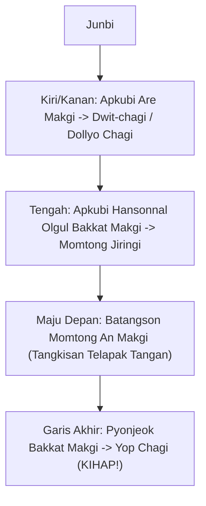
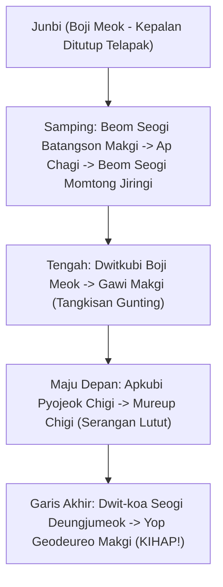
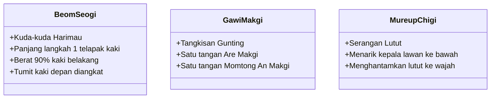

# Bab 4.2: Poomsae: Taegeuk Yook Jang (6 Jang) & Taegeuk Chil Jang (7 Jang)

Poomsae pada tingkatan **Sabuk Biru (Geup 5)** dan **Biru Strip (Geup 4)** membutuhkan fleksibilitas serta dinamika pengaturan napas yang tinggi. Gerakan air dan keteguhan gunung direpresentasikan dalam **Taegeuk Yook Jang** dan **Taegeuk Chil Jang**.

---

## 1. Taegeuk Yook Jang (태극 6장)

- **Simbol Trigram:** ☵ (Gam - Air / Kelancaran & Adaptasi)
- **Filosofi:** Air bersifat mengalir, fleksibel, mengikis rintangan paling keras secara terus-menerus, dan selalu mencari keseimbangan.
- **Jumlah Gerakan:** 19 Gerakan
- **Elemen Baru:** *Hansonnal Olgul Bakkat Makgi*, *Dollyo Chagi*, *Pyonjeok Bakkat Makgi*, dan teknik tangkisan telapak tangan terbuka (*Batangson Makgi*).

### Penjelasan Teknik Spesifik Taegeuk Yook Jang:

1. **Batangson Momtong An Makgi (바탕손 몸통안막기):**
   - Tangkisan menggunakan bantalan telapak tangan (*Batangson*) menolak serangan pukulan lawan ke arah ulu hati secara melingkar halus dari luar ke dalam.
2. **Pyonjeok Bakkat Makgi:**
   - Tangkisan mengepal membentak ke luar disusul tendangan memutar.

---

## 2. Taegeuk Chil Jang (태극 7장)

- **Simbol Trigram:** ☶ (Gan - Gunung / Keteguhan & Kestabilan)
- **Filosofi:** Gunung berdiri megah tak tergoyahkan. Gerakan menuntut posisi kuda-kuda yang sangat kokoh, hening, namun meledak saat menyerang.
- **Jumlah Gerakan:** 25 Gerakan
- **Elemen Baru:** *Beom Seogi* (Kuda-kuda Harimau), *Batangson Geodeureo Makgi*, *Boji Meok* (Kepalan ditutup telapak), *Gawi Makgi* (Tangkisan Gunting), *Mureup Chigi* (Serangan Lutut).

### Penjelasan Teknik Spesifik Taegeuk Chil Jang:

---
[← Bab 4.1: Teknik Tingkat Menengah](01-teknik-tingkat-menengah.md) | [Daftar Isi](../_index.md) | [Bab 4.3: UKT Sabuk Biru →](03-materi-dan-standar-ukt-sabuk-biru.md)
