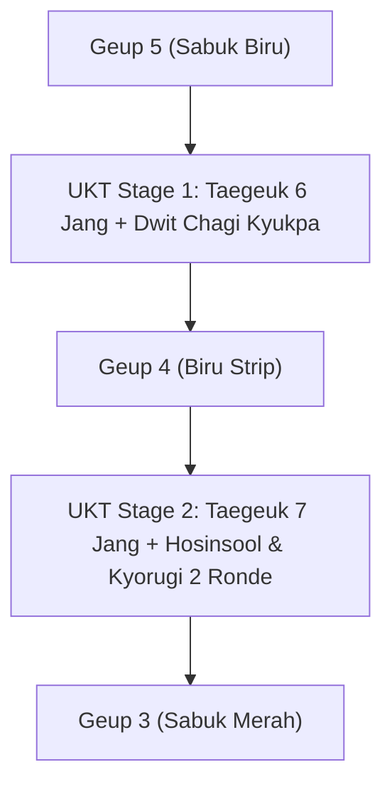
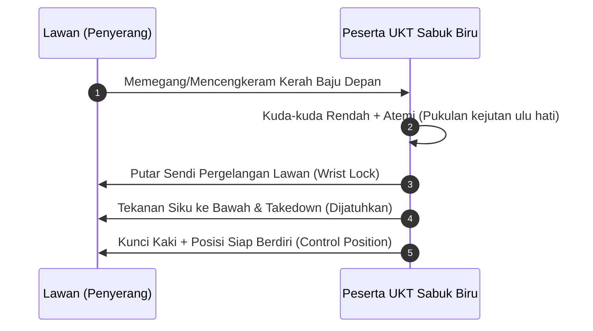
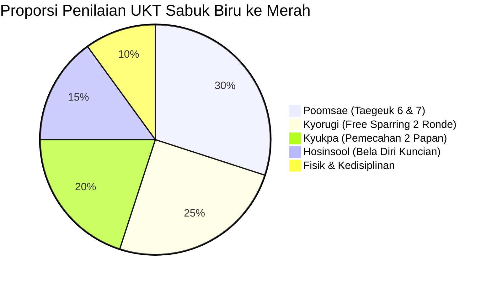

# Bab 4.3: Materi dan Standar UKT Sabuk Biru & Biru Strip (Geup 5 ke 4 & 4 ke 3)

Tingkatan **Sabuk Biru (Geup 5)** dan **Biru Strip (Geup 4)** melambangkan langit ke mana tumbuhan Taekwondo tumbuh menjulang tinggi. Ujian Kenaikan Tingkat (UKT) pada jenjang ini sangat ketat, menuntut koordinasi jurus tingkat tinggi (**Taegeuk Yook Jang** & **Taegeuk Chil Jang**), tendangan memutar membelakangi lawan (*Dwit Chagi*), aplikasi pertahanan diri (*Hosinsool*), serta pemecahan papan berganda (*Double Board Kyukpa*).

---

## 1. Peta Pengujian Tingkatan Sabuk Biru

| Bidang Ujian | Spesifikasi Geup 5 → Geup 4 (Biru Strip) | Spesifikasi Geup 4 → Geup 3 (Sabuk Merah) |
| :--- | :--- | :--- |
| **Masa Latihan Active** | Minimal 4 Bulan berkelanjutan | Minimal 4 Bulan berkelanjutan |
| **Poomsae Utama** | *Taegeuk Yook Jang (6 Jang)* | *Taegeuk Chil Jang (7 Jang)* |
| **Kuda-kuda Khusus** | *Apkubi* & *Dwitkubi* dinamis | *Beom Seogi* (Kuda-kuda Harimau) & *Boji Meok* |
| **Teknik Tangkisan Unik** | *Batangson Momtong An Makgi*, *Hansonnal Olgul* | *Gawi Makgi* (Tangkisan gunting), *Mureup Chigi* |
| **Teknik Tendangan Kunci** | *Dwit Chagi* (Tendangan belakang lurus) | *Twiyeo Yeop Chagi* (Tendangan samping melompat) |
| **Bela Diri (Hosinsool)** | 2 Variasi melepaskan cengkeraman pergelangan tangan | 3 Variasi melepaskan kuncian baju/kerah & bantingan |
| **Kyukpa (Pemecahan)** | 2 Papan kayu pinus (tebal 2 cm) dengan *Dwit Chagi* | 2 Papan kayu pinus (tebal 2 cm) dengan *Yeop Chagi* terbang |
| **Kyorugi Sparring** | 2 Ronde x 1.5 Menit (Fokus counter attack) | 2 Ronde x 2.0 Menit (Taktik kombinasi & stamina) |

---

## 2. Rincian Penilaian Materi Ujian Sabuk Biru

### A. Poomsae Taegeuk 6 & 7 Jang
1. **Taegeuk Yook Jang (Air):**
   - Penilaian menekankan kelancaran aliran tangkisan telapak tangan (*Batangson Makgi*), pernapasan saat *Hansonnal Olgul Bakkat Makgi*, serta transisi *Dollyo Chagi*.
2. **Taegeuk Chil Jang (Gunung):**
   - Penilaian menuntut kestabilan mutlak pada kuda-kuda *Beom Seogi* (berat 90% di kaki belakang), presisi tangkisan gunting (*Gawi Makgi*), dan daya ledak serangan lutut (*Mureup Chigi*).

### B. Aplikasi Bela Diri Praktis (Hosinsool)

### C. Pemecahan Benda Keras (Kyukpa)
- **Teknik Dwit Chagi:** Kaki penendang mendorong lurus ke belakang menggunakan tumit (*Dwitkumchi*). Papan diletakkan sejajar dada penguji. Papan wajib pecah terbelah dua tanpa goyah.

---

## 3. Rubrik Standar Evaluasi Sabuk Biru

| Skor Total | Hasil Evaluasi | Tindakan |
| :---: | :--- | :--- |
| **85 - 100** | Lulus *Distinction* | Direkomendasikan masuk tim atlet Dojang / Asisten Pelatih. |
| **70 - 84** | Lulus Standard | Menyandang Sabuk Merah (Geup 3). |
| **< 70** | Tidak Lulus | Diwajibkan mengulang materi Poomsae & Kyukpa dalam UKT berikutnya. |

---
[← Bab 4.2: Taegeuk 6 & 7 Jang](02-taegeuk-yook-jang-dan-chil-jang.md) | [Daftar Isi](../_index.md) | [Bab 5.1: Taegeuk 8 Jang & Pemantapan →](../05-sabuk-merah-dan-persiapan-dan-1/01-taegeuk-pal-jang-dan-pemantapan.md)
