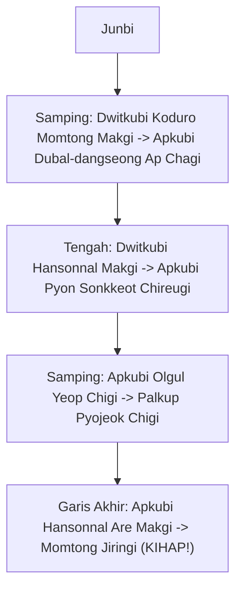
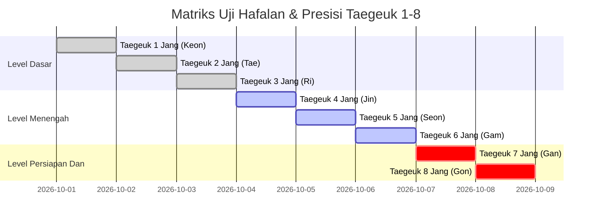

# Bab 5.1: Poomsae: Taegeuk Pal Jang (8 Jang) & Pemantapan Seluruh Taegeuk

Tingkatan **Sabuk Merah (Geup 3 hingga Geup 1)** adalah fase puncak persiapan sebelum memasuki gerbang Sabuk Hitam (Dan 1/Poom 1 Kukkiwon). Sabuk merah melambangkan bahaya: praktisi telah memiliki kekuatan besar yang harus dikendalikan dengan kematangan mental dan kontrol emosi.

---

## 1. Taegeuk Pal Jang (태극 8장)

- **Simbol Trigram:** ☷ (Gon - Bumi / Ketundukan & Ibu Alam)
- **Filosofi:** Bumi memayungi segalanya, menerima elemen langit, api, air, dan angin. Poomsae terakhir dari seri Taegeuk ini merupakan sintesis dari seluruh teknik dasar hingga menengah.
- **Jumlah Gerakan:** 27 Gerakan (Jurus terpanjang dalam seri Taegeuk)
- **Elemen Baru:** *Geodeureo Are Makgi*, *Dubal-dangseong Ap Chagi* (Tendangan ganda melompat di udara), *Olgul Yeop Chigi*, *Palkup Pyojeok Chigi*, *Yop Chagi* tingkat tinggi.

### Penjelasan Teknik Kunci Taegeuk Pal Jang:

1. **Dubal-dangseong Ap Chagi (두발당성 앞차기):**
   - Tendangan depan dua kaki beruntun di udara. Kaki pertama menendang rendah sebagai umpan, disusul kaki kedua menendang tinggi ke arah dagu lawan saat tubuh melayang di udara.
2. **Geodeureo Are Makgi (거듭 아래막기):**
   - Tangkisan bawah ganda berlapis di mana tangan kedua membantu menopang siku tangan utama.

---

## 2. Matriks Pemantapan Poomsae Taegeuk (1 Jang - 8 Jang)

Calon Sabuk Hitam Dan 1 wajib menguasai seluruh 8 Poomsae Taegeuk tanpa keraguan sedikit pun. Pelatih dapat menguji secara acak (*Random Draw Evaluation*).

---

## 3. Rubrik Penilaian Presisi Poomsae (Kukkiwon Standard)

1. **Accuracy (5.0 Poin):**
   - Ketepatan lintasan tangan dan kaki.
   - Ketepatan sudut kuda-kuda (*Seogi*).
   - Penyelesaian garis Poomsae (*Yeon-mu Seon*) tepat di titik awal *Junbi*.
2. **Presentation (5.0 Poin):**
   - *Power & Speed* (Letupan ledakan tenaga).
   - *Rhythm & Timing* (Pengaturan tempo dan fleksibilitas pernapasan).
   - *Expression of Energy* (Kihap, pandangan mata, dan kepercayaan diri).

---
[← Bab 4.3: UKT Sabuk Biru](../04-sabuk-biru-dan-biru-strip/03-materi-dan-standar-ukt-sabuk-biru.md) | [Daftar Isi](../_index.md) | [Bab 5.2: Kyorugi & Kyukpa →](02-kyorugi-kyukpa-dan-hosinsool.md)
