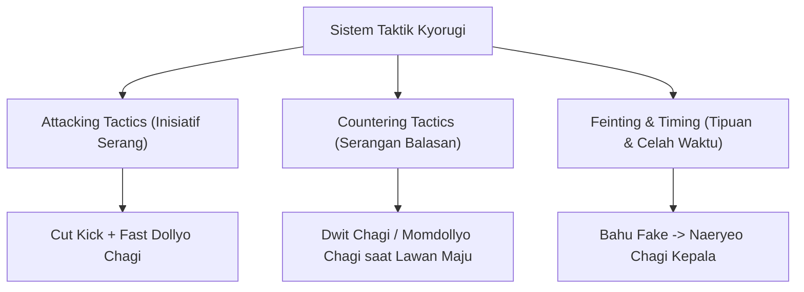
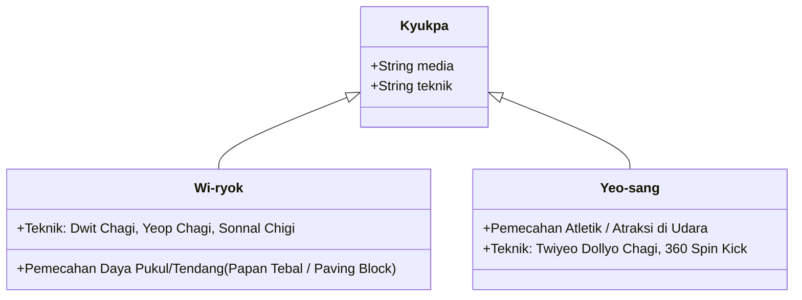
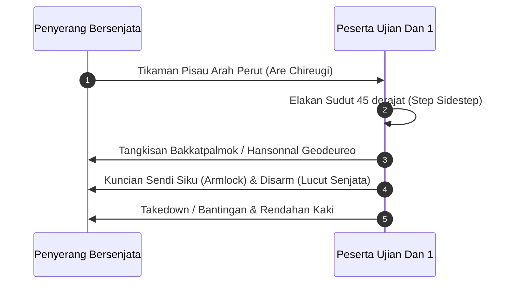

# Bab 5.2: Strategi Kyorugi, Pemecahan Benda Keras (Kyukpa), & Hosinsool Lanjutan

Ujian kepangkatan Sabuk Hitam Dan 1 menuntut penguasaan tiga pilar utama aplikasi fisik Taekwondo: **Kyorugi (Pertarungan Arena)**, **Kyukpa (Pemecahan Benda Keras)**, dan **Hosinsool Lanjutan (Bela Diri Praktis)**.

---

## 1. Taktik & Strategi Kyorugi (Pertarungan Arena)

Pada tingkat Sabuk Merah, praktisi tidak lagi sekadar menendang, melainkan membaca pola pertarungan lawan (*Tactical Fighting*).

### Sistem Poin Kyorugi (World Taekwondo Rules):
- **1 Poin:** Pukulan lurus (*Momtong Jiringi*) yang mendarat tepat di pelindung dada (*Hogu*).
- **2 Poin:** Tendangan standar (*Dollyo Chagi*) ke pelindung dada.
- **3 Poin:** Tendangan langsung ke arah kepala (*Olgul Kick*).
- **4 Poin:** Tendangan memutar (*Turning Kick / Dwit Chagi*) yang mendarat di pelindung dada.
- **5 Poin:** Tendangan memutar ke arah kepala (*Momdollyo Olgul Chagi*).

---

## 2. Pemecahan Benda Keras (Kyukpa - 격파)

Kyukpa menguji ketepatan perkenaan, keberanian mental, dan akumulasi kecepatan serta fokus tenaga (*Focus of Power / Jipjung*).

### Prinsip Keselamatan & Keberhasilan Kyukpa:
1. **Penetrasi Target:** Membayangkan perkenaan tidak berhenti di permukaan papan, melainkan menembus 10-15 cm di belakang papan.
2. **Kunci Sendi pada Moment Impact:** Sendi pergelangan kaki atau pisau tangan wajib dikunci kuat agar energi kinetik tidak berbalik meredam ke dalam tubuh sendiri.

---

## 3. Hosinsool Lanjutan (Pertahanan Terhadap Serangan Senjata & Senjata Tumpul)

Dalam standar Ujian Dan 1, peserta diuji melepaskan diri dan melumpuhkan penyerang bersenjata tajam (pisau kayu) atau tongkat kayu tumpul:

---
[← Bab 5.1: Taegeuk 8 Jang & Pemantapan](01-taegeuk-pal-jang-dan-pemantapan.md) | [Daftar Isi](../_index.md) | [Bab 5.3: Standar Ujian Dan 1 Kukkiwon →](03-standar-ujian-dan-1-kukkiwon.md)
