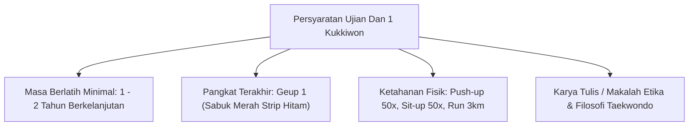
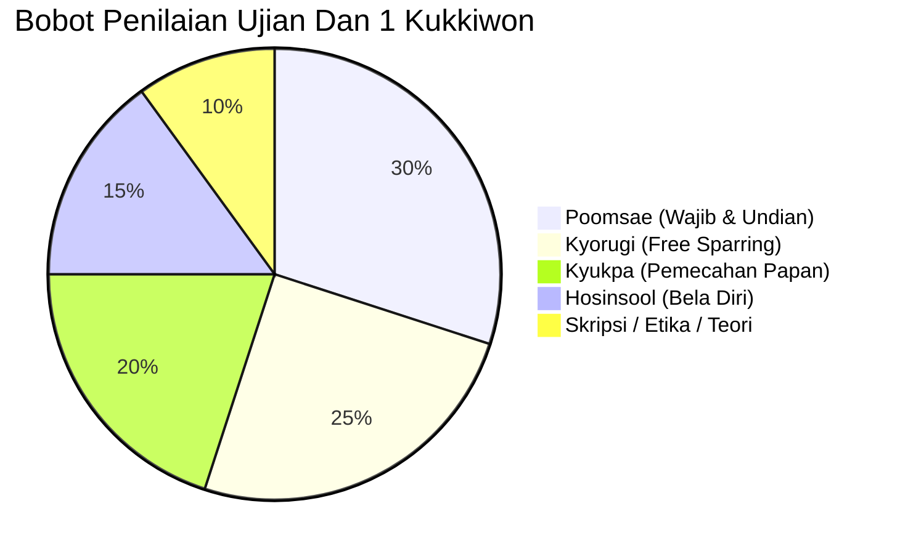
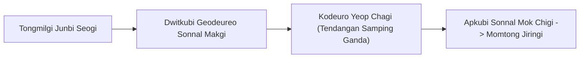

# Bab 5.3: Standar Ujian Dan 1 / Sabuk Hitam Kukkiwon

Mencapai **Dan 1 Kukkiwon** (atau **Poom 1** bagi praktisi berusia di bawah 15 tahun) adalah awal resmi dari perjalanan profesional Taekwondo. Dan 1 bukan diartikan sebagai akhir dari proses belajar, melainkan penanda bahwa praktisi telah menguasai seluruh fondasi dan siap mempelajari seniTaekwondo secara mendalam.

---

## 1. Persyaratan Administratif & Fisik

---

## 2. Struktur Ujian Sabuk Hitam (Exam Structure)

Penguji bersertifikat Kukkiwon (*Kukkiwon Examiner*) mengevaluasi peserta melalui 5 materi pengujian utama:

| Materi Ujian | Spesifikasi & Kriteria Penilaian |
| :--- | :--- |
| **Poomsae (Jurus)** | 1. Jurus Wajib: *Taegeuk 8 Jang* 2. Jurus Undian: Salah satu dari *Taegeuk 1 Jang - 7 Jang* |
| **Pengenalan Poomsae Koryo** | Penguji sering meminta pengenalan Poomsae Dan 1: *Koryo* |
| **Kyorugi (Pertarungan)** | Sparring 2 ronde (masing-masing 1.5 - 2 menit) menunjukkan teknik serang & counter |
| **Kyukpa (Pemecahan)** | Pemecahan 2-3 bilah papan kayu pinus (ketebalan 2-3 cm) dengan teknik *Dwit Chagi* & *Yeop Chagi* |
| **Hosinsool (Bela Diri)** | 3 Aplikasi pembebasan cengkeraman + 2 pertahanan terhadap senjata tumpul/tajam |
| **Wawancara & Etika** | Tanya jawab filosofi Taekwondo, terminologi Korea, dan komitmen mengajar/berkontribusi |

---

## 3. Sekilas Poomsae Koryo (고려) - Poomsae Sabuk Hitam Dan 1

Poomsae **Koryo** merepresentasikan semangat Dinasti Koryo di Korea yang terkenal akan keberanian para pahlawannya.

- **Simbol Trigram:** 士 (Seonbi - Manusia Berbudi Pekerti & Ksatria)
- **Ciri Khas Gerakan:** *Tongmilgi Junbi Seogi* (Sikap siap mendorong kotak nirmala), *Sonnal Mok Chigi*, *Kopeot Chigi*, *Me-jumeok Pyojeok Chigi*, dan kuda-kuda *Hakdari Seogi* (kuda-kuda bangau satu kaki).

---

## 4. Tanggung Jawab & Sumpah Sabuk Hitam (Black Belt Pledge)

Setelah lulus ujian Dan 1 dan menerima sertifikat resmi Kukkiwon World Taekwondo Headquarters di Seoul, Korea Selatan, praktisi mengikrarkan sumpah:

> *"Saya berjanji untuk menjunjung tinggi etika Taekwondo, menghormati pelatih dan senior, tidak menyalahgunakan seni membela diri ini untuk kejahatan, serta menjadi teladan keteladanan karakter di masyarakat."*

---
[← Bab 5.2: Kyorugi & Kyukpa](02-kyorugi-kyukpa-dan-hosinsool.md) | [Daftar Isi](../_index.md)
