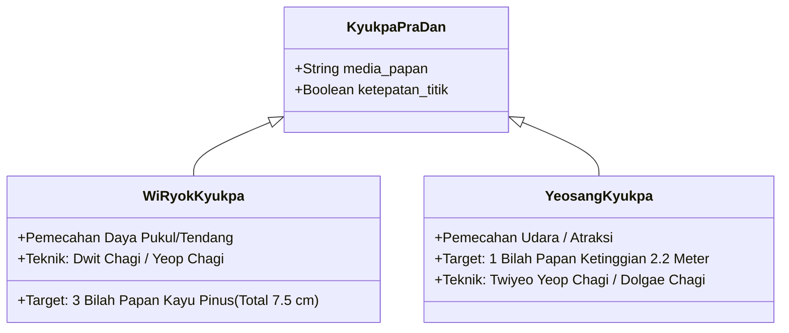
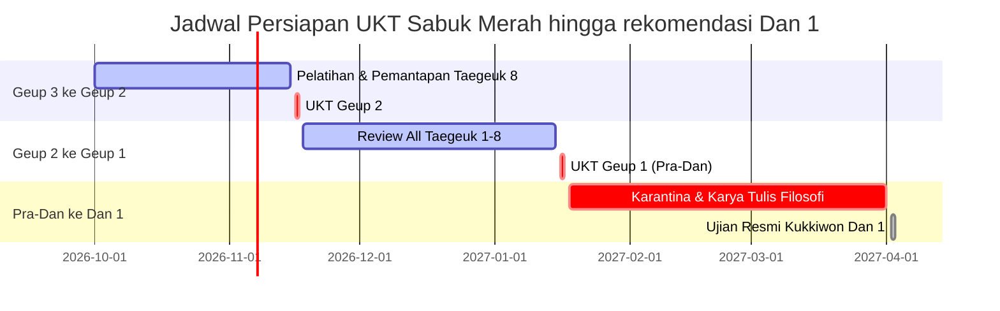

# Bab 5.4: Materi dan Standar UKT Sabuk Merah & Merah Strip (Geup 3 ke 2 & 2 ke 1)

Jenjang **Sabuk Merah (Geup 3)**, **Merah Strip I (Geup 2)**, dan **Merah Strip II / Pra-Dan (Geup 1)** merupakan gerbang akhir sebelum Taekwondoin melangkah ke tingkatan Sabuk Hitam (Dan 1 Kukkiwon). Warna merah melambangkan bahaya: peserta telah memiliki daya hancur fisik yang tinggi sehingga dituntut kontrol diri, maturitas etika, serta kesempurnaan teknik mutlak dalam Ujian Kenaikan Tingkat (UKT).

---

## 1. Peta Kualifikasi Pra-Dan 1 (Geup 3 → Geup 1)

| Tingkatan Ujian | Target Poomsae | Spesifikasi Kyukpa | Hosinsool & Kyorugi | Standard Fisik |
| :--- | :--- | :--- | :--- | :--- |
| **Geup 3 → Geup 2** | *Taegeuk Pal Jang (8 Jang)* | 2 Bilah Papan (2.5 cm) dengan *Dwit Chagi* / *Yeop Chagi* | 3 Variasi Hosinsool + Sparring 2 Ronde | Push-up 35x, Sit-up 40x |
| **Geup 2 → Geup 1 (Pra-Dan)** | *Taegeuk 8 Jang* + 2 Jurus Undian (*Taegeuk 1-7*) | 3 Bilah Papan (2.5 cm) dengan *Dolgae Chagi* / *Twiyeo Dwit Chagi* | Hosinsool Multi-Attacker + Sparring 3 Ronde | Push-up 50x, Sit-up 50x, Run 3km < 15 mnt |

---

## 2. Rincian Materi Pengujian UKT Sabuk Merah

### A. Pengujian Poomsae Komprehensif (Random Drawing System)
Pada ujian Geup 1 (Pra-Dan), penguji tidak hanya menilai *Taegeuk 8 Jang*, tetapi memilih **2 Taegeuk acak** dari Taegeuk 1 hingga 7 secara tiba-tiba:
- Penguji menguji ingatan memori otot (*Muscle Memory*) dan kedalaman filosofi trigram setiap Poomsae.
- Penilaian ketat pada: *Accuracy* (5.0) dan *Presentation* (5.0).

### B. Pemecahan Daya & Teknik Akrobatik (Kyukpa - 격파)

### C. Hosinsool Lanjutan & Kyorugi Bebas (Multi-Attacker & Sparring)
1. **Hosinsool Multi-Attacker (2 Penyerang):** Peserta dikepung oleh 2 lawan (satu menyerang dengan pukulan, satu mencoba memegang dari belakang). Peserta wajib melakukan *Sidestep*, melumpuhkan penyerang belakang dengan *Elbow Strike*, dan mengeksekusi bantingan pada penyerang depan.
2. **Kyorugi Sparring Intensif (3 Ronde x 2 Menit):** Evaluasi ketahanan fisik, pembacaan taktik (*Feinting & Timing*), serta kepatuhan pada aturan World Taekwondo (WT).

---

## 3. Matriks Kualifikasi Menuju rekomendasi Dan 1 Kukkiwon

---
[← Bab 5.3: Standar Ujian Dan 1 Kukkiwon](03-standar-ujian-dan-1-kukkiwon.md) | [Daftar Isi](../_index.md)
