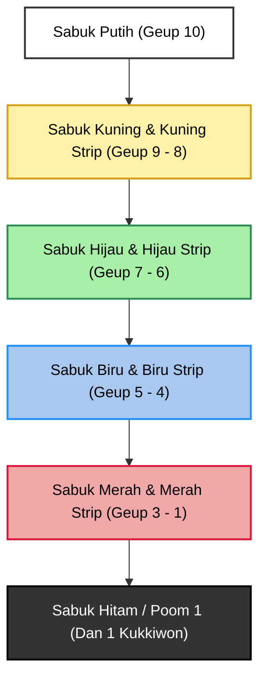

# Kurikulum Pelatihan Taekwondo: Dari Sabuk Putih hingga Dan 1

Selamat datang di panduan kurikulum komprehensif pelatihan Taekwondo (standar World Taekwondo / Kukkiwon). Buku ini dirancang secara sistematis untuk memandu praktisi, pelatih (Sabeum), dan instruktur dalam menavigasi jenjang kepangkatan (Geup 10 hingga Dan 1/Poom 1).

---

## 📌 Pendahuluan & Tujuan Buku

Taekwondo bukan sekadar seni membela diri fisik, melainkan sistem disiplin mental, taktik pertarungan, dan pengembangan karakter. Kurikulum ini menyusun standar kompetensi teknis, fisiologis, serta teoritis secara bertahap agar praktisi dapat menguasai fondasi hingga siap menempuh Ujian Sabuk Hitam (Dan 1 Kukkiwon).

### Pokok Bahasan Utama:
1. **Etika & Tradisi Dojang:** Nilai-nilai dasar (*Taekwondo Jungshin*), tata krama Korea, dan struktur organisasi.
2. **Teknik Dasar (Kibon Dongjak):** Kuda-kuda (*Seogi*), pukulan (*Jiringi*), tangkisan (*Makgi*), dan tendangan (*Chagi*).
3. **Jurus Standar (Poomsae):** Eksekusi detail Taegeuk 1 Jang hingga Taegeuk 8 Jang dan pengenalan Poomsae Koryo.
4. **Pertarungan (Kyorugi):** Sistem langkah (*Step*), strategi jarak, variasi serangan balasan (*Counter attack*), dan standar keselamatan.
5. **Bela Diri Praktis & Pemecahan (Hosinsool & Kyukpa):** Aplikasi teknik pertahanan diri realistis dan pengujian daya pukul/tendang.

---

## 🗺️ Peta Jalan Tingkatan Sabuk (Geup & Dan Progress)

---

## 📚 Daftar Isi Buku

### Bab 1: Fondasi & Sabuk Putih (Geup 10)
- [01.1 Filosofi, Etika Dojang, dan Terminologi Dasar](01-fondasi-dan-sabuk-putih/01-filosofi-dan-etika.md)
- [01.2 Kuda-kuda (Seogi), Pukulan (Jiringi), & Tangkisan (Makgi) Dasar](01-fondasi-dan-sabuk-putih/02-kuda-kuda-dan-pukulan-dasar.md)
- [01.3 Poomsae: Taegeuk Il Jang (1 Jang)](01-fondasi-dan-sabuk-putih/03-taegeuk-il-jang.md)
- [01.4 Materi dan Standar UKT Sabuk Putih (Geup 10 ke Geup 9)](01-fondasi-dan-sabuk-putih/04-materi-dan-standar-ukt-sabuk-putih.md)

### Bab 2: Sabuk Kuning & Kuning Strip (Geup 9 - 8)
- [02.1 Tendangan Dasar (Chagi) & Kombinasi Tangkisan](02-sabuk-kuning-dan-kuning-strip/01-tendangan-dasar-dan-tangkisan.md)
- [02.2 Poomsae: Taegeuk Ee Jang (2 Jang) & Taegeuk Sam Jang (3 Jang)](02-sabuk-kuning-dan-kuning-strip/02-taegeuk-ee-jang-dan-sam-jang.md)
- [02.3 Materi dan Standar UKT Sabuk Kuning & Kuning Strip (Geup 9 ke 8 & 8 ke 7)](02-sabuk-kuning-dan-kuning-strip/03-materi-dan-standar-ukt-sabuk-kuning.md)

### Bab 3: Sabuk Hijau & Hijau Strip (Geup 7 - 6)
- [03.1 Teknik Tendangan Samping, Memutar, & Step Kyorugi Dasar](03-sabuk-hijau-dan-hijau-strip/01-teknik-samping-dan-memutar.md)
- [03.2 Poomsae: Taegeuk Sa Jang (4 Jang) & Taegeuk Oh Jang (5 Jang)](03-sabuk-hijau-dan-hijau-strip/02-taegeuk-sa-jang-dan-oh-jang.md)
- [03.3 Materi dan Standar UKT Sabuk Hijau & Hijau Strip (Geup 7 ke 6 & 6 ke 5)](03-sabuk-hijau-dan-hijau-strip/03-materi-dan-standar-ukt-sabuk-hijau.md)

### Bab 4: Sabuk Biru & Biru Strip (Geup 5 - 4)
- [04.1 Teknik Tingkat Menengah, Kombinasi Serangan, & Hosinsool](04-sabuk-biru-dan-biru-strip/01-teknik-tingkat-menengah.md)
- [04.2 Poomsae: Taegeuk Yook Jang (6 Jang) & Taegeuk Chil Jang (7 Jang)](04-sabuk-biru-dan-biru-strip/02-taegeuk-yook-jang-dan-chil-jang.md)
- [04.3 Materi dan Standar UKT Sabuk Biru & Biru Strip (Geup 5 ke 4 & 4 ke 3)](04-sabuk-biru-dan-biru-strip/03-materi-dan-standar-ukt-sabuk-biru.md)

### Bab 5: Sabuk Merah & Persiapan Dan 1 (Geup 3 - Dan 1)
- [05.1 Poomsae: Taegeuk Pal Jang (8 Jang) & Pemantapan Seluruh Taegeuk](05-sabuk-merah-dan-persiapan-dan-1/01-taegeuk-pal-jang-dan-pemantapan.md)
- [05.2 Strategi Kyorugi, Pemecahan Benda Keras (Kyukpa), & Hosinsool Lanjutan](05-sabuk-merah-dan-persiapan-dan-1/02-kyorugi-kyukpa-dan-hosinsool.md)
- [05.3 Standar Penilaian Ujian Dan 1 / Sabuk Hitam Kukkiwon](05-sabuk-merah-dan-persiapan-dan-1/03-standar-ujian-dan-1-kukkiwon.md)
- [05.4 Materi dan Standar UKT Sabuk Merah & Merah Strip (Geup 3 ke 2 & 2 ke 1)](05-sabuk-merah-dan-persiapan-dan-1/04-materi-dan-standar-ukt-sabuk-merah.md)

---
