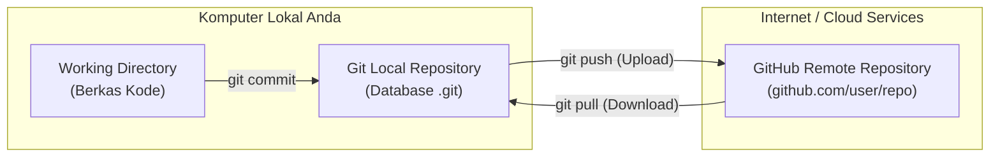

# Bab 1.1: Apa itu Git dan GitHub? Analogi & Perbedaan Utama

Untuk memahami sistem pengontrol versi (*Version Control System* / VCS), bayangkan Anda sedang bermain *video game* RPG yang panjang. Sebelum memasuki pertarungan melawan musuh yang kuat, Anda akan melakukan **Save Game** (menyimpan titik progres). Jika karakter Anda kalah di pertarungan tersebut, Anda tidak perlu mengulang permainan dari awal; Anda cukup melakukan **Load Game** dari titik *save* terakhir.

**Git** berfungsi seperti mesin *Save Game* untuk berkas-berkas proyek koding Anda.

---

## 1. Analogi Dunia Nyata: Mengapa Kita Membutuhkan Git?

Tanpa Git, alur kerja tradisional seorang pemula ketika membuat dokumen atau program biasanya terlihat seperti berikut:

```text
proyek-website/
├── index.html
├── index_backup.html
├── index_revisi_bos.html
├── index_final.html
├── index_final_beneran.html
└── index_final_fix_banget.html
```

Masalah utama dari metode manual di atas:
1. **Boros Ruang Penyimpanan:** Banyak duplikasi file yang membingungkan.
2. **Ketiadaan Riwayat Detail:** Anda tidak tahu apa yang diubah antara `index_final.html` dan `index_final_beneran.html`.
3. **Bahaya Tertimpa (Overwritten):** Jika bekerja dalam tim, rekan Anda bisa secara tidak sengaja menimpa perubahan file milik Anda.

Dengan **Git**, Anda hanya memiliki satu berkas `index.html`. Setiap kali ada perubahan signifikan, Git mencatat snapshot (rekaman momen) dari seluruh proyek Anda ke dalam sebuah basis data rahasia bernama `.git`.

---

## 2. Perbedaan Utama: Git vs GitHub

Banyak pemula yang menganggap Git dan GitHub adalah hal yang sama. Padahal keduanya adalah dua teknologi yang sangat berbeda tetapi saling melengkapi.

| Fitur / Karakteristik | Git | GitHub |
| :--- | :--- | :--- |
| **Jenis Teknologi** | Perangkat Lunak CLI / Alat VCS Lokal | Platform Layanan Berbasis Web (Cloud) |
| **Lokasi Eksekusi** | Berjalan secara lokal di komputer Anda | Berjalan di server awan (Cloud Server) |
| **Fungsi Utama** | Mencatat riwayat perubahan berkas lokal | Menyimpan repository Git secara online & kolaborasi tim |
| **Kebutuhan Internet** | Tidak butuh internet (100% Offline) | Membutuhkan koneksi internet |
| **Diciptakan Oleh** | Linus Torvalds (Pencipta Linux) tahun 2005 | Tom Preston-Werner, dkk (2008), kini akuisisi Microsoft |

### Visualisasi Hubungan Git dan GitHub



---

## 3. Sistem Pengontrol Versi Terdistribusi (Distributed VCS)

Sebelum Git populer, sistem pengontrol versi menggunakan arsitektur **Terpusat (Centralized VCS)** seperti SVN (Subversion) atau CVS. Pada sistem terpusat, jika server utama down atau Anda tidak memiliki koneksi internet, Anda sama sekali tidak bisa melakukan commit atau melihat riwayat perubahan.

Git menggunakan arsitektur **Terdistribusi (Distributed VCS)**. Artinya:
- Setiap pengembang memiliki **salinan penuh (full clone)** dari seluruh sejarah riwayat repository di komputer lokal mereka.
- Anda dapat melakukan commit, membuat branch, dan memeriksa log perubahan secara penuh tanpa koneksi internet.
- Jika server GitHub mengalami masalah, repositori di komputer para pengembang berfungsi sebagai cadangan (*backup*) penuh yang lengkap.

---

## Ringkasan Bab

- **Git** adalah perangkat lunak lokal yang mencatat perubahan berkas (*version control*).
- **GitHub** adalah platform cloud untuk menyimpan repositori Git dan memfasilitasi kerja sama tim melalui fitur web seperti Pull Request, Issue Tracker, dan Code Review.
- Git bekerja secara terdistribusi sehingga seluruh operasi utama dapat dijalankan secara offline di komputer lokal Anda.

---

[Daftar Isi](../_index.md) | [Subbab Selanjutnya →](02-instalasi-dan-konfigurasi-awal.md)
