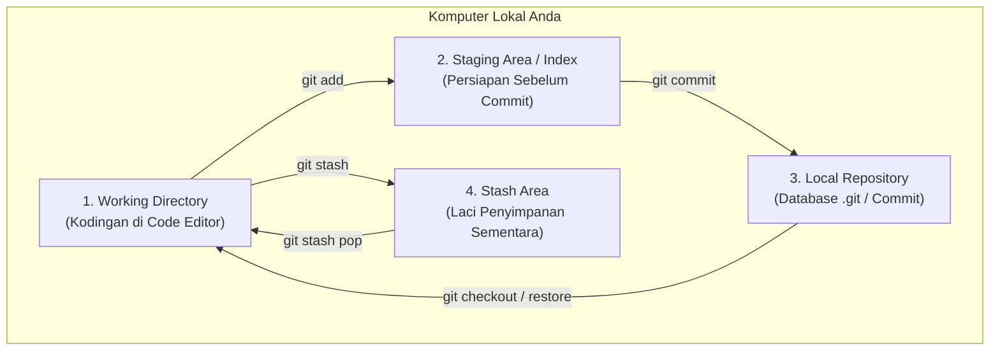

# Bab 2.1: Empat Area Utama Git (Working Tree, Index, Local Repo, Stash)

Kunci utama untuk menguasai Git tanpa rasa bingung adalah memahami **arsitektur 4 area utama** tempat kode Anda berada. Banyak pemula mengira ketika menulis koding di text editor dan menekan `Ctrl+S`, Git langsung mencatatnya ke dalam riwayat *save*. Padahal, Git memerlukan beberapa tahapan eksplisit.

Keempat area tersebut adalah:
1. **Working Directory (Working Tree)**
2. **Staging Area (Index)**
3. **Local Repository (Commit History)**
4. **Stash Area (Penyimpanan Sementara)**

---

## 1. Diagram Alir 4 Area Git

---

## 2. Penjelasan Mendalam Masing-masing Area

### A. Working Directory (Working Tree)
Ini adalah folder proyek fisik tempat Anda mengetik kodingan menggunakan code editor seperti VS Code, Neovim, atau Notepad. Berkas di area ini adalah berkas nyata yang ada di harddisk Anda.
- **Karakteristik:** Berkas bisa dalam kondisi belum dilacak (*untracked*) atau sudah dimodifikasi (*modified*).
- **Analogi:** Meja kerja tempat Anda sedang menggambar draft surat.

### B. Staging Area (Index)
Staging Area adalah tempat penampungan sementara (*staging*) tempat Anda memilih berkas mana saja yang siap untuk disimpan ke dalam sejarah Git.
- **Mengapa butuh Staging Area?** Anda mungkin mengedit 5 berkas sekaligus, tetapi hanya ingin menyimpan 2 berkas yang berhubungan dengan fitur pencarian. Anda cukup memasukkan 2 berkas tersebut ke Staging Area menggunakan `git add`.
- **Analogi:** Amplop surat tempat Anda mengumpulkan berkas-berkas yang sudah selesai diperiksa sebelum dimasukkan ke dalam kotak pos.

### C. Local Repository (.git)
Local Repository adalah basis data tersembunyi (folder `.git`) yang mencatat seluruh riwayat snapshot commit, metadata penulis, timestamp, serta hubungan antar-commit.
- **Karakteristik:** Ketika berkas sudah masuk ke Local Repository melalui perintah `git commit`, perubahan tersebut sudah tersimpan aman secara permanen di mesin waktu Git.
- **Analogi:** Brankas arsip berisi buku rekaman resmi yang sudah diberi stempel dan tidak bisa diubah begitu saja.

### D. Stash Area (Laci Sementara)
Stash Area adalah area darurat yang disediakan Git untuk menyembunyikan perubahan yang belum selesai dikerjakan di Working Directory secara sementara tanpa perlu membuat commit resmi.
- **Skenario Penggunaan:** Anda sedang asyik koding fitur baru, tiba-tiba ada bug kritis di produksi yang harus segera diperbaiki. Anda menjalankan `git stash` untuk menyembunyikan kerjaan sementara, memperbaiki bug, lalu mengembalikan pekerjaan tadi dengan `git stash pop`.
- **Analogi:** Laci meja tempat menyapu bersih kertas-kertas yang berantakan saat ada tamu mendadak.

---

## 3. Rangkuman Perintah Perpindahan Antar Area

| Perintah Git | Dari Area | Menuju Area | Fungsi Utama |
| :--- | :--- | :--- | :--- |
| `git add <file>` | Working Directory | Staging Area | Menandai berkas siap diproses |
| `git commit -m "msg"` | Staging Area | Local Repository | Menyimpan snapshot permanen |
| `git stash` | Working Directory | Stash Area | Menyimpan sementara pekerjaan draft |
| `git stash pop` | Stash Area | Working Directory | Mengembalikan draft dari laci stash |
| `git checkout -- <file>` | Local Repository | Working Directory | Pembatalan perubahan lokal |

---

## Ringkasan Bab

- Git memisahkan ruang kerja menjadi **Working Directory**, **Staging Area**, **Local Repository**, dan **Stash Area**.
- Fleksibilitas **Staging Area** memungkinkan kita memilih perubahan mana yang layak dimasukkan dalam satu unit commit.
- **Stash** berguna untuk menyimpan draft pekerjaan sementara tanpa mengotori riwayat commit.

---

[← Subbab Sebelumnya](../01-konsep-dasar-dan-instalasi/02-instalasi-dan-konfigurasi-awal.md) | [Daftar Isi](../_index.md) | [Subbab Selanjutnya →](02-siklus-hidup-berkas-file-lifecycle.md)
