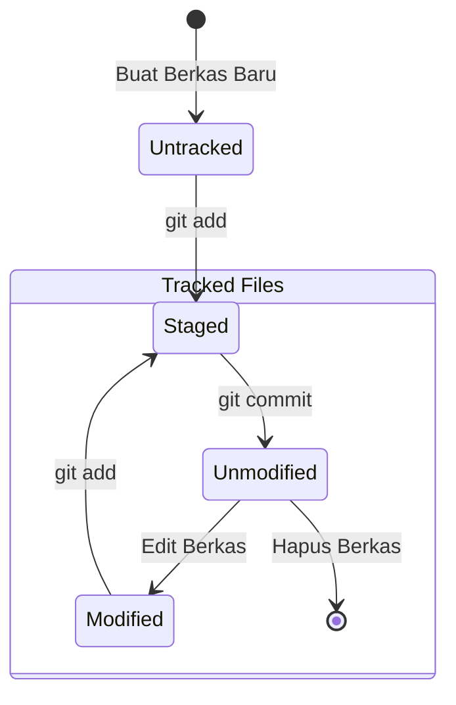

# Bab 2.2: Siklus Hidup Berkas (Untracked, Unmodified, Modified, Staged)

Di dalam repositori Git, setiap berkas memiliki **status siklus hidup (file lifecycle state)**. Memahami perubahan status ini sangat penting agar Anda tahu persis apa yang akan terjadi saat menjalankan perintah `git status` atau `git commit`.

---

## 1. Diagram State Machine Lifecycle Berkas

Secara garis besar, berkas di folder proyek dikategorikan menjadi 2 status utama: **Untracked** (Belum Dilacak) dan **Tracked** (Sudah Dilacak). Berkas yang *Tracked* dapat berada dalam salah satu dari tiga kondisi: *Unmodified*, *Modified*, atau *Staged*.



---

## 2. Penjelasan 4 Status Berkas

### A. Untracked (Belum Dilacak)
Berkas baru yang baru saja Anda buat di folder proyek. Git melihat berkas ini ada di harddisk, tetapi Git sengaja mengabaikannya sampai Anda secara eksplisit memintanya untuk melacak berkas tersebut.

### B. Unmodified (Belum Dimodifikasi)
Berkas yang sudah pernah di-commit sebelumnya dan belum mengalami perubahan apapun sejak commit terakhir.

### C. Modified (Telah Dimodifikasi)
Berkas *Tracked* yang baris kodenya telah diubah, ditambah, atau dihapus, tetapi Anda **belum** memasukkannya ke Staging Area.

### D. Staged (Siap Di-commit)
Berkas yang perubahannya telah ditandai dengan perintah `git add` dan siap untuk dimasukkan ke dalam commit berikutnya.

---

## 3. Alur Praktis: Dari `git init` Hingga `git commit`

Mari kita ikuti alur kerja nyata dari membuat repositori baru hingga menyimpan commit pertama.

### Langkah 1: Inisialisasi Repositori (`git init`)
Buka terminal, buat folder baru, dan jalankan `git init`:
```bash
mkdir proyek-pertama
cd proyek-pertama
git init
```
*Efek:* Git membuat folder rahasia `.git` di dalam `proyek-pertama`.

### Langkah 2: Memeriksa Status (`git status`)
```bash
git status
```
*Output:*
```text
On branch main
No commits yet
nothing to commit (create/insert files and use "git add" to track)
```

### Langkah 3: Membuat Berkas Baru & Cek Untracked State
Buat berkas `index.html`:
```bash
echo "<h1>Hello World</h1>" > index.html
git status
```
*Output:*
```text
Untracked files:
  (use "git add <file>..." to include in what will be committed)
	index.html
```

### Langkah 4: Menambahkan ke Staging Area (`git add`)
```bash
git add index.html
git status
```
*Output:*
```text
Changes to be committed:
  (use "git rm --cached <file>..." to unstage)
	new file:   index.html
```

### Langkah 5: Melakukan Commit (`git commit`)
Simpan snapshot permanen ke Local Repository:
```bash
git commit -m "feat: inisialisasi struktur awal index.html"
```
*Output:*
```text
[main (root-commit) a1b2c3d] feat: inisialisasi struktur awal index.html
 1 file changed, 1 insertion(+)
 create mode 100644 index.html
```

### Langkah 6: Melihat Riwayat Commit (`git log`)
```bash
git log --oneline
```
*Output:*
```text
a1b2c3d (HEAD -> main) feat: inisialisasi struktur awal index.html
```

---

## 4. Standar Penulisan Commit Message yang Baik

Jangan menggunakan pesan commit asal-asalan seperti `"fix bug"`, `"update"`, atau `"bismillah bener"`. Gunakan konvensi **Conventional Commits**:

- `feat:` untuk penambahan fitur baru (contoh: `feat: tambah tombol login google`)
- `fix:` untuk perbaikan bug (contoh: `fix: perbaiki error perhitungan diskon`)
- `docs:` untuk perubahan dokumentasi (contoh: `docs: perbarui panduan instalasi di README`)
- `style:` untuk perapian format/CSS tanpa mengubah logika bisnis

---

## Ringkasan Bab

- Siklus hidup berkas bergerak dari **Untracked** $\rightarrow$ **Staged** $\rightarrow$ **Unmodified** $\rightarrow$ **Modified**.
- Perintah `git status` adalah kompas Anda untuk mengetahui kondisi terkini berkas.
- Gunakan `git add` untuk memilih berkas dan `git commit -m "pesan"` untuk menyimpan riwayat snapshot.
- Tulis pesan commit dengan format yang rapi dan deskriptif.

---

[← Subbab Sebelumnya](01-empat-area-utama-git.md) | [Daftar Isi](../_index.md) | [Subbab Selanjutnya →](03-membatalkan-perubahan-dan-kembali-ke-masa-lalu.md)
