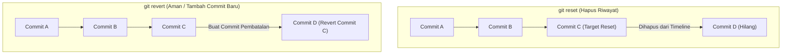

# Bab 2.3: Membatalkan Perubahan & Kembali ke Masa Lalu

Salah satu kekuatan utama Git sebagai "mesin waktu" adalah kemampuannya untuk mengabaikan kesalahan koding, membatalkan perubahan, dan memulihkan kondisi berkas seperti semula.

Namun, cara membatalkan perubahan tergantung pada **di area mana** perubahan tersebut berada saat ini.

---

## 1. Membatalkan Perubahan di Staging Area & Working Directory

### A. Mengeluarkan Berkas dari Staging Area (*Unstaging*)
Jika Anda terlanjur menjalankan `git add script.js`, tetapi menyadari berkas tersebut belum siap di-commit:

```bash
git restore --staged script.js
```
*Efek:* Berkas `script.js` dikembalikan dari **Staging Area** ke **Working Directory** (status berubah dari *Staged* menjadi *Modified*).

### B. Membuang Perubahan di Working Directory (*Discarding Changes*)
Jika Anda mengedit `index.html` lalu terjadi error dan Anda ingin mengembalikan isi berkas seperti saat commit terakhir:

```bash
git restore index.html
```
> [!CAUTION]
> Perintah `git restore <file>` akan **menghapus secara permanen** perubahan lokal yang belum di-commit. Perubahan yang terhapus dengan perintah ini tidak dapat dikembalikan lagi!

---

## 2. Memperbaiki Commit Terakhir (`git commit --amend`)

Jika Anda baru saja membuat commit, lalu menyadari ada tipografi pada pesan commit atau lupa memasukkan satu berkas kecil:

```bash
# 1. Masukkan berkas yang tertinggal ke staging
git add berkas-tertinggal.css

# 2. Perbarui commit terakhir tanpa membuat commit baru
git commit --amend -m "feat: tambah gaya CSS dan lengkapi layout"
```

---

## 3. Memutar Balik Riwayat Commit: `git reset` vs `git revert`

Ketika Anda ingin membatalkan satu atau beberapa commit yang sudah terjadi di masa lalu, Git menyediakan dua mekanisme utama: `git reset` dan `git revert`.



---

### A. Memahami 3 Mode `git reset`

Perintah `git reset <commit-hash>` memindahkan pointer branch ke commit masa lalu. Terdapat 3 opsi utama:

| Mode Reset | Menghapus Commit? | Nasib Berkas di Staging Area | Nasib Berkas di Working Directory |
| :--- | :--- | :--- | :--- |
| `--soft` | Ya | **Dipertahankan** (Tetap Staged) | **Dipertahankan** |
| `--mixed` *(Default)* | Ya | Dikeluarkan (Unstaged) | **Dipertahankan** |
| `--hard` | Ya | Dihapus | **DIHAPUS PERMANEN** |

#### Contoh Penggunaan:
```bash
# Kembali ke commit 3 langkah ke belakang, perubahan berkas tetap aman di working directory
git reset --mixed HEAD~1

# Kembali ke commit spesifik dan hapus SEMUA perubahan (Gunakan dengan sangat hati-hati!)
git reset --hard a1b2c3d
```

---

### B. Pembatalan Aman untuk Kolaborasi: `git revert`

Perintah `git reset` mengubah riwayat sejarah (*rewrite history*). Jika commit tersebut sudah di-push ke GitHub dan digunakan oleh tim lain, menggunakan `git reset` akan merusak repositori rekan Anda.

Solusi yang aman untuk kolaborasi adalah **`git revert`**. `git revert` tidak menghapus commit lama, melainkan membuat **commit baru** yang secara otomatis membalikkan (*undo*) perubahan dari commit target.

```bash
# Batalkan perubahan yang terjadi pada commit b4c5d6e
git revert b4c5d6e
```

*Efek:* Git akan membuka teks editor untuk mengonfirmasi pesan commit pembatalan baru seperti `"Revert 'feat: tambah fitur salah'"`.

---

## Ringkasan Bab

- Gunakan `git restore --staged <file>` untuk mengeluarkan berkas dari Staging Area.
- Gunakan `git restore <file>` untuk membuang editan lokal (permanen).
- Gunakan `git commit --amend` untuk memperbaiki commit paling akhir.
- Gunakan `git reset` hanya pada branch pribadi yang **belum** di-push ke remote.
- Gunakan `git revert` untuk membatalkan commit secara aman pada repositori publik/kolaboratif.

---

[← Subbab Sebelumnya](02-siklus-hidup-berkas-file-lifecycle.md) | [Daftar Isi](../_index.md) | [Subbab Selanjutnya →](../03-cabang-dan-penggabungan-branching-merging/01-konsep-branch-dan-penelusuran-head.md)
