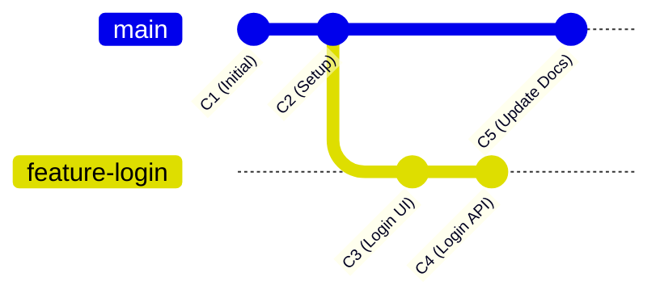
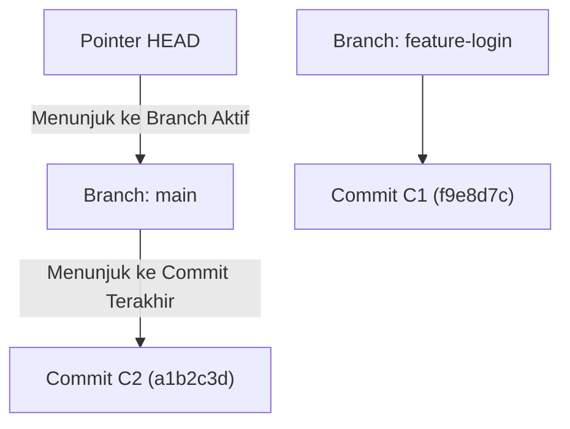

# Bab 3.1: Konsep Branch & Penelusuran Pointer HEAD

Dalam pengembangan perangkat lunak modern, beberapa fitur sering kali dikerjakan secara bersamaan. Jika semua pengembang menulis kode secara langsung pada satu jalur utama yang sama, kode aplikasi akan sangat rawan rusak (*broken*).

Di sinilah fitur **Branching (Percabangan)** pada Git menjadi penyelamat.

---

## 1. Apakah Sebenarnya Branch Itu?

Banyak pemula membayangkan bahwa membuat *branch* baru berarti membuat salinan (*copy-paste*) seluruh folder proyek ke tempat lain. Asumsi ini salah.

Di dalam Git, sebuah **Branch** hanyalah sebuah **pointer (penunjuk ringan)** berukuran 40 byte yang mengarah ke hash commit tertentu. Karena hanya berupa pointer teks, membuat branch baru di Git berlangsung instan (hitungan milidetik), tidak peduli seberapa besar ukuran repositori Anda.

---

## 2. Memahami Pointer `HEAD`

Bagaimana Git tahu branch mana yang sedang Anda buka saat ini di text editor? Git mengelolanya menggunakan pointer khusus bernama **`HEAD`**.

- **`HEAD`** adalah penunjuk "Anda Berada di Sini". `HEAD` biasanya menunjuk ke nama branch yang sedang aktif, yang kemudian menunjuk ke commit paling baru di branch tersebut.

Ketika Anda berpindah branch (misalnya running `git switch feature-login`), pointer `HEAD` cukup digeser untuk menunjuk ke `feature-login`. Berkas-berkas di Working Directory Anda secara otomatis disesuaikan oleh Git untuk mencerminkan kondisi commit pada branch `feature-login`.

---

## 3. Strategi Percabangan Sederhana (Feature Branch Pattern)

Untuk pemula, alur kerja percabangan yang paling direkomendasikan adalah **Feature Branch Pattern**:

1. **`main` Branch:** Cabang utama yang berisi kode stabil dan siap rilis ke pengguna. Dilarang koding langsung di branch `main`!
2. **`feature/*` Branch:** Cabang khusus yang dibuat untuk membuat satu fitur baru (contoh: `feature/halaman-profil`). Setelah fitur selesai dan diuji, branch ini digabungkan (*merge*) kembali ke `main`.
3. **`hotfix/*` Branch:** Cabang darurat yang dibuat dari `main` untuk memperbaiki bug kritis di produksi secara cepat.

---

## Ringkasan Bab

- **Branch** pada Git sangat ringan (*lightweight*) karena hanya berupa pointer teks penunjuk commit.
- **`HEAD`** adalah pointer yang menandai posisi kerja Anda saat ini.
- Gunakan cabang `main` khusus untuk kode yang stabil, dan buatlah cabang *feature* untuk setiap tugas baru.

---

[← Bab Sebelumnya](../02-lifecycle-git-lokal/03-membatalkan-perubahan-dan-kembali-ke-masa-lalu.md) | [Daftar Isi](../_index.md) | [Subbab Selanjutnya →](02-membuat-pindah-dan-merge-branch.md)
