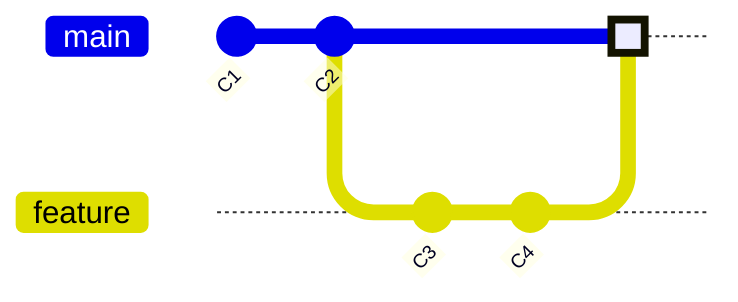
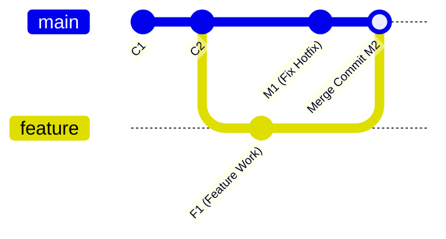

# Bab 3.2: Membuat, Pindah, dan Menggabungkan Branch

Setelah memahami konsep dasar branch dan pointer `HEAD`, sekarang saatnya mengeksekusi operasi perintah branch di terminal: membuat cabang, berpindah antar cabang, dan mengabungkan kembali perubahan kode (*merge*).

---

## 1. Perintah Dasar Pengelolaan Branch

### A. Melihat Daftar Branch
```bash
git branch
```
*Output:*
```text
* main
  feature/login
```
*(Tanda bintang `*` menandakan branch yang sedang aktif di mana `HEAD` berada).*

### B. Membuat Branch Baru
```bash
git branch feature/register
```

### C. Berpindah Branch (`git switch` vs `git checkout`)
Pada Git versi modern (v2.23+), disarankan menggunakan perintah **`git switch`** yang lebih spesifik daripada perintah lama `git checkout`.

```bash
# Perintah Modern (Rekomendasi)
git switch feature/register

# Perintah Lama
git checkout feature/register
```

### D. Membuat dan Langsung Berpindah Branch dalam Satu Perintah
```bash
# Menggunakan git switch (-c singkatan dari create)
git switch -c feature/payment

# Menggunakan git checkout (-b singkatan dari branch)
git checkout -b feature/payment
```

### E. Menghapus Branch
Jika fitur sudah selesai digabungkan dan tidak lagi dibutuhkan:
```bash
git branch -d feature/payment
```

---

## 2. Mengenal Dua Jenis Penggabungan (Merge Types)

Ketika Anda menggabungkan dua branch menggunakan perintah `git merge`, Git secara otomatis memilih salah satu dari dua strategi berikut:

### A. Fast-Forward Merge
Terjadi jika tidak ada commit baru di branch target (`main`) sejak branch fitur dibuat. Git hanya perlu menggeser pointer `main` maju ke depan mengikuti commit terbaru branch fitur.



### B. 3-Way Merge (True Merge)
Terjadi jika kedua branch telah berkembang secara independen (ada commit baru di `main` DAN ada commit baru di branch `feature`). Git akan membandingkan 3 snapshot (Common Ancestor, Commit Utama `main`, dan Commit Utama `feature`) lalu membuat satu **Merge Commit** baru secara otomatis.



---

## 3. Praktik Penggabungan (Hands-on Workflow)

Berikut langkah-langkah standar menggabungkan branch `feature/login` ke branch `main`:

```bash
# Langkah 1: Pastikan semua perubahan di branch feature sudah di-commit
git switch feature/login
git add .
git commit -m "feat: selesaikan antarmuka login"

# Langkah 2: Pindah ke branch tujuan (main)
git switch main

# Langkah 3: Eksekusi penggabungan (merge)
git merge feature/login

# Langkah 4: Hapus branch feature yang sudah tidak terpakai (opsional)
git branch -d feature/login
```

---

## Ringkasan Bab

- Perintah `git switch -c <nama-branch>` adalah cara tercepat membuat sekaligus berpindah cabang.
- **Fast-Forward Merge** hanya menggeser pointer cabang tanpa membuat commit gabungan baru.
- **3-Way Merge** membuat commit gabungan khusus ketika kedua branch saling bercabang secara independen.
- Selalu pastikan Anda berada di branch tujuan (misal `main`) sebelum menjalankan `git merge <branch-asal>`.

---

[← Subbab Sebelumnya](01-konsep-branch-dan-penelusuran-head.md) | [Daftar Isi](../_index.md) | [Subbab Selanjutnya →](03-penanganan-konflik-conflict-resolution.md)
