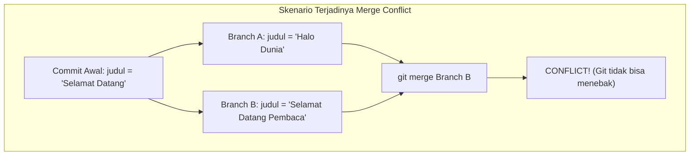

# Bab 3.3: Penanganan Konflik (Merge Conflict Resolution)

Bagi pengembang pemula, munculnya pesan **Merge Conflict** sering kali memicu kepanikan. Padahal, konflik bukanlah sebuah error atau kerusakan sistem. Konflik adalah cara aman Git meminta bantuan manusia saat ada dua perubahan yang bertentangan pada baris kode yang sama.

---

## 1. Mengapa Merge Conflict Terjadi?

Git sangat cerdas dalam menggabungkan berkas secara otomatis. Namun, jika Anda dan rekan Anda mengubah **baris berkas yang sama** dengan **isi yang berbeda** secara bersamaan di dua branch berbeda, Git tidak tahu versi mana yang benar. Git menolak melempar tebakan dan menyerahkan keputusan kepada Anda.



---

## 2. Mengenal Anatomi Penanda Konflik Git

Saat konflik terjadi, Git akan menyisipkan penanda khusus di dalam berkas kodingan Anda:

```html
<<<<<<< HEAD
<h1>Halo Dunia (Versi dari Branch Aktif Anda)</h1>
=======
<h1>Selamat Datang Pembaca (Versi dari Branch yang Ingin Digabung)</h1>
>>>>>>> feature/header-baru
```

### Penjelasan Simbol Penanda:
- **`<<<<<<< HEAD`** : Batas awal kode yang berasal dari branch Anda saat ini.
- **`=======`** : Garis pemisah antara dua versi perubahan yang bertolak belakang.
- **`>>>>>>> <branch-name>`** : Batas akhir kode yang berasal dari branch yang sedang ingin digabungkan.

---

## 3. Langkah Demi Langkah Menyelesaikan Konflik

Berikut alur terstruktur menyelesaikan *merge conflict*:

### Langkah 1: Deteksi Berkas yang Berkonflik
Jalankan perintah status untuk melihat berkas mana yang bermasalah:
```bash
git status
```
*Output:*
```text
Unmerged paths:
  (use "git add <file>..." to mark resolution)
	both modified:   index.html
```

### Langkah 2: Buka Berkas & Tentukan Pilihan
Buka berkas `index.html` di text editor (seperti VS Code). Anda dapat memilih salah satu dari 4 opsi keputusan:
1. **Accept Current Change:** Mempertahankan kode bagian atas (HEAD).
2. **Accept Incoming Change:** Mempertahankan kode bagian bawah.
3. **Accept Both Changes:** Mempertahankan kedua versi kode.
4. **Manual Edit:** Menulis ulang kombinasi baru yang paling tepat dan menghapus seluruh garis penanda `<<<<<<<`, `=======`, dan `>>>>>>>`.

Contoh Hasil Setelah Di-edit Manual:
```html
<h1>Halo Dunia - Selamat Datang Pembaca</h1>
```

### Langkah 3: Tandai Konflik Selesai (`git add`)
Setelah penanda konflik dibersihkan dan berkas disimpan, beri tahu Git bahwa konflik telah terselesaikan:

```bash
git add index.html
```

### Langkah 4: Selesaikan Commit Penggabungan
Jalankan commit tanpa flag `-m` (Git akan menyiapkan pesan commit merge otomatis):

```bash
git commit
```

---

## 4. Opsi Darurat: Pembatalan Merge (`git merge --abort`)

Jika saat proses penanganan konflik Anda merasa sangat bingung dan ingin mengembalikan kondisi repositori persis sebelum perintah merge dijalankan, gunakan perintah pembatalan darurat ini:

```bash
git merge --abort
```
*Efek:* Git akan membatalkan seluruh proses merge dan mengembalikan kondisi Working Directory Anda ke keadaan semula secara aman.

---

## Ringkasan Bab

- **Merge Conflict** terjadi ketika dua cabang mengubah baris kode yang sama secara bersamaan.
- Git menyisipkan penanda `<<<<<<<`, `=======`, dan `>>>>>>>` untuk memperlihatkan perbedaan.
- Penyelesaian konflik membutuhkan tindakan manual: buka berkas, pilih kode yang benar, hapus penanda konflik, lalu jalankan `git add` dan `git commit`.
- Gunakan `git merge --abort` jika ingin membatalkan penggabungan dan memulai dari awal.

---

[← Subbab Sebelumnya](02-membuat-pindah-dan-merge-branch.md) | [Daftar Isi](../_index.md) | [Subbab Selanjutnya →](../04-lifecycle-github-dan-kolaborasi-remote/01-menghubungkan-git-lokal-ke-github.md)
