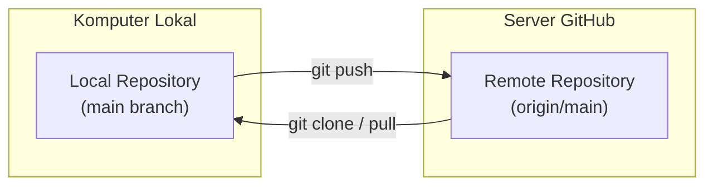

# Bab 4.1: Menghubungkan Repository Lokal ke GitHub Remote

Setelah mahir mengelola riwayat commit dan branch di komputer lokal, langkah berikutnya adalah mempublikasikan kode Anda ke internet menggunakan **GitHub**. Ini membuka pintu bagi pengarsipan awan (*cloud backup*) dan kolaborasi tim secara global.

---

## 1. Konsep Remote Repository & Alias `origin`

**Remote Repository** adalah repositori Git yang di-host di server internet (seperti GitHub, GitLab, atau Bitbucket).

Untuk mempermudah pengetikan URL GitHub yang panjang (misalnya `git@github.com:username/proyek-hebat.git`), Git menggunakan nama **alias (shortcut)**. Secara konvensi, alias bawaan untuk server remote utama dinamakan **`origin`**.



---

## 2. Penghubungan Skenario A: Repositori Lokal yang Sudah Ada

Jika Anda sudah membuat kodingan di komputer lokal dan ingin mengunggahnya ke repositori GitHub baru:

### Langkah 1: Buat Repositori Kosong di GitHub
1. Buka [github.com/new](https://github.com/new).
2. Isi nama repositori (misal `proyek-pertama`).
3. Kosongkan centang *Add a README file* dan *.gitignore* agar repositori di GitHub benar-benar kosong.
4. Klik **Create repository**.

### Langkah 2: Tambahkan Remote URL di Terminal Lokal
Salin URL SSH/HTTPS dari GitHub, lalu jalankan di folder proyek lokal Anda:

```bash
# Menambahkan alias 'origin'
git remote add origin git@github.com:username/proyek-pertama.git

# Memeriksa daftar remote yang terhubung
git remote -v
```
*Output:*
```text
origin	git@github.com:username/proyek-pertama.git (fetch)
origin	git@github.com:username/proyek-pertama.git (push)
```

### Langkah 3: Unggah Commit Pertama (`git push -u`)
```bash
git push -u origin main
```
> [!NOTE]
> Flag **`-u`** (singkatan dari `--set-upstream`) memberitahu Git untuk mengikat branch lokal `main` dengan branch remote `origin/main`. Untuk *push* berikutnya di masa depan, Anda cukup mengetikkan `git push`.

---

## 3. Penghubungan Skenario B: Mengunduh Repositori dari GitHub (`git clone`)

Jika repositori sudah ada di GitHub (misalnya proyek *open-source* atau proyek tim) dan Anda ingin mengunduhnya ke komputer lokal:

```bash
git clone git@github.com:username/proyek-hebat.git
```

Perintah `git clone` secara otomatis mengeksekusi 3 hal sekaligus:
1. Membuat folder baru bernama `proyek-hebat`.
2. Mengunduh seluruh berkas dan riwayat commit lengkap dari GitHub.
3. Menambahkan alias `origin` secara otomatis mengarah ke URL GitHub tersebut.

---

## Ringkasan Bab

- **`origin`** adalah nama alias standar untuk URL repositori remote GitHub Anda.
- Gunakan `git remote add origin <URL>` untuk menghubungkan repositori lokal ke GitHub.
- Flag `-u` pada `git push -u origin main` menetapkan hubungan *tracking upstream*.
- Perintah `git clone <URL>` digunakan untuk mengunduh repositori remote yang sudah ada ke mesin lokal.

---

[← Bab Sebelumnya](../03-cabang-dan-penggabungan-branching-merging/03-penanganan-konflik-conflict-resolution.md) | [Daftar Isi](../_index.md) | [Subbab Selanjutnya →](02-siklus-kolaborasi-fetch-pull-push.md)
