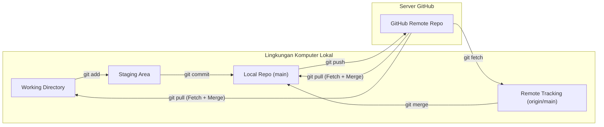
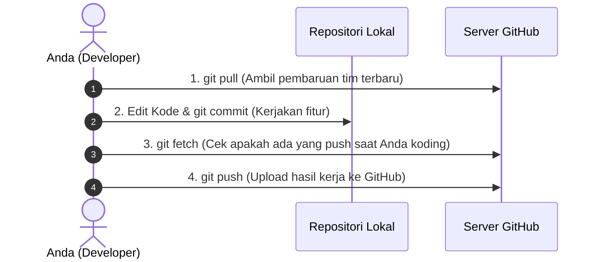

# Bab 4.2: Siklus Kolaborasi: Fetch, Pull, dan Push

Saat bekerja dalam tim, beberapa orang akan mengunggah (*push*) commit ke repositori GitHub yang sama secara bersamaan. Untuk menjaga kodingan lokal Anda tetap selaras (*in sync*) dengan server, Anda harus menguasai siklus **Fetch, Pull, dan Push**.

---

## 1. Diagram Arsitektur Aliran Data Remote



---

## 2. Perbedaan Kritis: `git fetch` vs `git pull`

Banyak pemula kebingungan membedakan antara `git fetch` dan `git pull`.

### A. `git fetch` (Mengunduh Tanpa Menggabungkan)
`git fetch` hanya mengunduh data dan riwayat commit terbaru dari GitHub dan menyimpannya di cabang penelusuran remote lokal (`origin/main`). **`git fetch` sama sekali tidak menyentuh atau mengubah berkas di Working Directory Anda.**

- **Kapan digunakan?** Saat Anda ingin melihat perubahan apa saja yang dibuat oleh rekan tim tanpa risiko merusak kodingan yang sedang Anda kerjakan.

```bash
git fetch origin
git log main..origin/main --oneline
```

### B. `git pull` (Mengunduh Langsung Menggabungkan)
`git pull` adalah gabungan dari dua perintah otomatis: **`git fetch` + `git merge`**. Perintah ini mengunduh commit terbaru dari GitHub lalu langsung menggabungkannya ke branch lokal Anda saat ini.

- **Kapan digunakan?** Saat Anda ingin menyegarkan kodingan lokal Anda dengan pembaruan tim terbaru sebelum mulai menulis fitur baru.

```bash
git pull origin main
```

---

## 3. Alur Kerja Harian yang Disarankan (Daily Best Practices)

Untuk menghindari bentrokan kode dan konflik yang membingungkan saat bekerja dengan tim, ikuti alur kerja disiplin 4 langkah berikut setiap hari:



---

## 4. Penanganan Penolakan Push (*Non-Fast-Forward Push Rejected*)

Jika Anda mencoba melakukan `git push` tetapi rekan tim Anda telah mengunggah commit baru terlebih dahulu, GitHub akan menolak push Anda dengan pesan error berikut:

```text
! [rejected]        main -> main (fetch first)
error: failed to push some refs to 'github.com:user/repo.git'
hint: Updates were rejected because the remote contains work that you do
hint: not have locally. Integrate the remote changes (e.g. 'git pull ...')
```

### Cara Menyelesaikannya:
1. Jalankan `git pull origin main` untuk mengunduh perubahan dari rekan Anda terlebih dahulu.
2. Jika ada konflik, selesaikan konflik tersebut secara manual (seperti pada Bab 3.3).
3. Setelah commit penggabungan selesai, jalankan kembali `git push origin main`.

---

## Ringkasan Bab

- **`git push`** mengunggah commit lokal Anda ke GitHub.
- **`git fetch`** mengunduh riwayat commit terbaru dari GitHub tanpa mengubah kode di Working Directory.
- **`git pull`** mengunduh sekaligus menggabungkan perubahan remote ke branch lokal (`git fetch` + `git merge`).
- Selalu lakukan **`git pull`** sebelum memulai pekerjaan baru dan sebelum melakukan **`git push`**.

---

[← Subbab Sebelumnya](01-menghubungkan-git-lokal-ke-github.md) | [Daftar Isi](../_index.md) | [Subbab Selanjutnya →](03-pull-request-code-review-dan-github-flow.md)
