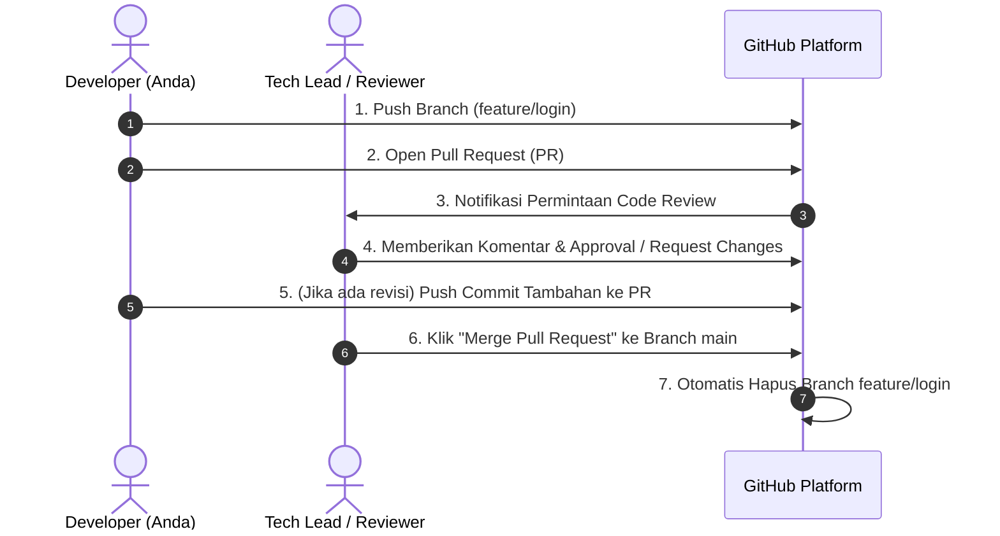

# Bab 4.3: GitHub Flow: Pull Request, Code Review, & Merging

Di dalam perusahaan teknologi modern dan proyek *open-source*, seorang pengembang dilarang keras melakukan *push* kode secara langsung ke branch `main`.

Sebagai gantinya, seluruh perubahan wajib melalui alur standar industri yang disebut **GitHub Flow** dan mekanisme peninjauan kode bernama **Pull Request (PR)**.

---

## 1. Siklus Hidup GitHub Flow



---

## 2. Mengenal Pull Request (PR)

**Pull Request (PR)** adalah fitur web GitHub yang memungkinkan pengembang memberitahu anggota tim lain bahwa mereka telah menyelesaikan sebuah fitur dan memohon agar perubahan kode tersebut ditinjau (*review*) sebelum digabungkan ke branch utama (`main`).

### Keuntungan Utama Pull Request:
1. **Menjaga Kualitas Kode (Code Quality):** Senior developer dapat memeriksa apakah kode sudah efisien dan bebas dari bug sebelum rilis.
2. **Berbagi Pengetahuan (Knowledge Sharing):** Anggota tim lain belajar tentang implementasi fitur baru.
3. **Mencegah Kerusakan Sistem:** Branch `main` terlindungi oleh aturan *Branch Protection Rules*.

---

## 3. Langkah Praktis Eksekusi GitHub Flow

Berikut panduan langkah demi langkah mempraktikkan GitHub Flow:

### Langkah 1: Buat Branch & Push Perubahan
```bash
git switch -c feature/tambah-profil
# ... edit berkas ...
git add .
git commit -m "feat: tambah komponen kartu profil pengguna"
git push -u origin feature/tambah-profil
```

### Langkah 2: Buat Pull Request di GitHub Web
1. Buka repositori Anda di [github.com](https://github.com).
2. Anda akan melihat spanduk kuning bertuliskan **"Compare & pull request"**. Klik tombol tersebut.
3. Isi **Title** PR secara ringkas (contoh: `feat: Penambahan Komponen Kartu Profil`).
4. Isi **Description** dengan penjelasan ringkas apa saja yang diubah dan cara mengujinya.
5. Klik **Create Pull Request**.

### Langkah 3: Proses Code Review & Diskusi
- Tim / Reviewer melihat perubahan pada tab **Files changed**.
- Reviewer dapat memberikan komentar pada baris kode tertentu.
- Jika ada perbaikan yang diminta, Anda cukup mengedit berkas di komputer lokal, melakukan commit, dan `git push` ulang ke branch `feature/tambah-profil`. Pull Request di GitHub akan terbarui secara otomatis!

### Langkah 4: Merging Pull Request
Setelah Reviewer menyetujui (*Approve*) PR:
1. Klik tombol hijau **Merge pull request**.
2. Klik **Confirm merge**.
3. Klik **Delete branch** untuk membersihkan cabang remote di server GitHub.

### Langkah 5: Bersihkan Cabang di Komputer Lokal
Setelah PR di-merge di GitHub, perbarui branch `main` lokal Anda dan hapus branch fitur bekas tadi:

```bash
git switch main
git pull origin main
git branch -d feature/tambah-profil
```

---

## 4. Glosarium Istilah Penting GitHub

- **Pull Request (PR):** Usulan penggabungan branch fitur ke branch utama.
- **Code Review:** Proses pemeriksaan kualitas kode oleh sesama pengembang.
- **Squash and Merge:** Opsi menggabungkan seluruh commit kecil dari branch PR menjadi satu commit bersih di branch `main`.
- **Fork:** Salinan repositori orang lain ke akun GitHub Anda pribadi (biasa digunakan untuk berkontribusi pada proyek open-source).

---

## Penutup Buku

Selamat! Anda telah mempelajari seluruh fondasi penting Git dan GitHub dari nol:
1. Konsep **4 Area Git** (Working Tree, Index, Local Repo, Stash).
2. **File Lifecycle** (Untracked, Modified, Staged).
3. **Branching & Merging** serta penanganan konflik.
4. **GitHub Remote & GitHub Flow** untuk kolaborasi profesional.

Teruslah berlatih menggunakan terminal dan terapkan alur kerja disiplin ini pada setiap proyek koding Anda!

---

[← Subbab Sebelumnya](02-siklus-kolaborasi-fetch-pull-push.md) | [Daftar Isi](../_index.md)
