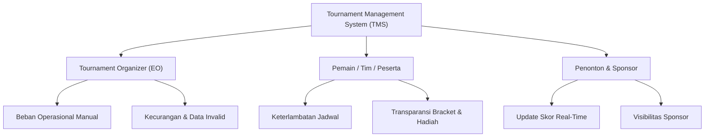

# Bab 1.1: Riset Pasar & Problem Statement Penyelenggara Turnamen

Sebelum menulis sebaris kode pun atau merancang arsitektur microservices, fondasi utama dari produk turnamen yang laris adalah validasi empiris atas titik masalah (*pain points*) yang dihadapi oleh para stakeholder utama kompetisi.

---

## 1. Persona Stakeholder Utama

Sistem manajemen turnamen (*Tournament Management System / TMS*) merupakan platform *multi-sided market*. Kebutuhan setiap persona harus dipetakan secara terpisah:

### A. Tournament Organizer (EO / Admin)
- **Karakteristik:** Mengelola puluhan hingga ribuan peserta dengan tenggat waktu ketat.
- **Pain Point:** 
  - Verifikasi identitas peserta dan bukti pembayaran dilakukan secara manual (via pesan instan/spreadsheet).
  - *Bracket seeding* manual sering menimbulkan prasangka nepotisme atau kesalahan struktur bagan.
  - Komunikasi revisi jadwal match memakan waktu dan berisiko *miss-communication*.

### B. Pemain / Tim Competitor
- **Karakteristik:** Fokus pada performa kompetisi, sensitif terhadap keadilan dan efisiensi waktu.
- **Pain Point:**
  - Ketidakpastian jadwal *lobby* atau *matching*.
  - Ketakutan akan manipulasi skor oleh pihak lawan atau panitia.
  - Proses klaim *prize pool* yang lambat dan transaksinya tidak transparan.

---

## 2. Pemetaan Problem Statement Berdasarkan Skala Turnamen

| Skala Turnamen | Jumlah Peserta | Tantangan Utama Operasional | Solusi Software yang Dibutuhkan |
| :--- | :--- | :--- | :--- |
| **Komunitas / Lokal** | 16 - 64 Tim | Efisiensi waktu admin tunggal | Otomatisasi pendaftaran & generator bracket instan |
| **Regional / Semi-Pro** | 128 - 1,024 Tim | Validasi data massal & penyusunan jadwal paralel | Verifikasi otomatis, multi-stage bracket & sistem dispute |
| **Enterprise / Major** | 10,000+ Tim | High traffic spike, keamanan data, audit trail | Concurrency handling, audit log immutable, API integrasi game |

---

## 3. Metrik Validasi Masalah (Problem Validation Metrics)

Sebelum melangkah ke tahap MVP, validasi masalah dinyatakan berhasil jika memenuhi indikator kuantitatif berikut:

1. **Time-to-Setup Metric:** Waktu pembuatan turnamen hingga pendaftaran siap dipublikasi berkurang dari **>2 jam (manual)** menjadi **<10 menit (sistem)**.
2. **Operational Error Rate:** Angka kesalahan *seeding* atau salah input hasil skor turun hingga **0%**.
3. **Dispute Resolution Speed:** Durasi penyelesaian sengketa *match* berkurang dari **30 menit** menjadi **<5 menit** berkat sistem pelaporan bukti terstruktur.

---
[Daftar Isi](../_index.md) | [Subbab Selanjutnya →](02-merancang-mvp-dan-value-proposition.md)
