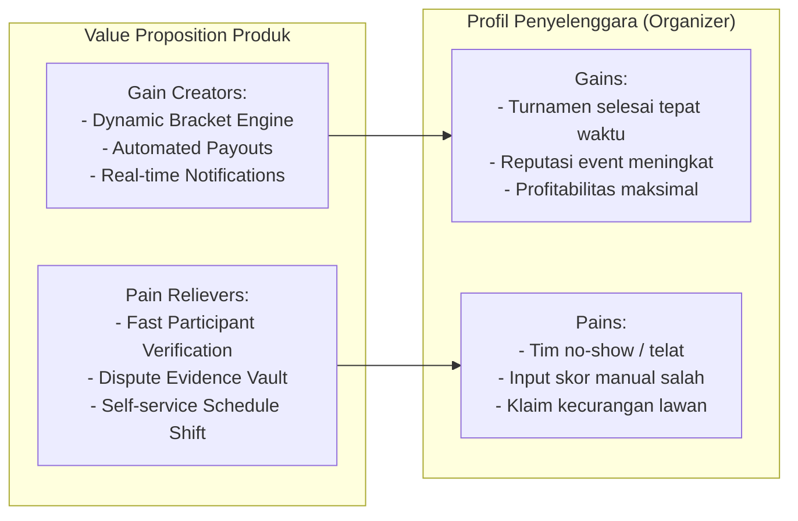

# Bab 1.2: Merancang MVP & Value Proposition Produk Turnamen

Mengembangkan platform turnamen sering kali terjebak dalam *over-engineering*—membangun fitur kompleks seperti integrasi live streaming interaktif atau gamifikasi sebelum fitur utama turnamen berjalan secara andal. Subbab ini membahas strategi perancangan Minimum Viable Product (MVP) yang tepat sasaran.

---

## 1. Value Proposition Canvas

Value proposition platform turnamen harus secara eksplisit menjawab *pains* dan menghasilkan *gains* bagi penyelenggara turnamen:



---

## 2. Matriks Prioritasi Fitur MVP (MoSCoW Method)

Untuk memastikan rilis cepat dan pengujian Product-Market Fit (PMF) di lapangan, fitur dipilah menggunakan metode MoSCoW:

```text
+-----------------------------------------------------------------------+
| MUST HAVE (MVP Release)                                               |
| - Authentication & Role-Based Access (Admin vs Participant)           |
| - Tournament Setup (Single Elimination & Double Elimination Engine)   |
| - Automated Slot Reservation & Payment Gateway Integration            |
| - Match Reporting & Score Submission with Image Evidence Upload       |
+-----------------------------------------------------------------------+
| SHOULD HAVE (Phase 1)                                                 |
| - Swiss System & Round-Robin Tournament formats                       |
| - Automated Check-in Timer & Auto-DQ (Disqualification) for late teams|
| - Live WebSockets score ticker & bracket viewer widget                |
+-----------------------------------------------------------------------+
| COULD HAVE (Phase 2)                                                  |
| - Direct Game API Integration (Auto-fetch result via Riot/Moonton API)|
| - Sponsor banner Ad Manager & Custom Branding Domain                  |
+-----------------------------------------------------------------------+
| WON'T HAVE (Initial Scope)                                            |
| - Native Live Streaming Server / In-app Broadcast Studio              |
+-----------------------------------------------------------------------+
```

---

## 3. Menilai Indicator Product-Market Fit (PMF)

Produk turnamen dianggap mencapai PMF apabila memenuhi indikator kuantitatif (*Sean Ellis Test* & *Retention Rate*):

1. **The 40% Rule (Must-have test):** Minimal **40%** dari organizer aktif menyatakan *"sangat kecewa"* jika platform ini berhenti beroperasi.
2. **Organizer Organic Retention:** Minimal **35%** organizer membuat turnamen kedua mereka dalam waktu 30 hari secara independen tanpa *incentive sales*.
3. **Virality K-Factor:** Setiap 1 turnamen yang dibuat oleh EO berhasil menggaet rata-rata **128 pemain baru**, di mana **2%** dari pemain tersebut kemudian mendaftar sebagai EO baru (*viral loop*).

---
[← Bab Sebelumnya](01-riset-pasar-dan-problem-statement.md) | [Daftar Isi](../_index.md) | [Subbab Selanjutnya →](../02-arsitektur-dan-skalabilitas/01-desain-sistem-bracket-dan-matchmaking.md)
