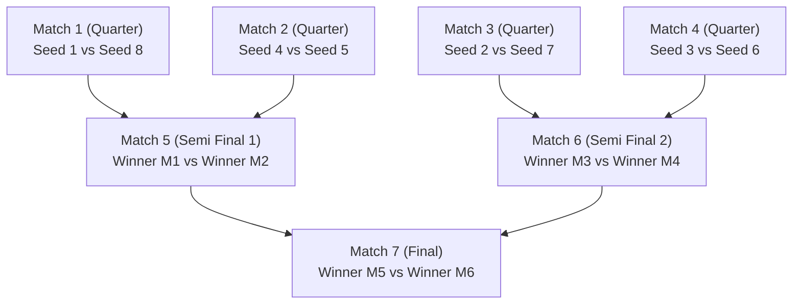
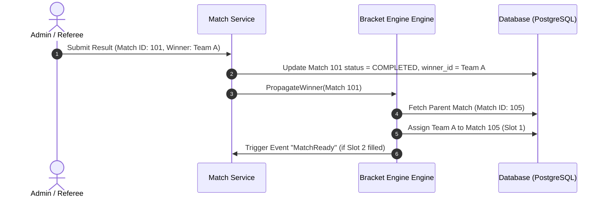

# Bab 2.1: Desain Sistem Bracket Engine & Algoritma Matchmaking

Jantung dari *Tournament Management System* adalah **Bracket Engine**. Mesin ini bertanggung jawab menentukan struktur pertarungan, menangani *bye slots*, serta meloloskan pemenang ke babak berikutnya secara matematis dan deterministik.

---

## 1. Struktur Data & Pemodelan Pohon Bracket (Binary Tree)

Untuk turnamen *Single Elimination*, struktur bagan dapat dipetakan sebagai **Full Binary Tree** terbalik atau array berukuran $2^N - 1$, di mana $N$ adalah jumlah ronde.



### Pemetaan Indeks Node Match (Binary Tree Array Indexing):
Untuk match ke-$i$ (1-indexed):
- **Parent Match (Round Berikutnya):** $\lfloor i / 2 \rfloor$
- **Left Child Match (Round Sebelumnya 1):** $2 \times i$
- **Right Child Match (Round Sebelumnya 2):** $2 \times i + 1$

---

## 2. Algoritma Seeding (Standard Tournament Seeding)

*Standard Seeding* memastikan tim unggulan (*Seed 1* dan *Seed 2*) tidak bertemu hingga babak Final. Algoritma pembagian *bracket seed* secara rekursif dirancang sebagai berikut:

```typescript
/**
 * Menghasilkan urutan pasangan seeding untuk bracket berukuran N (harus berpangkat 2)
 */
export function generateSeeding(numTeams: number): number[] {
  if (numTeams === 2) {
    return [1, 2];
  }

  const previousRound = generateSeeding(numTeams / 2);
  const currentRound: number[] = [];

  for (let i = 0; i < previousRound.length; i++) {
    currentRound.push(previousRound[i]);
    currentRound.push(numTeams + 1 - previousRound[i]);
  }

  return currentRound;
}

// Contoh Output untuk 8 Tim: [1, 8, 4, 5, 2, 7, 3, 6]
// Match 1: Seed 1 vs Seed 8
// Match 2: Seed 4 vs Seed 5
// Match 3: Seed 2 vs Seed 7
// Match 4: Seed 3 vs Seed 6
```

---

## 3. Komparasi Format Turnamen Utama

| Format Turnamen | Kompleksitas Algoritma | Handling Bye Slots | Total Jumlah Match ($T$ tim) |
| :--- | :--- | :--- | :--- |
| **Single Elimination** | $O(\log T)$ | Mengisi slot kosong pada round 1, auto-advance seed tertinggi | $T - 1$ |
| **Double Elimination** | $O(\log T)$ (Dual Tree: Winners & Losers Bracket) | Rekursi pergerakan loser match dari Winners Bracket | $2T - 2$ atau $2T - 1$ |
| **Round-Robin** | $O(T^2)$ (Polygon Algorithm) | Menambahkan elemen *dummy* jika $T$ ganjil | $\frac{T(T-1)}{2}$ |
| **Swiss System** | $O(R \cdot T \log T)$ (Matching berdasar skor sama) | Mencegah rematch antartim yang pernah bertanding | $R \times \frac{T}{2}$ ($R$ = Jumlah ronde) |

---

## 4. Mekanisme State Propagation (Pergeseran Pemenang)

Ketika match dinyatakan selesai (*Status: Completed*), *Bracket Engine* memicu alur *state propagation*:



---
[← Bab Sebelumnya](../01-validasi-dan-pmf/02-merancang-mvp-dan-value-proposition.md) | [Daftar Isi](../_index.md) | [Subbab Selanjutnya →](02-arsitektur-high-concurrency-dan-realtime.md)
