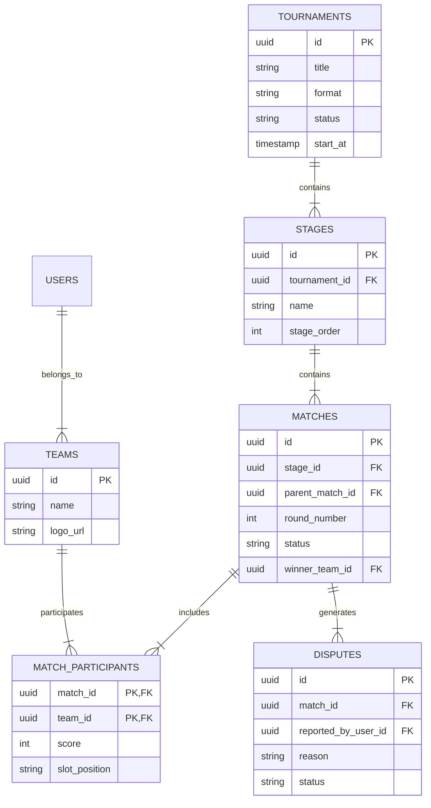
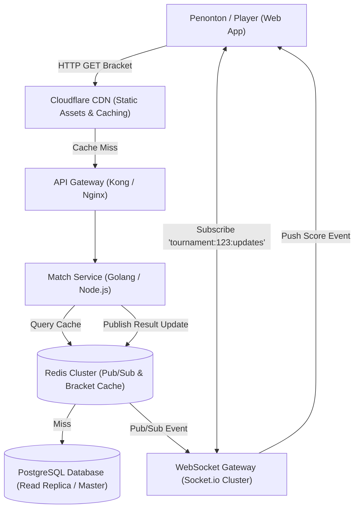

# Bab 2.2: Arsitektur High-Concurrency, Realtime Leaderboard & Database Schema

Pada saat babak final atau pembukaan pendaftaran turnamen populer, sistem akan mengalami *traffic spike* ribuan request per detik (RPS). Subbab ini membahas skema database relasional yang ternormalisasi serta arsitektur pendukung *high-concurrency*.

---

## 1. Skema Database Relasional (Entity Relationship Diagram)

Skema database dirancang untuk mendukung variasi format turnamen, riwayat skor, serta audit trail sengketa:



---

## 2. High-Concurrency Architecture for Live Score & Bracket Updates

Untuk mencegah *database bottleneck* akibat jutaan penonton yang me-refresh halaman bagan (*bracket viewer*), digunakan strategi caching dan pub/sub WebSockets:



---

## 3. Strategi Penanganan Traffic Spike (Concurrency Control)

### A. Slot Reservation & Anti Race-Condition
Saat pendaftaran dibuka (misal: 64 slot diperebutkan oleh 5,000 tim secara bersamaan), penggunaan transaksi basis data standar akan menyebabkan *database locking*. Solusinya adalah **Redis Atomic Decr / Distributed Locking**:

```typescript
// Pattern: Redis Atomic Slot Reservation
export async function reserveTournamentSlot(tournamentId: string, teamId: string): Promise<boolean> {
  const lockKey = `tournament:${tournamentId}:slots`;
  
  // Mengurangi sisa slot secara atomik
  const remainingSlots = await redis.decr(lockKey);

  if (remainingSlots < 0) {
    // Slot habis, rollback counter
    await redis.incr(lockKey);
    return false;
  }

  // Enqueue job ke RabbitMQ / BullMQ untuk pemrosesan pembayaran & persistensi DB
  await queue.add('process_registration', { tournamentId, teamId });
  return true;
}
```

### B. Read Optimization (Redis Sorted Sets untuk Leaderboard)
Untuk turnamen berbasis poin (seperti Battle Royale / PUBG / Free Fire), perhitungan *leaderboard* memanfaatkan data struktur **Redis Sorted Sets (ZSET)**:

```bash
# Menambah poin tim secara atomik saat match selesai
ZINCRBY leaderboard:tournament_999 15 "Team_Alpha"
ZINCRBY leaderboard:tournament_999 10 "Team_Bravo"

# Mengambil Top 10 Tim secara Real-time dengan Latensi <1ms
ZREVRANGE leaderboard:tournament_999 0 9 WITHSCORES
```

---
[← Bab Sebelumnya](01-desain-sistem-bracket-dan-matchmaking.md) | [Daftar Isi](../_index.md) | [Subbab Selanjutnya →](../03-monetisasi-dan-pertumbuhan/01-strategi-monetisasi-dan-retensi-penyelenggara.md)
