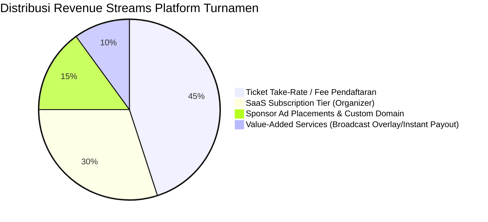
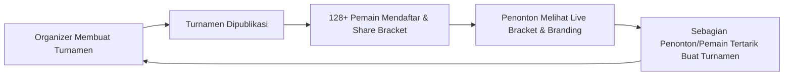

# Bab 3.1: Strategi Monetisasi, Model SaaS & Pertumbuhan Skala Produk

Membuat platform turnamen dengan teknologi hebat saja tidak cukup; platform tersebut harus memiliki model bisnis yang berkelanjutan dan memberikan insentif finansial bagi penyelenggara maupun pemilik platform.

---

## 1. Model Monetisasi Utama (Revenue Streams)

Platform turnamen modern mengombinasikan beberapa jalur pendapatan (*hybrid monetization*):

### A. Ticket Fee / Take-Rate Model (B2C & B2B2C)
- **Mekanisme:** Platform mengambil persentase potong (misal **3% + Rp 2.000 per pendaftaran**) dari biaya masuk (*entry fee*) yang dibayarkan oleh pemain.
- **Keunggulan:** *Zero friction* bagi EO pemula karena platform hanya mengambil keuntungan saat turnamen menghasilkan uang.

### B. Tiered SaaS Subscription (B2B Organizer Plan)
- **Free Tier:** Maksimal 32 tim per turnamen, format Single Elimination saja, dengan watermark platform.
- **Pro Plan ($49/bulan):** Hingga 256 tim, statistik tingkat lanjut, penyesuaian warna/brand, export data CSV/Excel.
- **Enterprise Plan ($299+/bulan):** Unlimited slot, Custom Domain (contoh: `tournament.brand.com`), SLA support 24/7, serta API akses langsung.

### C. Value-Added Add-ons
- **Live Broadcast Graphics Package:** Layanan generator overlay stream otomatis (HTML5 OBS graphics layer) yang menampilkan skor & bracket *real-time*.
- **Instant Prize Payout:** Kemudahan bagi pemenang untuk langsung mencairkan hadiah uang tunai melalui dompet digital (*e-wallet integration*), di mana platform mengambil komisi penanganan (*payout fee*).

---

## 2. Unit Economics & Key Financial Metrics

Untuk memastikan profitabilitas bisnis turnamen, metrik *unit economics* harus dijaga positif:

$$LTV > 3 \times CAC$$

- **Customer Acquisition Cost (CAC):** Biaya akuisisi per penyelenggara turnamen baru.
- **Lifetime Value (LTV):** Total estimasi pendapatan dari satu EO selama menggunakan platform.
- **Net Revenue Retention (NRR):** Target NRR **>110%**, artinya penyelenggara yang bertahan cenderung meng-upgrade paket mereka seiring membesarnya skala turnamen mereka.

---

## 3. Strategi Pertumbuhan & Organic Viral Loops

### Komponen Penggerak Viral Loop:
1. **Interactive Embeddable Bracket Widget:** Bagan turnamen dapat di-embed di situs media atau blog external dengan atribut *"Powered by TournamentPlatform"*.
2. **Player Portfolio & Match History:** Halaman profil publik pemain yang mencatat riwayat kejuaraan dan trofi digital, memicu pemain untuk membagikannya ke media sosial.
3. **Automated Referee & Dispute Resolution Workflow:** Tingkat kepuasan peserta yang tinggi mendorong mereka merekomendasikan platform kepada komunitas lain.

---
[← Bab Sebelumnya](../02-arsitektur-dan-skalabilitas/02-arsitektur-high-concurrency-dan-realtime.md) | [Daftar Isi](../_index.md)
