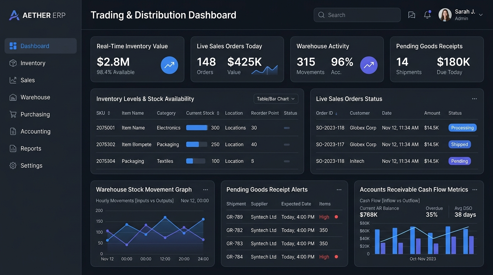

# B2B Modular ERP — Product Overview & System Blueprint

## 1. Executive Summary & Problem Statement

Perusahaan berskala menengah (*Small-Medium Enterprises* / UKM) di sektor **Trading, Grosir, dan Distribusi B2B** di Indonesia sering kali terjebak dalam dua pilihan ekstrem saat mengadopsi sistem manajemen:
1. Menggunakan kumpulan aplikasi terpisah (Excel/Spreadsheet untuk stok, aplikasi POS ritel sederhana untuk kasir, dan software akuntansi terpisah yang diinput ulang manual).
2. Membeli ERP monolitik global enterprise (SAP, Oracle NetSuite, Odoo Enterprise) yang terlampau mahal, kompleks, lambat diimplementasikan, dan menuntut biaya kustomisasi tinggi.

Kondisi fragmentasi ini menciptakan titik kegagalan (*pain points*) operasional yang kritis:

- **Silo Data Stok & Overselling:** Data stok antara bagian penjualan (Sales) dan gudang (Warehouse) tidak tersinkronisasi secara *real-time*. Sales sering mengonfirmasi pesanan atas barang yang sebenarnya sudah habis atau telah di-*reserved* untuk pelanggan lain.
- **Kebocoran Piutang (Bad Debt) & Batas Kredit Longgar:** Tidak adanya validasi otomatis batas kredit (*credit limit*) dan umur piutang (*aging accounts receivable*) saat penerbitan Surat Jalan (*Delivery Order*), mengakibatkan barang tetap dikirim ke pelanggan bermasalah.
- **Selisih Fisik vs Catatan Sistem (Phantom Inventory):** Pergerakan barang masuk (*Goods Receipt*) dan keluar (*Delivery Order*) tidak terikat langsung dengan mutasi stok double-entry, memicu selisih saat *stock opname*.
- **Ketidakcocokan Faktur Pemasok (3-Way Matching Failure):** Invoice dari supplier sering kali dibayar tanpa validasi silang otomatis antara dokumen *Purchase Order* (PO), *Goods Receipt Note* (GRN), dan *Vendor Bill*.
- **Keterlambatan Laporan Keuangan:** Tim akuntansi memerlukan waktu 2 hingga 3 minggu setelah tutup buku bulanan hanya untuk merekonsiliasi jurnal penjualan, pembelian, dan penyusutan nilai persediaan (*COGS/HPP*).

**B2B Modular ERP** dirancang sebagai solusi *progressive & modular enterprise resource planning* yang memecah kompleksitas sistem menjadi modul-modul independen (*decoupled modules*). Sistem ini mengutamakan kecepatan implementasi (*rapid time-to-value*), dimulai dari pondasi inti (*Core & Master Data*), alur operasional utama (*Inventory, Procure-to-Pay, Order-to-Cash*), hingga otomasi pembukuan finansial tanpa membebani pengguna dengan kompleksitas berlebih di awal.


*Gambar 1.1: Mockup Antarmuka Web Dashboard B2B Modular ERP (Trading & Distribution).*

---

## 2. Modular Architecture Decomposition (Dekomposisi Modul)

Untuk mencegah jebakan arsitektur *spaghetti monolitik*, B2B Modular ERP didekomposisi ke dalam 4 tingkatan lapisan (*modular layers*):

```text
┌─────────────────────────────────────────────────────────────────────────────┐
│                       LAYER 3: FINANCIAL & SUB-LEDGER                       │
│  [Accounts Payable (AP)] ── [Accounts Receivable (AR)] ── [General Ledger]  │
└──────────────────────────────────────▲──────────────────────────────────────┘
                                       │ (Async Domain Events: Invoiced, Paid)
┌──────────────────────────────────────┴──────────────────────────────────────┐
│                    LAYER 2: BUSINESS OPERATIONS (CORE O&S)                  │
│   ┌─────────────────────────────┐     ┌─────────────────────────────────┐   │
│   │   Procure-to-Pay (P2P)      │     │      Order-to-Cash (O2C)        │   │
│   │  PO -> Goods Receipt -> Bill│     │  SO -> Delivery Order -> Invoice│   │
│   └──────────────┬──────────────┘     └────────────────┬────────────────┘   │
│                  │                                     │                    │
│                  └───────────────┐     ┌───────────────┘                    │
│                                  ▼     ▼                                    │
│                       [Inventory & Warehouse Control]                       │
│                       Stock Moves | Multi-Location | Quants                 │
└──────────────────────────────────────▲──────────────────────────────────────┘
                                       │ (References SKU, UoM, Partner)
┌──────────────────────────────────────┴──────────────────────────────────────┐
│                    LAYER 1: MASTER DATA MANAGEMENT (MDM)                    │
│    [Product / SKU & Variants] ── [Multi-UoM] ── [Business Partner (B2B)]    │
└──────────────────────────────────────▲──────────────────────────────────────┘
                                       │ (Tenancy, RBAC, Seq Engine)
┌──────────────────────────────────────┴──────────────────────────────────────┐
│                   LAYER 0: CORE PLATFORM FOUNDATION                         │
│  [Multi-Tenant Context] ── [RBAC & Permissions] ── [Sequence Engine & Audit] │
└─────────────────────────────────────────────────────────────────────────────┘
```

### 2.1 Penjelasan Hirarki Lapisan
1. **Layer 0: Core Platform Foundation:**
   - Menyediakan isolasi multi-tenant, otentikasi JWT, hierarki otorisasi berbasis Role-Based Access Control (RBAC), pencatatan jejak audit (*Universal Audit Trail*), dan mesin penomoran otomatis dokumen yang thread-safe (*Document Numbering Sequence Engine*).
2. **Layer 1: Master Data Management (MDM):**
   - Menampung entitas dasar sistem: Katalog Produk (SKU, barcode, konversi satuan multi-UoM, kategori), dan Mitra Bisnis (*Business Partners*) yang mencakup Pelanggan (*Customer*) dan Pemasok (*Vendor*) lengkap dengan syarat termin pembayaran (*payment terms*) dan limit kredit.
3. **Layer 2: Business Operations (Supply Chain & Trading):**
   - **Inventory & Warehouse:** Melacak lokasi fisik rak/gudang, status stok *on-hand*, *reserved*, dan *available*, serta pencatatan mutasi barang (*Stock Movements*).
   - **Procure-to-Pay (P2P):** Alur pengadaan barang dari *Purchase Order* (PO), penerimaan barang fisik gudang (*Goods Receipt*), hingga tagihan vendor (*Vendor Bill*).
   - **Order-to-Cash (O2C):** Alur penjualan grosir dari *Sales Order* (SO) dengan validasi stok & limit kredit, pengiriman barang (*Delivery Order*), hingga penagihan piutang (*Customer Invoice*).
4. **Layer 3: Financial & Sub-Ledger:**
   - Mencatat buku besar pembantu piutang (*AR Sub-ledger*) dan hutang (*AP Sub-ledger*), rekonsiliasi pembayaran, serta mendistribusikan jurnal otomatis (*Automated Journal Entries*) ke General Ledger.

---

## 3. Value Proposition & Key Differentiators

- **Progressive Modular Adoption:** Organisasi dapat mengaktifkan modul secara modular (misal: hanya modul Stok & Penjualan terlebih dahulu, tanpa harus langsung mengaktifkan modul Akuntansi penuh).
- **Two-Phase Stock Reservation (No Overselling):** Mekanisme *soft-reservation* berbasis Redis distributed lock saat Sales Order dibuat, dan *hard-deduction* saat Surat Jalan (*Delivery Order*) divalidasi keluar dari gerbang gudang.
- **Strict B2B Credit Limit Enforcement:** Pemeriksaan limit kredit pelanggan secara *real-time* yang memblokir pembuatan Sales Order atau Surat Jalan baru apabila total *Outstanding AR + Uninvoiced Orders* melampaui plafon kredit yang disetujui.
- **Automated 3-Way Matching:** Memverifikasi kesesuaian antara kuantitas PO, kuantitas fisik yang diterima (GRN), dan tagihan invoice supplier sebelum pembayaran dapat disetujui, mengeliminasi pembayaran berlebih (*overbilling*).
- **Audit-Proof & Traceable:** Setiap perubahan dokumen, koreksi stok, dan status workflow dicatat dengan identitas pengguna, cap waktu milidetik, dan snapshot data sebelum vs sesudah.

---

## 4. Target User Personas

| Persona | Role & Tanggung Jawab | Kebutuhan Utama & Tujuan |
| :--- | :--- | :--- |
| **Owner / Direktur Operasional** | Pengambil keputusan strategis | Memantau dashboard *cash flow*, margin laba kotor harian, perputaran stok (*inventory turnover*), dan persetujuan diskon khusus. |
| **Warehouse Manager / Staf Gudang** | Penerimaan & pengeluaran barang | Memindai barcode surat jalan, mencatat barang masuk/keluar, melakukan mutasi antar-rak gudang, dan stok opname berkala. |
| **Procurement / Purchasing Officer** | Pengadaan & negosiasi supplier | Mengelola katalog vendor, membandingkan penawaran harga, menerbitkan PO resmi, dan memantau status estimasi kedatangan (ETA). |
| **Sales Executive / B2B Account Rep** | Penjualan & retensi klien | Membuat pesanan penjualan (*Sales Order*), mengecek sisa kuota kredit pelanggan, dan memantau status pengiriman barang ke klien. |
| **Finance & Accounting Officer** | Penagihan, pembayaran, & pembukuan | Menerbitkan invoice pelanggan, memantau umur piutang (AR Aging), memverifikasi tagihan supplier (AP), dan rekonsiliasi kas/bank. |

---

## 5. Core Success Metrics (KPIs)

- **Inventory Accuracy Rate:** Mencapai `≥ 99.5%` akurasi antara catatan stok di sistem dengan kuantitas fisik di gudang.
- **Order-to-Fulfillment Processing Time:** Memangkas waktu pembuatan Sales Order hingga penerbitan Surat Jalan dari rata-rata 45 menit menjadi `< 5 menit`.
- **Zero Race-Condition Overselling:** 100% konsistensi stok ketika terjadi pemesanan simultan pada SKU dengan stok terbatas via *Redis Distributed Lock*.
- **API Response Latency:** P95 response time `< 150ms` untuk endpoint pencatatan transaksi operasional (SO, PO, DO, GRN).
- **AP/AR Reconciliation Speed:** Mengurangi waktu verifikasi dan penutupan buku piutang/hutang bulanan dari 10 hari kerja menjadi `< 1 hari kerja`.

---

## 6. Model Pembiayaan, Estimasi Biaya (Capex/Opex) & Skema Berlangganan (SaaS Tiers)

Untuk menjangkau spektrum pelaku usaha yang luas di Indonesia—mulai dari toko grosir mandiri hingga distributor regional berskala korporat—B2B Modular ERP menerapkan skema pembiayaan bertingkat yang relevan dengan kapasitas finansial dan kompleksitas operasional tiap segmen: **Starter**, **Basic (UMKM)**, **Standard**, **Premium**, dan **Custom / Enterprise**.

---

### 6.1 Rincian Skema Paket Berlangganan (Subscription Tiers)

```text
┌────────────────────────────────────────────────────────────────────────────────────────┐
│                        HIERARKI TIER BERLANGGANAN B2B MODULAR ERP                      │
├───────────────┬──────────────────┬─────────────────┬─────────────────┬────────────────┤
│ 1. STARTER    │ 2. BASIC (UMKM)  │ 3. STANDARD     │ 4. PREMIUM      │ 5. CUSTOM      │
│ Rp 299 rb/bln │ Rp 699 rb/bln    │ Rp 1.499 rb/bln │ Rp 2.899 rb/bln │ Rp 7.500 rb/bln│
│ Toko Rintisan │ Toko Grosir/UKM  │ Distributor B2B │ Dist. Regional  │ Korporat/Holding│
│ 1 Gudang/2 User│ 2 Gudang/5 User │ 5 Gudang/15 User│ Unl. Gudang/35  │ Private Cloud  │
└───────────────┴──────────────────┴─────────────────┴─────────────────┴────────────────┘
```

#### Tier 1: Starter (Usaha Rintisan / Solopreneur)
- **Harga Berlangganan:** **Rp 299.000 / bulan** (atau **Rp 2.990.000 / tahun** — Hemat 2 Bulan).
- **Target Segmen:** Toko kelontong grosir pemula, kios semi-eceran, atau agen mandiri yang baru bertransisi dari buku catatan manual/Excel.
- **Cakupan Modul:**
  - Core Multi-Tenant & Master Data Management (Produk & Kontak Mitra).
  - Manajemen Persediaan Dasar (Maksimal 1 Gudang / Toko, batas 500 SKU).
  - Kasir POS Ritel Cepat (1 Register Kasir) dengan cetak struk nota kasir thermal.
  - Penjualan Kasir Tunai & QRIS statis.
- **Batasan Kuota:** 2 Pengguna (*User Seats*), 1 Cabang/Gudang, kuota hingga 300 transaksi/bulan.
- **Dukungan Layanan:** Onboarding mandiri via video tutorial, *Email Support* (SLA respons 24 jam kerja).

---

#### Tier 2: Basic — Khusus UMKM (Toko Grosir & Distributor Kecil)
- **Harga Berlangganan:** **Rp 699.000 / bulan** (atau **Rp 6.990.000 / tahun** — Hemat 2 Bulan).
- **Target Segmen:** UKM grosir bahan bangunan, sembako/FMCG lokal, distributor alat tulis/listrik dengan alur pemisahan staf toko, gudang, dan sales.
- **Cakupan Modul:**
  - **Seluruh fitur Tier Starter.**
  - **Multi-Gudang Dasar:** Hingga 2 Gudang fisik, pelacakan stok *on-hand* vs *reserved*, mutasi transfer barang antar-gudang, dan stok opname.
  - **Penjualan B2B (Order-to-Cash):** Pembuatan Sales Order (SO), penerbitan Surat Jalan (Delivery Order / DO) resmi, Faktur Penjualan (Customer Invoice), dan validasi batas kredit (*credit limit* pelanggan).
  - **Pembelian (Procure-to-Pay Dasar):** Penerbitan PO ke supplier, pencatatan Surat Jalan Masuk (Goods Receipt / GRN), dan pencatatan tagihan vendor (*Vendor Bill*).
  - **Piutang & Hutang (AR/AP Dasar):** Pemantauan tagihan belum lunas dan jadwal jatuh tempo pembayaran invoice.
- **Batasan Kuota:** 5 Pengguna (*User Seats*), 2 Gudang fisik, kuota hingga 1.500 transaksi/bulan, unlimited SKU produk.
- **Dukungan Layanan:** Onboarding terpandu via Google Meet (1 sesi 60 menit), *WhatsApp Support* jam kerja (SLA respons 4 jam).

---

#### Tier 3: Standard (Distributor Menengah / Multi-Cabang)
- **Harga Berlangganan:** **Rp 1.499.000 / bulan** (atau **Rp 14.990.000 / tahun** — Hemat 2 Bulan).
- **Target Segmen:** Perusahaan distributor berkembang dengan tim sales canvasser lapangan, multi-cabang kota, dan kebutuhan pembukuan keuangan terintegrasi otomatis.
- **Cakupan Modul:**
  - **Seluruh fitur Tier Basic (UMKM).**
  - **Multi-Cabang & Multi-Gudang:** Hingga 3 Cabang resmi, 5 Gudang penyimpanan.
  - **Aplikasi Mobile Gudang (PWA Barcode Scanner):** Staf gudang dapat memindai barcode fisik saat penerimaan barang (GRN) dan picking barang keluar langsung dari smartphone.
  - **Pengadaan Lanjut & 3-Way Matching:** Verifikasi kesesuaian kuantitas & harga antara PO, GRN fisik, dan tagihan faktur vendor sebelum pembayaran disetujui.
  - **Manajemen Kas & Bank:** Pembukuan kas kecil (*petty cash*), mutasi bank operasional, dan rekonsiliasi kas/bank.
  - **Akuntansi Umum & Jurnal Otomatis:** Otomasi penjurnalan HPP saat barang dikirim (DO), pencatatan persediaan, serta laporan keuangan standar (Neraca & Laba Rugi / P&L).
  - **Daftar Harga Bertingkat (*Tiered Price List*):** Harga khusus per level pelanggan (Grosir Besar, Semi-Grosir, Toko Ritel).
- **Batasan Kuota:** 15 Pengguna (*User Seats*), 3 Cabang, 5 Gudang, kuota hingga 5.000 transaksi/bulan.
- **Dukungan Layanan:** Onboarding tim 2 sesi, *Priority WhatsApp Support* (SLA respons 1 jam kerja).

---

#### Tier 4: Premium (Distributor Regional & Enterprise UKM Mapan)
- **Harga Berlangganan:** **Rp 2.899.000 / bulan** (atau **Rp 28.990.000 / tahun** — Hemat 2 Bulan).
- **Target Segmen:** Distributor regional mapan dengan puluhan armada pengiriman, omzet miliaran per bulan, kebutuhan audit keuangan resmi, dan integrasi pajak negara.
- **Cakupan Modul:**
  - **Seluruh fitur Tier Standard.**
  - **Kapasitas Unlimited:** Unlimited cabang, unlimited gudang, dan unlimited kuota transaksi dokumen.
  - **B2B Customer Self-Service Portal:** Klien grosir memiliki akun login mandiri untuk melihat sisa plafon kredit, mengecek riwayat tagihan, dan memasukkan *purchase order* mandiri 24/7.
  - **Integrasi Pajak e-Faktur DJP:** Perhitungan otomatis PPN 11%/PPh dan ekspor berkas CSV format resmi DJP e-Faktur.
  - **Analitik Kebutuhan Stok Otomatis (*Reorder Point & Safety Stock*):** Rekomendasi pembelian otomatis berdasarkan tren kecepatan penjualan (*lead time demand forecast*).
  - **Approval Workflow Bertingkat:** Otorisasi berjenjang (Supervisor -> Manager -> Direktur) untuk transaksi bernilai tinggi atau persetujuan batas kredit macet.
  - **Audit Trail Forensik:** Log aktivitas detail per milidetik yang merekam data sebelum vs sesudah perubahan untuk kepatuhan audit eksternal.
- **Batasan Kuota:** 35 Pengguna (*User Seats*), Unlimited Cabang/Gudang, 50 GB Penyimpanan cloud (lampiran PDF/foto DO & bukti bayar).
- **Dukungan Layanan:** *Dedicated Customer Success Manager*, Pelatihan staf on-site/remote berkala, SLA Uptime 99.9%.

---

#### Tier 5: Custom / Enterprise (Korporasi, Holding & Private Cloud)
- **Harga Berlangganan:** **Mulai dari Rp 7.500.000 / bulan** (SaaS Private Cloud) atau **Lisensi On-Premise + Annual Maintenance Contract (AMC 20%/tahun)**.
- **Target Segmen:** Perusahaan distribusi prinsipal/manufaktur besar, holding multi-badan hukum PT, atau institusi yang mewajibkan penempatan data di server internal.
- **Cakupan Kustomisasi:**
  - **Infrastruktur Terisolasi (Single-Tenant Private Cloud / On-Premise VM):** Database dan instance aplikasi terpisah penuh tanpa berbagi resource (*isolated instance*).
  - **Kustomisasi Modul Khusus:** Modul Manufaktur/BOM perakitan, pelacakan GPS armada truk pengiriman, atau integrasi webhook dua arah ke sistem internal legacy (SAP, Oracle, AS400).
  - **Multi-Company / Multi-PT Holding:** Konsolidasi laporan keuangan lintas entitas anak perusahaan dalam satu dashboard induk.
  - **Custom SLA & BCP:** Service Level Agreement 99.95% dengan *Business Continuity Plan* dan *Disaster Recovery*.
- **Batasan Kuota:** Unlimited Pengguna, Dedicated Compute/Memory Node, Custom Storage Sizing.
- **Dukungan Layanan:** *Dedicated Technical Account Manager*, Tim implementasi on-site, kustomisasi SLA respon 15 menit 24/7.

---

### 6.2 Matriks Perbandingan Fitur Antar-Paket

| Modul & Kapasitas Fitur | Starter | Basic (UMKM) | Standard | Premium | Custom / Enterprise |
| :--- | :---: | :---: | :---: | :---: | :---: |
| **Harga Bulanan (IDR)** | **Rp 299.000** | **Rp 699.000** | **Rp 1.499.000** | **Rp 2.899.000** | **Rp 7.500.000+** |
| **Harga Tahunan (Hemat 2 Bln)**| **Rp 2.990.000** | **Rp 6.990.000** | **Rp 14.990.000** | **Rp 28.990.000** | *Custom SLA* |
| **Jumlah User Seats** | 2 User | 5 User | 15 User | 35 User | Unlimited |
| **Jumlah Gudang Fisik** | 1 Gudang | 2 Gudang | 5 Gudang | Unlimited | Unlimited |
| **Batas Cabang Bisnis** | 1 Cabang | 1 Cabang | 3 Cabang | Unlimited | Multi-PT Holding |
| **Batas Transaksi Dokumen/Bln** | 300 Dokumen | 1.500 Dokumen | 5.000 Dokumen | Unlimited | Unlimited |
| **Katalog SKU Produk** | Maks 500 SKU | Unlimited | Unlimited | Unlimited | Unlimited |
| **Kasir POS Ritel & Nota Kasir**| Ya (1 Register)| Ya (1 Register)| Ya (3 Register)| Ya (Unlimited) | Ya (Custom POS) |
| **Penjualan Grosir B2B (SO/DO)** | - | Ya | Ya | Ya | Ya |
| **Kontrol Plafon Kredit Klien** | - | Ya | Ya | Ya | Ya |
| **Pengadaan Pemasok (PO/GRN)** | - | Ya | Ya (3-Way Match)| Ya (3-Way Match)| Ya (3-Way Match)|
| **Mobile Barcode Scanner PWA**| - | - | Ya | Ya | Ya |
| **Kas/Bank & Rekonsiliasi** | - | - | Ya | Ya | Ya |
| **Jurnal Otomatis & Akuntansi**| - | - | Ya | Ya | Ya |
| **Daftar Harga Bertingkat** | - | - | Ya | Ya | Ya |
| **Portal Klien B2B Mandiri** | - | - | - | Ya | Ya |
| **Ekspor Pajak e-Faktur DJP** | - | - | - | Ya | Ya |
| **Otomasi Reorder Point** | - | - | - | Ya | Ya |
| **Approval Berjenjang & Audit**| - | - | - | Ya | Ya |
| **Infrastruktur Dedicated** | Shared Multi-Tenant | Shared Multi-Tenant | Shared Multi-Tenant | Shared High-Perf | Dedicated Node / On-Prem |

---

### 6.3 Add-On Fleksibel (Opsi Penambahan Kuota)

Untuk pelanggan yang membutuhkan kapasitas lebih tanpa harus langsung *upgrade* ke tier di atasnya:
- **Tambahan User Seat:** Rp 45.000 / user / bulan.
- **Tambahan Gudang Fisik:** Rp 150.000 / gudang / bulan.
- **Tambahan Register Kasir POS:** Rp 75.000 / register / bulan.
- **Penyimpanan Dokumen Tambahan (Cloud Storage):** Rp 50.000 / 25 GB / bulan.
- **Paket WhatsApp Notification Gateway API:** Rp 150.000 / 1.000 pesan (notifikasi status kiriman SO dan pengingat jatuh tempo tagihan).

---

### 6.4 Estimasi Biaya Pengembangan Sistem (Capital Expenditure / Capex)

Investasi awal untuk pengembangan rekayasa perangkat lunak MVP (Bulan 1–2.5):

| Komponen Investasi | Alokasi SDM & Scope Pekerjaan | Waktu Pengerjaan | Estimasi Biaya (IDR) |
| :--- | :--- | :---: | :---: |
| **Principal Software Architect** | Desain arsitektur Modular Monolith, isolasi tenancy RLS, engine sequence, dan skema database. | 3 minggu | Rp 35.000.000 |
| **Senior Backend Engineers (2 Pax)** | Pengembangan modul Core, MDM, Inventory Quants, P2P, O2C, serta API endpoints transaksional. | 8 minggu | Rp 80.000.000 |
| **Frontend & Mobile PWA Engineers (2 Pax)** | Web Admin Dashboard Next.js, POS cashier interface, dan PWA barcode scanner gudang. | 8 minggu | Rp 50.000.000 |
| **UI/UX Designer** | Pembuatan Design System Figma, interaksi layar POS, responsive layout dashboard. | 4 minggu | Rp 20.000.000 |
| **QA Automation & Security Engineer** | Stress testing penguncian stok konkuren (Redis lock), audit isolasi multi-tenant, testing RBAC. | 3 minggu | Rp 20.000.000 |
| **Infrastruktur, Domain & Legalitas** | CI/CD setup, domain & SSL enterprise, pendaftaran HAKI merek dagang & sertifikasi PSE Kominfo. | - | Rp 15.000.000 |
| **Total Capex (Investasi R&D Awal)** | | **10 Minggu** | **Rp 220.000.000** |

---

### 6.5 Estimasi Biaya Operasional Rutin (Operational Expenditure / Opex)

Biaya rutin bulanan untuk menjaga stabilitas infrastruktur cloud multi-tenant dan dukungan operasional:

| Komponen Opex | Deskripsi & Provider Layanan | Biaya / Bulan (IDR) |
| :--- | :--- | :---: |
| **Cloud App Servers & API Cluster** | VPS Cluster / Kubernetes Node (High-Availability reverse proxy, load balancer) | Rp 3.500.000 |
| **Managed Database PostgreSQL** | High-availability PostgreSQL dengan automated daily backup & point-in-time recovery | Rp 4.500.000 |
| **Redis In-Memory Cluster** | Redis Cache & Distributed Lock (`Redlock`) untuk proteksi *race-condition* stok | Rp 1.500.000 |
| **Object Storage & CDN** | AWS S3 / Cloudflare R2 untuk penyimpanan PDF faktur, bukti bayar, dan barcode | Rp 800.000 |
| **Third-Party Monitoring & SaaS** | Sentry (Error tracking), Logtail, GitHub Enterprise, Postmark (Email invoice otomatis) | Rp 1.200.000 |
| **DevOps & Security Maintenance** | On-call DevOps support, patch security, dan pemantauan latensi P95 harian | Rp 6.000.000 |
| **Total Fixed Opex Platform** | *(Kapasitas hingga 150 tenant aktif)* | **Rp 17.500.000 / bln** |

---

### 6.6 Proyeksi Pendapatan (MRR / ARR) & Titik Impas (Break-Even Point)

Dengan bauran pelanggan tipikal (*client mix*): 
- 25% Starter (Rp 299rb)
- 40% Basic UMKM (Rp 699rb)
- 25% Standard (Rp 1.499jt)
- 10% Premium (Rp 2.899jt)

Diperoleh rata-rata nilai pendapatan per tenant (**ARPU / Average Revenue Per User**) sebesar **~Rp 1.019.000 / bulan**.

| Target Pertumbuhan | Jumlah Tenant Aktif | Monthly Recurring Revenue (MRR) | Annual Recurring Revenue (ARR) | Net Profit Operasional (Setelah Opex) |
| :---: | :---: | :---: | :---: | :---: |
| **Bulan ke-3 (Early Adopters)** | 25 Perusahaan | Rp 25.475.000 | Rp 305.700.000 | **+Rp 7.975.000 / bln** |
| **Bulan ke-6 (Growth)** | 60 Perusahaan | Rp 61.140.000 | Rp 733.680.000 | **+Rp 43.640.000 / bln** |
| **Bulan ke-12 (Scale)** | 140 Perusahaan | Rp 142.660.000 | Rp 1.711.920.000 | **+Rp 125.160.000 / bln** |
| **Bulan ke-24 (Maturity)** | 350 Perusahaan | Rp 356.650.000 | Rp 4.279.800.000 | **+Rp 339.150.000 / bln** |

#### Analisis Break-Even Point (BEP):
1. **BEP Operasional Bulanan:** Tercapai dengan hanya **18 tenant aktif** (`18 x Rp 1.019.000 = Rp 18.342.000 > Opex Rp 17.500.000`).
2. **BEP Investasi Awal (Capex Rp 220.000.000):** Tercapai pada **Bulan ke-8 hingga ke-9** sejak peluncuran komersial, dengan asumsi akuisisi moderat 10–12 tenant baru per bulan.


---

## Navigasi Dokumen & Modul

| Navigasi | Tautan Dokumen |
| :--- | :--- |
| **Ikhtisar Dokumen Utama** | [00-overview.md](00-overview.md) *(Halaman ini)* |
| **Arsitektur Sistem & Tech Stack** | [01-architecture-and-techstack.md →](01-architecture-and-techstack.md) |
| **Katalog Fitur & Spesifikasi Modul** | [features/README.md →](features/README.md) |
| **Roadmap Implementasi & Milestones** | [roadmap.md →](roadmap.md) |


