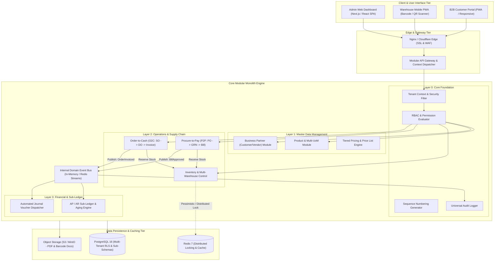
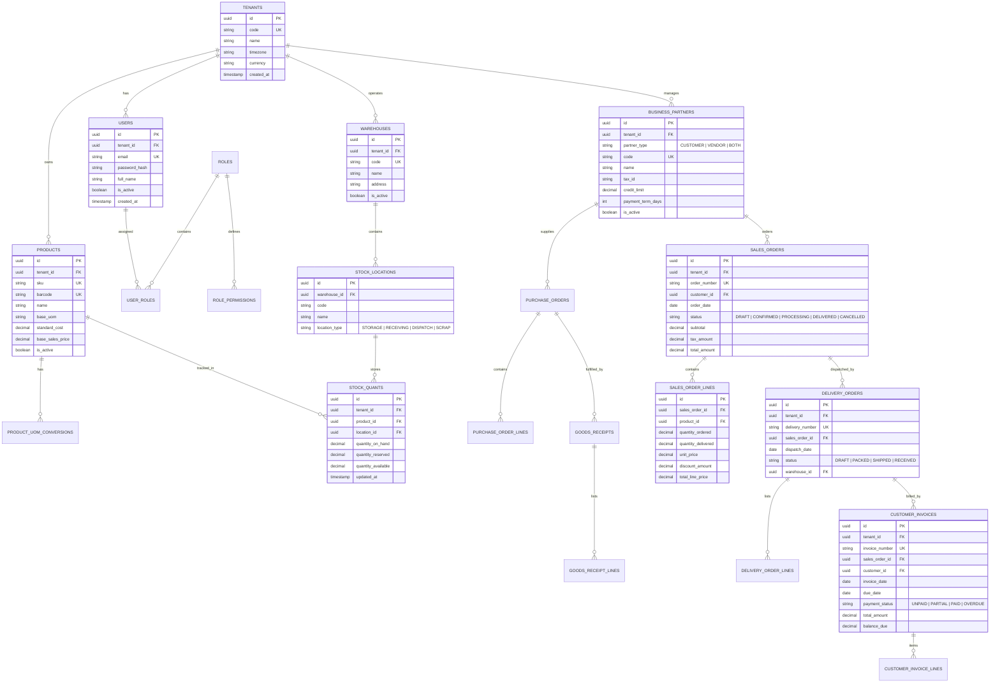

# B2B Modular ERP — System Architecture & Tech Stack

## 1. High-Level Modular Monolith Architecture

B2B Modular ERP mengadopsi pola **Modular Monolith** berbasis *Domain-Driven Design (DDD)* dan *Clean Architecture*. Pendekatan ini memberikan keunggulan kesederhanaan *deployment* dan performa *in-memory transaction* antar-modul, namun tetap memisahkan *domain boundary*, skema tabel, dan kontrak modul (*module public interfaces / domain events*) secara ketat agar siap diekstraksi menjadi microservices jika skala traffic menuntut di masa depan.

---

## 2. Database Schema (Mermaid ERD)

Skema database diorganisasi secara modular dengan relasi berbasis kunci asing (*Foreign Keys*) dan `tenant_id` pada setiap tabel transaksional untuk memastikan isolasi data multi-tenant yang ketat.

---

## 3. Tech Stack & Infrastructure Specifications

| Komponen Arsitektur | Teknologi / Framework | Justifikasi Rekayasa (Engineering Rationale) |
| :--- | :--- | :--- |
| **Frontend Web Framework** | **Next.js 14+ (App Router, React 18/19, TypeScript)** | SSR untuk halaman portal & CSR cepat untuk SPA Admin Dashboard, modular routing, dan integrasi tipe end-to-end. |
| **UI Component Library** | **Tailwind CSS + Shadcn UI + Lucide Icons** | Desain clean, performa render tinggi tanpa CSS runtime overhead, mudah disesuaikan untuk tema multi-tenant. |
| **Client State & Cache** | **TanStack Query v5 + Zustand** | Optimistic UI updates, caching mutasi data operasional, dan manajemen state lokal yang ringan. |
| **Backend Runtime** | **Go 1.22+ (Fiber / Gin) ATAU Node.js (NestJS / Fastify)** | Kecepatan eksekusi tinggi, memory footprint rendah, konkurensi native via goroutine untuk menangani ribuan mutasi stok per detik. |
| **Database Utama** | **PostgreSQL 16** | Mendukung ACID transaksional ketat, skema relasional terstruktur, dan fitur *Row-Level Security (RLS)* bawaan untuk isolasi tenant. |
| **Distributed Cache & Locking**| **Redis 7 (Redis Cluster)** | Eksekusi *distributed lock* (`Redlock`) saat proses reservasi stok produk untuk mencegah *race condition* / *overselling*. |
| **Internal Domain Event Bus**| **Redis Streams / RabbitMQ** | Pengiriman event antar-modul tanpa kopling langsung (misal: saat Surat Jalan divalidasi, otomatis memicu mutasi stok dan jurnal akuntansi). |
| **Object & Document Storage** | **AWS S3 / Cloudflare R2 / MinIO** | Penyimpanan dokumen digital PDF (Surat Jalan, Faktur Penjualan, PO, label barcode). |
| **Container & Orchestration** | **Docker + Kubernetes (atau Docker Compose di VM Edge)** | Standardisasi environment, zero-downtime rolling deployment, dan portabilitas lokal. |

---

## 4. Security, Isolation, & Reliability Model

### 4.1 Multi-Tenant Data Isolation Strategy
- **Shared Database, Shared Schema dengan Row-Level Security (RLS):**
  - Setiap query transaksional secara wajib menyertakan filter `WHERE tenant_id = :current_tenant_id`.
  - Pada layer database, fungsi session context PostgreSQL (`SET LOCAL app.current_tenant_id = '...'`) diaktifkan via database connection middleware untuk menjamin tidak ada data tenant yang bocor antar-organisasi (*data leak immunity*).

### 4.2 Concurrency & Race-Condition Prevention (Stock Reservation)
- Untuk mencegah dua Sales Order memesan stok yang sama secara bersamaan:
  1. Backend mengakuisisi Redis Lock dengan kunci: `lock:stock:tenant:{tenant_id}:product:{product_id}:location:{location_id}` dengan TTL 3000ms.
  2. Eksekusi query verifikasi `quantity_available = (quantity_on_hand - quantity_reserved) >= requested_qty`.
  3. Update atomik `quantity_reserved = quantity_reserved + requested_qty`.
  4. Rilis Redis Lock.

### 4.3 Idempotency Key pada Endpoint Finansial
- Seluruh endpoint mutasi finansial dan status final dokumen (seperti `POST /api/v1/sales/orders`, `POST /api/v1/sales/invoices/pay`) mewajibkan header HTTP:
  - `X-Idempotency-Key: <UUIDv4>`
- Backend menyimpan status eksekusi idempotency key di Redis dengan TTL 24 jam. Jika permintaan dengan key yang sama diulang, sistem mengembalikan respon tersimpan sebelumnya tanpa mengeksekusi ulang mutasi database.

### 4.4 Granular RBAC (Role-Based Access Control)
- Struktur hak akses menggunakan tuple: `Resource:Action:Scope`
  - Contoh: `inventory.moves:create:warehouse_01`, `sales.orders:approve:all`, `accounting.reports:read:company`.
  - Token JWT hanya membawa `sub`, `tenant_id`, dan `role_ids`. Validasi permission detail dievaluasi oleh memory-cached policy layer.

---

## Navigasi Dokumen & Modul

| Navigasi | Tautan Dokumen |
| :--- | :--- |
| **← Dokumen Sebelumnya** | [00-overview.md (Ikhtisar Sistem)](00-overview.md) |
| **Arsitektur & Tech Stack** | [01-architecture-and-techstack.md](01-architecture-and-techstack.md) *(Halaman ini)* |
| **Katalog Fitur Lengkap** | [features/README.md](features/README.md) |
| **Dokumen Selanjutnya →** | [FR-01: Multi-Tenant Core & RBAC →](features/FR-01-multi-tenant-core-and-rbac.md) |
| **Roadmap Implementasi** | [roadmap.md →](roadmap.md) |

