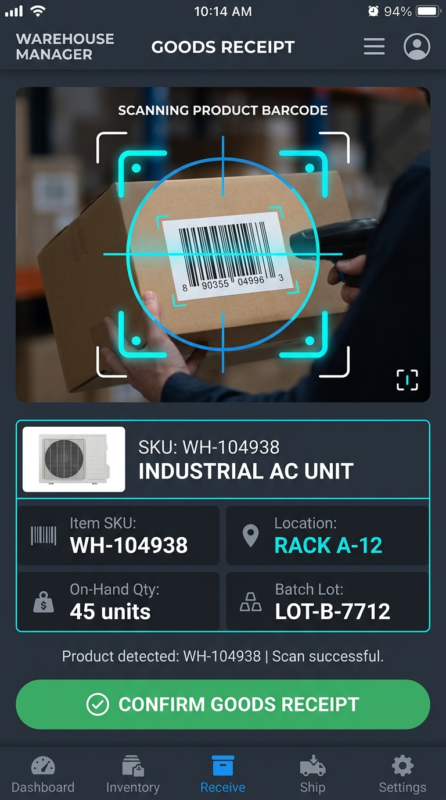
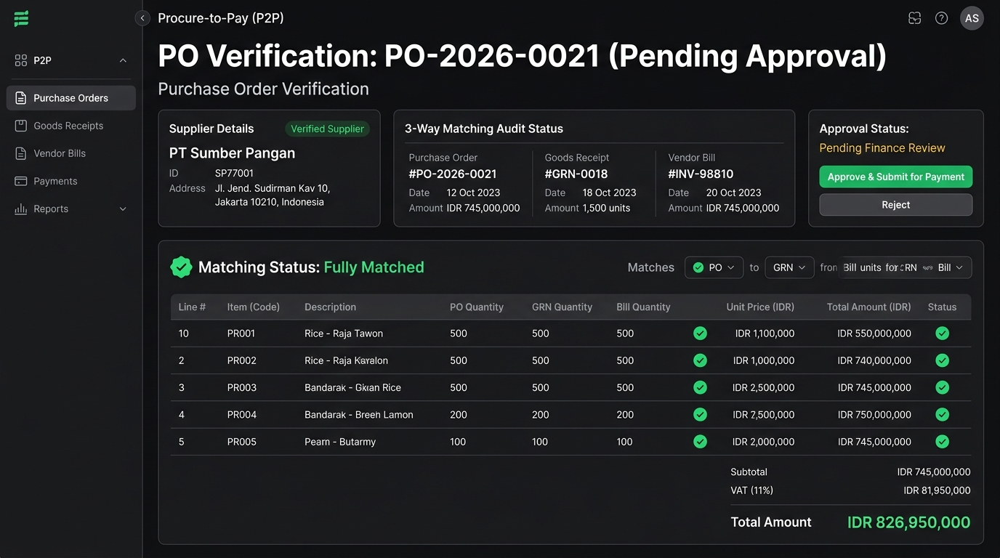
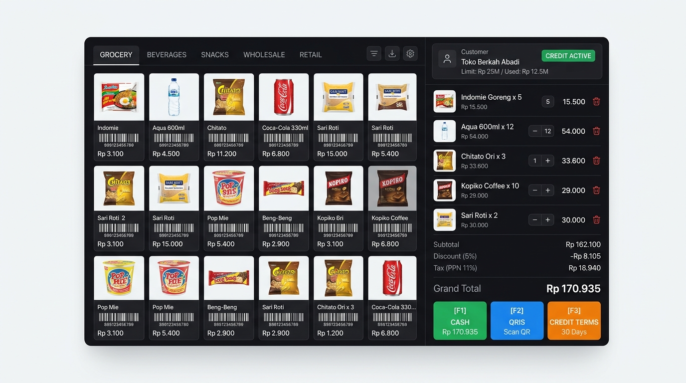

# B2B Modular ERP — Katalog Fitur & Spesifikasi Modul (Feature Index)

Direktori ini memuat seluruh berkas spesifikasi teknis fitur (*Functional Requirements* / FR) untuk **B2B Modular ERP**. Setiap berkas memuat *User Story*, *Acceptance Criteria* (Gherkin), spesifikasi JSON endpoint API, penanganan *edge cases*, serta review keamanan.

---

## 1. Daftar Spesifikasi Fitur MVP

| No | Modul & Dokumen Fitur | Prioritas | Kompleksitas | Estimasi | Deskripsi Singkat |
| :---: | :--- | :---: | :---: | :---: | :--- |
| **FR-01** | [FR-01: Multi-Tenant Core, RBAC & Sequence Engine](FR-01-multi-tenant-core-and-rbac.md) | P0 | High | 1-2 minggu | Isolasi tenant multi-perusahaan, otorisasi peran RBAC granular, dan generator nomor urut dokumen otomatis (*thread-safe*). |
| **FR-02** | [FR-02: Master Data Management (MDM)](FR-02-master-data-management.md) | P0 | Medium | 1-2 minggu | Katalog SKU, barcode, konversi satuan bertingkat (*Multi-UoM*), serta master Pelanggan & Pemasok dengan limit kredit dan termin bayar. |
| **FR-03** | [FR-03: Inventory & Multi-Warehouse Stock Control](FR-03-inventory-and-warehouse.md) | P0 | High | 2 minggu | Pelacakan stok multi-gudang (*on-hand*, *reserved*, *available*), mutasi stok, dan pencegahan *race-condition* via Redis Distributed Lock. |
| **FR-04** | [FR-04: Procure-to-Pay / P2P](FR-04-procure-to-pay.md) | P0 | High | 2 minggu | Alur pesanan pembelian (PO), penerimaan barang fisik gudang (GRN) yang otomatis menambah stok, dan pencocokan tagihan vendor (*3-Way Matching*). |
| **FR-05** | [FR-05: Order-to-Cash / O2C](FR-05-order-to-cash.md) | P0 | High | 2 minggu | Pesanan penjualan (SO) dengan pengecekan plafon kredit & reservasi stok, Surat Jalan pengiriman (DO), dan penerbitan Faktur Penjualan. |

---

## 2. Ilustrasi Visual Antarmuka Modul

Setiap modul dilengkapi dengan desain antarmuka operasional yang siap dikembangkan:

- **Modul Gudang & Inventaris (FR-03):**  
    
  *Lihat spesifikasi lengkap di [FR-03: Inventory & Multi-Warehouse Stock Control](FR-03-inventory-and-warehouse.md).*

- **Modul Pengadaan & Pembelian (FR-04):**  
    
  *Lihat spesifikasi lengkap di [FR-04: Procure-to-Pay / P2P](FR-04-procure-to-pay.md).*

- **Modul Penjualan & Kasir POS (FR-05):**  
    
  *Lihat spesifikasi lengkap di [FR-05: Order-to-Cash / O2C](FR-05-order-to-cash.md).*

---

## 3. Navigasi Dokumen Induk

| Navigasi | Tautan Dokumen |
| :--- | :--- |
| **← Ikhtisar Sistem (Overview)** | [00-overview.md](../00-overview.md) |
| **← Arsitektur & Skema Database** | [01-architecture-and-techstack.md](../01-architecture-and-techstack.md) |
| **Mulai Baca Fitur Pertama** | [FR-01: Multi-Tenant Core & RBAC →](FR-01-multi-tenant-core-and-rbac.md) |
| **Roadmap Implementasi & Milestones** | [roadmap.md (Tahapan Eksekusi) →](../roadmap.md) |
