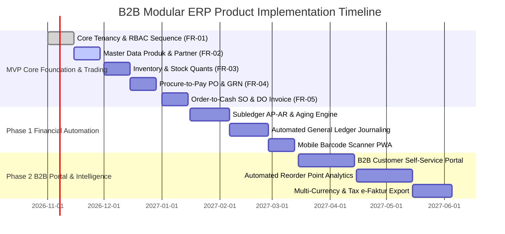
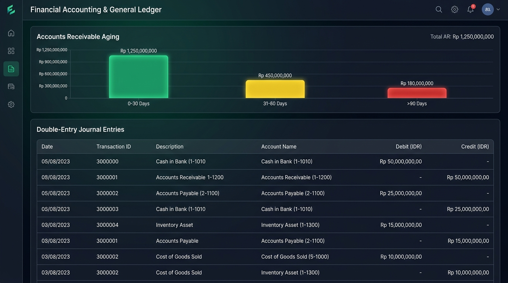

# B2B Modular ERP — Implementation Roadmap

## 1. Executive Roadmap Overview

Roadmap implementasi B2B Modular ERP dirancang secara terukur ke dalam tiga fase strategis untuk memastikan kestabilan integritas data stok dan transaksi sebelum membuka modul akuntansi otomatis dan portal eksternal.

---

## 2. Milestone Details

### 2.1 MVP Milestone: Core Platform & Trading Operations (Week 1 to 8)
Fokus peluncuran MVP adalah memberikan kemampuan operasional *end-to-end* bagi distributor atau pedagang grosir untuk mengelola stok, pembelian dari supplier, dan penjualan ke pelanggan tanpa resiko *overselling* atau kebocoran kredit. Seluruh dokumen spesifikasi fitur dapat ditelusuri di [Katalog Fitur (features/README.md)](features/README.md).

- **Scope Deliverables:**
  - **[FR-01: Multi-Tenant Core, RBAC & Sequence Engine](features/FR-01-multi-tenant-core-and-rbac.md):** Multi-tenant isolation, user authentication, RBAC policy enforcement, dan thread-safe sequence numbering engine.
  - **[FR-02: Master Data Management (MDM)](features/FR-02-master-data-management.md):** Master data katalog produk dengan konversi Multi-UoM (Pcs/Karton/Pallet), serta direktori Pelanggan & Pemasok dengan plafon kredit (*credit limit*).
  - **[FR-03: Inventory & Multi-Warehouse Stock Control](features/FR-03-inventory-and-warehouse.md):** Manajemen inventaris multi-gudang, status ketersediaan *stock quants* (*on-hand* vs *reserved*), serta penguncian terdistribusi (*Redis lock*).
  - **[FR-04: Procure-to-Pay / P2P](features/FR-04-procure-to-pay.md):** Alur pengadaan (*Procure-to-Pay*) dari PO ke GRN (Surat Jalan Masuk) hingga verifikasi Vendor Bill dengan *3-way matching*.
  - **[FR-05: Order-to-Cash / O2C](features/FR-05-order-to-cash.md):** Alur penjualan grosir (*Order-to-Cash*) dari SO dengan pengecekan batas kredit, penerbitan Surat Jalan (*Delivery Order*), dan Faktur Penjualan (*Customer Invoice*).
- **Target Release:** Akhir Q4 2026 (Piloting di 2 distributor FMCG & Bahan Bangunan).

---

## 2.2 Phase 1: Financial Automation & Warehouse Mobility (Month 3 to 5)
Menghubungkan seluruh transaksi fisik dan operasional ke buku besar keuangan secara otomatis serta mempermudah operasional staf lapangan.

*Gambar R.1: Antarmuka Buku Besar Umum & Analisis Umur Piutang (AR Aging Chart).*

- **Scope Deliverables:**
  - **Subledger AP/AR & Aging Schedule:** Laporan umur piutang (*30/60/90 days aging schedule*) otomatis dan rekonsiliasi pembayaran bertahap (*partial payment matching*).
  - **Automated General Ledger Journal Dispatcher:** Setiap transaksi GRN otomatis menjurnal Persediaan Belum Ditagih (*Accrued Purchases*), dan setiap DO langsung membebankan HPP (*COGS*) & mengkredit persediaan secara akurat.
  - **Warehouse Mobile Scanner PWA:** Aplikasi mobile ramah kamera ponsel atau scanner barcode Bluetooth untuk cek stok cepat dan validasi penerimaan barang di rak gudang (lihat aset [warehouse-scanner-app.jpg](assets/warehouse-scanner-app.jpg)).
- **Target Release:** Q1 2027.

---

## 2.3 Phase 2: B2B Customer Portal & Predictive Analytics (Month 6 to 9)
Memberdayakan pelanggan dengan akses mandiri dan membantu manajemen meramalkan kebutuhan stok barang.

- **Scope Deliverables:**
  - **B2B Customer Self-Service Portal:** Pelanggan dapat masuk ke portal mandiri untuk melihat katalog harga khusus (*special tier price*), riwayat pesanan, sisa limit kredit, mengunduh faktur pajak, dan mengajukan pesanan baru 24/7.
  - **Automated Reorder Point & Safety Stock Analytics:** Algoritma peramalan kebutuhan stok berdasarkan rata-rata penjualan harian (*lead time demand*) yang otomatis menerbitkan rekomendasi draft Purchase Order.
  - **Multi-Currency & Indonesian Tax Integration:** Dukungan transaksi multi-mata uang asing dan ekspor data CSV faktur siap impor ke aplikasi e-Faktur DJP.
- **Target Release:** Q2 2027.

---

## 3. Komersialisasi & Monetisasi Berlangganan (GTM Packaging)

Setiap milestone pengembangan dihubungkan langsung dengan peluncuran tier komersial bertahap:

1. **Rilis MVP (Bulan ke-2):** Meluncurkan paket **Starter (Rp 299.000 / bln)** untuk toko rintisan dan paket **Basic — UMKM (Rp 699.000 / bln)** untuk toko grosir dan distributor kecil (target 25 pilot tenant pertama).
2. **Rilis Phase 1 (Bulan ke-5):** Meluncurkan paket **Standard (Rp 1.499.000 / bln)** dengan integrasi mobile barcode scanner gudang, modul kas/bank, dan jurnal akuntansi otomatis. Target melampaui BEP operasional bulanan (18 tenant aktif).
3. **Rilis Phase 2 (Bulan ke-9):** Meluncurkan paket **Premium (Rp 2.899.000 / bln)** dan **Custom / Enterprise (Rp 7.500.000+ / bln)** dengan portal B2B pelanggan mandiri, integrasi pajak e-Faktur DJP, dan private cloud isolation. Target mencapai BEP Capex investasi awal (Rp 220.000.000).

*(Rincian matriks fitur dan unit economics 5 tier dapat dipelajari di [00-overview.md#6-model-pembiayaan-estimasi-biaya-capexopex--skema-berlangganan-saas-tiers](00-overview.md)).*

---

## Navigasi Dokumen & Modul

| Navigasi | Tautan Dokumen |
| :--- | :--- |
| **← Ikhtisar Sistem (Overview)** | [00-overview.md](00-overview.md) |
| **← Arsitektur Sistem & Tech Stack** | [01-architecture-and-techstack.md](01-architecture-and-techstack.md) |
| **Katalog Fitur Lengkap** | [features/README.md](features/README.md) |
| **Daftar Fitur Langsung** | • [FR-01: Multi-Tenant Core](features/FR-01-multi-tenant-core-and-rbac.md) • [FR-02: Master Data Management](features/FR-02-master-data-management.md) • [FR-03: Inventory & Warehouse](features/FR-03-inventory-and-warehouse.md) • [FR-04: Procure-to-Pay](features/FR-04-procure-to-pay.md) • [FR-05: Order-to-Cash](features/FR-05-order-to-cash.md) |

