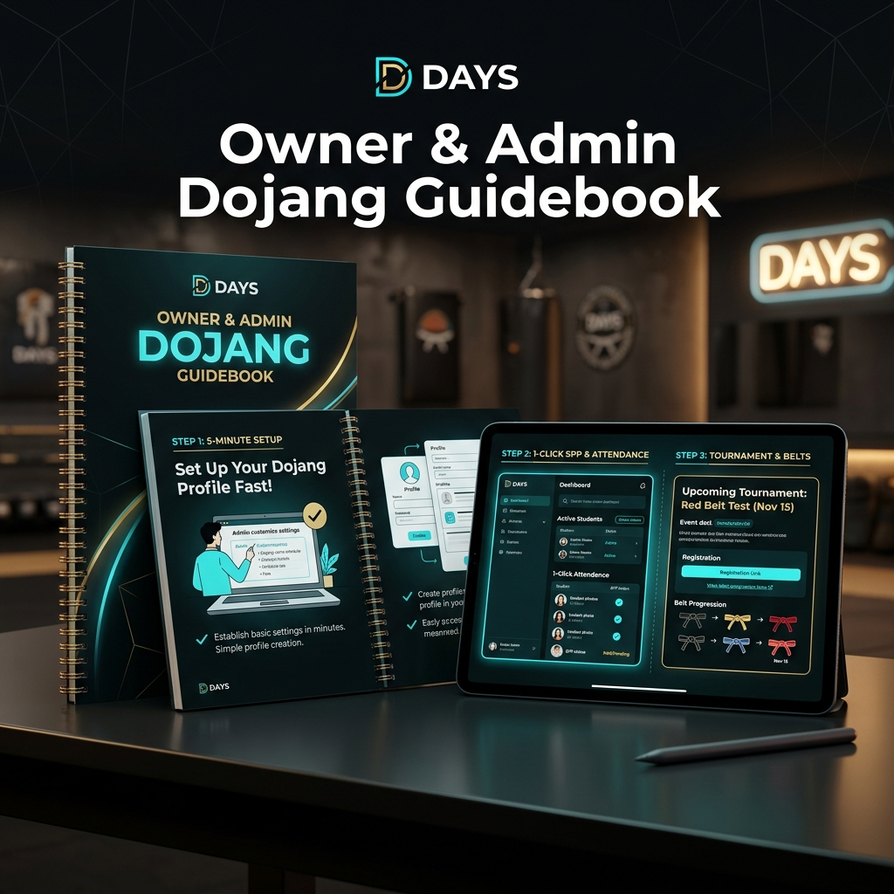
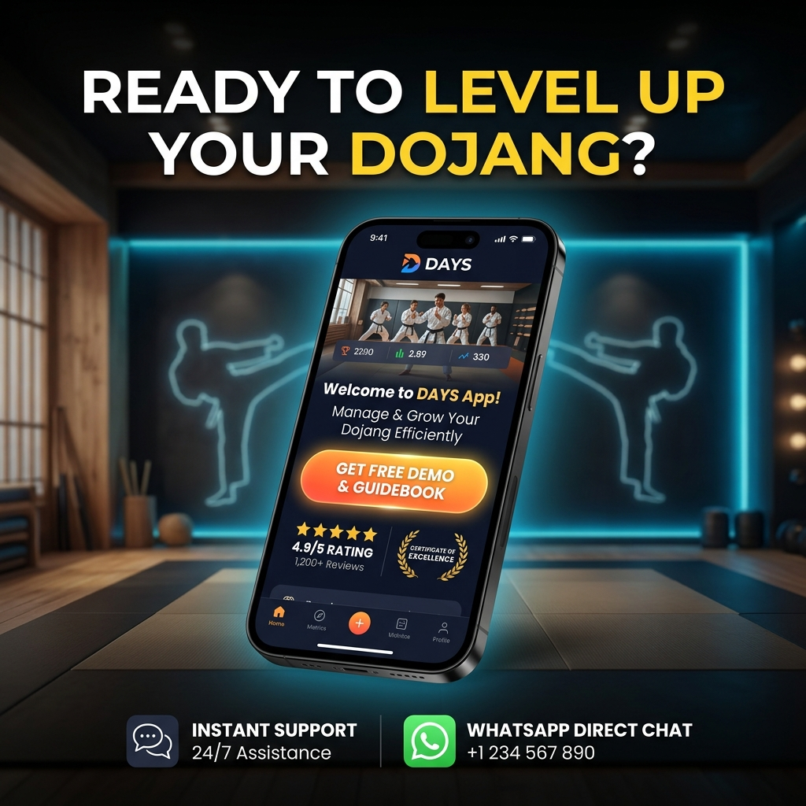

# Koleksi Caption & Copywriting Promosi DAYS

Dokumen ini memuat kumpulan draf materi promosi media sosial dan pesan siaran (*broadcast*) untuk aplikasi **DAYS (Dojang Application System)**, dengan fokus utama pada peluncuran **Buku Panduan / Modul Operasional Khusus Owner & Admin Dojang**.

---

## 1. Instagram Feed / LinkedIn / Facebook (Gaya Profesional & Edukatif)

Cocok untuk postingan *single image*, infografis, atau video landscape/portrait berdurasi sedang.

### Versi A: Fokus Kemudahan Adopsi Sistem & Panduan Cepat

```text
🥋 Kini Kelola Dojang Jadi Makin Mudah & Praktis Bersama DAYS!

Sering merasa kewalahan mengurus administrasi dojang manual, atau ragu beralih ke sistem digital karena takut ribet? Tenang! Sekarang DAYS (Dojang Application System) telah resmi dilengkapi dengan Buku Panduan & Modul Showcase Khusus Owner Dojang!

Buku panduan ini dirancang langkah demi langkah (step-by-step) agar pemilik dojang dan tim admin langsung mahir memaksimalkan seluruh fitur DAYS dalam hitungan menit, mencakup:

✨ Manajemen Anggota & Pelatih: Database terpusat, biodata digital, riwayat sabuk, hingga cetak kartu anggota.
⚡ Tagih SPP 1-Klik: Pengingat otomatis via WhatsApp, pembayaran QRIS instan, & kwitansi digital real-time.
🏆 Event, UKT, & Kontingen Otomatis: Pendaftaran kejuaraan dan ujian kenaikan tingkat tanpa perlu input ulang data berkali-kali.
📊 Laporan Keuangan & Analitik: Rekap kehadiran latihan, grafik performa murid, hingga kalkulasi honor pelatih secara transparan.

Tinggalkan cara manual yang memakan waktu dan rentan selisih. Waktunya dojang Anda bertransformasi menjadi lebih modern, tertib, dan profesional. 🚀

👉 Tonton video/slide di atas untuk melihat preview isi buku panduannya!
📲 Konsultasi & demo gratis: Hubungi kami via DM atau klik link di bio.

#DaysApp #DojangManagement #PanduanOwnerDojang #TaekwondoIndonesia #ManajemenDojang #AplikasiDojang #DigitalisasiDojang #EventTaekwondo #SportsTech
```

---

### Versi B: Fokus Efisiensi Waktu & Tata Kelola Mandiri

```text
Dari Pusing Urus Pembukuan Manual Menjadi Otomatis Hanya dalam 5 Menit Sehari! ⏱️🥋

Banyak owner dojang menghabiskan akhir pekan hanya untuk mencocokkan mutasi bank, mengecek kwitansi SPP kertas, atau mendata ulang atlet untuk kejuaraan.

Melalui DAYS (Dojang Application System) dan Modul Panduan Praktis Owner Dojang, kami membantu Anda memotong 80% beban administrasi rutin:

1. Setup Dojang Sekali Klik: Panduan konfigurasi jadwal, kelas, dan tarif iuran tanpa kendala teknis.
2. Otomasi Finansial: Notifikasi tagihan ramah via WhatsApp langsung ke wali murid.
3. Sinkronisasi Data Atlet: Ekspor data kontingen resmi dalam hitungan detik.

Modul panduan kami buat dengan bahasa yang lugas, panduan visual yang jelas, dan checklist harian yang aplikatif.

Siap bawa dojang Anda naik level? Hubungi tim kami untuk akses modul panduan dan uji coba sistem DAYS sekarang juga.

#ManajemenKlub #TaekwondoClub #DojangDigital #SoftwareDojang #AplikasiTaekwondo #DAYSApp
```

---

## 2. TikTok / Instagram Reels / YouTube Shorts (Gaya Interaktif & Dinamis)

Cocok untuk video vertikal (9:16) berdurasi 30–60 detik yang menampilkan rekaman layar (*screen recording*) aplikasi atau buku panduan fisik/PDF.

### Script & Caption 1: "Bongkar Buku Rahasia Owner Dojang"

**Pilihan Hook Pembuka Video (Pilih salah satu):**
- *"Owner dojang merapat! Nggak perlu lagi pusing bikin rekap SPP sampai larut malam..."*
- *"Ini alasan kenapa banyak dojang di Indonesia mulai tinggalkan buku absen dan kwitansi kertas!"*

**Caption Postingan:**
```text
Kabar gembira buat para Pemilik & Admin Dojang! 🥳🥋

Sekarang pakai DAYS (Dojang Application System) makin gampang karena SUDAH DILENGKAPI BUKU PANDUAN KHUSUS OWNER DOJANG!

Nggak perlu bingung lagi cara pakainya, karena di dalam modul panduan ini semua dijelaskan step-by-step:
1️⃣ Langkah Awal Onboarding: Atur profil pembayaran, jadwal kelas, & input database anggota.
2️⃣ Rutinitas Harian 5 Menit: Cek presensi latihan, kirim pengingat SPP WA 1-Klik, & verifikasi transfer otomatis.
3️⃣ Manajemen Event & UKT: Daftarkan kontingen & ujian sabuk tanpa ribet ketik ulang.
4️⃣ Tips Operasional & Analitik: Evaluasi pertumbuhan dojang & hitung honor pelatih secara transparan.

Bikin dojang makin modern, rapi, dan profesional tanpa pusing! 🔥

Tonton video ini untuk lihat cuplikan buku panduannya. Jangan lupa Like, Save, dan Share ke rekan pelatih atau pengurus dojang lainnya ya! 🙌

Ketik "MAU PANDUAN" di kolom komentar atau klik link di bio untuk info selengkapnya! 📩

#DAYSApplication #PanduanDojang #DojangManager #InfoTaekwondo #KelolaDojang #BisnisBeladiri #AplikasiBisnis #TaekwondoShorts
```

---

## 3. Copy Postingan Carousel & Visual Assets (5 Slide Edukatif)

Cocok untuk format carousel Instagram atau dokumen slide LinkedIn. Aset visual tersimpan di folder [`assets/`](file:///c:/Users/susen/Documents/githublab/days/content/ideas/caption/assets).

### **Slide 1: Cover (Hook & Branding)**

- **Visual:** Mockup tablet & smartphone menampilkan dashboard DAYS berdampingan dengan buku fisik *Owner Dojang Guidebook* berbalut aksen sabuk hitam Taekwondo, dilengkapi **Logo Resmi DAYS (Globe Biru Digital dengan tipografi cyan)** pada layar tablet, pojok atas, dan sampul buku panduan.
- **Headline:** *"Baru Pakai DAYS? Ini Panduan Lengkap Owner Dojang Agar Langsung Mahir dalam 5 Menit!"*
- **Sub-headline:** *"Tinggalkan pembukuan manual, beralih ke sistem otomatis yang modern dan rapi."*

---

### **Slide 2: Problem Statement (Kekacauan Administrasi Manual)**

- **Visual:** Meja operasional yang penuh kwitansi kusut, buku presensi manual, tumpukan berkas pendaftaran, kalkulator, dan ikon notifikasi merah penanda *stress & manual errors*.
- **Headline:** *"Tantangan Klasik yang Sering Bikin Owner Dojang Pusing:"*
- **Poin Masalah:**
  - ❌ Kwitansi pembayaran SPP tercecer dan sulit dilacak.
  - ❌ Waktu akhir pekan habis hanya untuk rekap absensi dan honor pelatih.
  - ❌ Ribet ketik ulang biodata atlet setiap kali ada kejuaraan & UKT.

---

### **Slide 3: The All-in-One Solution (Fitur DAYS)**

- **Visual:** Kartu UI futuristik & rapi: ID card digital atlet (foto & tingkatan sabuk), notifikasi tagihan SPP via WhatsApp otomatis, barcode QRIS pembayaran sukses, dan grafik analitik bulanan.
- **Headline:** *"DAYS: Ekosistem Digital Terpadu untuk Dojang Anda"*
- **Poin Solusi:**
  - 🥋 **Database Anggota Terpusat:** Profil atlet, kartu anggota digital, dan riwayat kenaikan sabuk.
  - ⚡ **Tagih SPP 1-Klik:** Notifikasi WhatsApp ramah langsung ke orang tua + verifikasi QRIS instan.
  - 📊 **Laporan & Rekap Otomatis:** Grafik pendapatan dojang, presensi murid, dan transparansi honor pelatih.

---

### **Slide 4: Showcase Buku Panduan (Step-by-Step Walkthrough)**

- **Visual:** Buku panduan fisik bersampul elegan terbuka di samping tablet yang menampilkan layar instruksi step-by-step DAYS yang mudah dipahami.
- **Headline:** *"Kini Dilengkapi Buku Panduan Khusus Owner Dojang!"*
- **Poin Nilai Tambah:**
  - ⏱️ **Setup Cepat 5 Menit:** Panduan praktis konfigurasi dojang tanpa perlu menguasai teknis rumit.
  - 📖 **Checklist Harian Admin:** Prosedur operasional standar (SOP) harian yang mudah didelegasikan ke staf/admin.
  - 🏆 **Manajemen Event & UKT:** Langkah registrasi turnamen instan tanpa *human error*.

---

### **Slide 5: Call to Action (Ajakan Bertindak)**

- **Visual:** Smartphone menampilkan aplikasi DAYS siap pakai dengan tombol menyala *"GET FREE DEMO & GUIDEBOOK"*, badge rating 4.9/5, serta ikon dukungan WhatsApp Direct Chat.
- **Headline:** *"Siap Bawa Dojang Anda Naik Level?"*
- **Ajakan Bertindak (CTA):**
  - 💾 **Simpan (Save)** postingan ini untuk referensi manajemen klub Anda.
  - 📩 **Ketik "MAU DEMO"** di komentar atau DM kami untuk mendapatkan akses uji coba gratis + modul panduan eksklusif!

---

## 4. Template Broadcast WhatsApp (Direct Outreach ke Owner & Pelatih)

Gunakan template ini untuk pesan langsung ke pengurus dojang atau grup komunitas beladiri.

```text
Salam Olahraga, Sabeum/Bapak/Ibu Pengurus Dojang 🙏🥋

Kini hadir solusi praktis untuk mempermudah operasional dojang Anda: *DAYS (Dojang Application System)*.

Untuk memastikan kemudahan implementasi, DAYS kini telah dilengkapi *Buku Panduan & Modul Khusus Owner Dojang*! 

Melalui panduan ini, Anda dapat langsung mengoptimalkan:
✅ Pencatatan database murid & riwayat sabuk secara terpusat.
✅ Pengiriman pengingat tagihan SPP via WhatsApp (1-Klik) & QRIS.
✅ Pendaftaran UKT serta kontingen kejuaraan otomatis tanpa re-entry data.
✅ Rekapitulasi absensi & laporan keuangan transparan.

Panduan ini disusun ringkas agar dojang Anda bisa *go digital* hanya dalam hitungan menit! 🚀

Tertarik melihat preview buku panduan dan demo aplikasi DAYS?
Balas pesan ini dengan *"MAU DEMO"* atau kunjungi: [Tautan Website / Kontak Tim DAYS]

Terima kasih dan salam hormat! 🥋
```

---

## 5. Ringkasan Kumpulan Tagar (Hashtags Bank)

Pilih 10–15 tagar berikut sesuai platform:

```text
#DaysApp #DojangApplicationSystem #TaekwondoIndonesia #ManajemenDojang #AplikasiDojang #DigitalisasiDojang #BukuPanduanDojang #OwnerDojang #SabeumTaekwondo #BeladiriIndonesia #SportManagement #KlubBeladiri #AplikasiPelatih #UKTTaekwondo #KejuaraanTaekwondo
```
