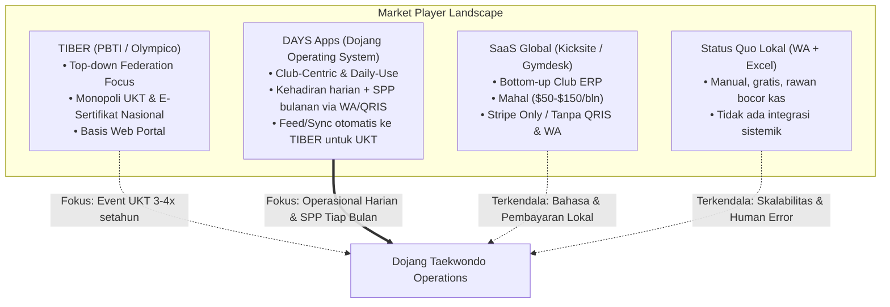

# Framework & Parameter Benchmarking Kompetitor — DAYS Apps
*(Dojang Taekwondo Application System)*

Dokumen ini memuat **Checklist Parameter Audit & Benchmarking** terinci untuk membandingkan **DAYS Apps** secara langsung (*head-to-head*) dengan:
1. **TIBER (Taekwondo Indonesia Berprestasi - Rekomendasi Resmi PBTI)** — Platform UKT & database nasional.
2. **SaaS Bela Diri Global** (*Kicksite*, *Martialytics*, *Gymdesk*).
3. **Status Quo Lokal** (*WhatsApp + Spreadsheet + Rekening Manual*).

---

## 1. Executive Summary & Lanskap Kompetitif

Ekosistem Taekwondo di Indonesia memiliki dinamika unik dengan hadirnya **TIBER (tiber.olympico.app)** yang memegang **surat rekomendasi resmi dari PBTI** untuk Ujian Kenaikan Tingkat (UKT).

### Strategic Positioning: DAYS vs TIBER
* **TIBER:** Berperan sebagai **Sistem Federasi Nasional (Top-Down)**. Sangat kuat pada legalitas sertifikat Dan/Geup resmi PBTI, pendaftaran ujian tingkat nasional/daerah, dan sinkronisasi ke Pengcab/Pengprov.
* **DAYS:** Memposisikan diri sebagai **Operating System Harian Dojang (Bottom-Up Club ERP)**. Menyelesaikan masalah harian pemilik dojang yang tidak disentuh oleh TIBER: presensi harian siswa dengan WA otomatis, penagihan SPP bulanan via QRIS, pembagian honor pelatih ranting sekolah, dan toko perlengkapan (dobok/hogu).
* **Sinergi Ideal:** DAYS menjadi *feeder system* yang mempersiapkan data murid sepanjang 3–4 bulan latihan harian, lalu mengekspor data yang sudah memenuhi syarat kelayakan ujian langsung ke TIBER saat periode UKT PBTI tiba.

---

## 2. Checklist Detail Parameter Benchmarking (6 Dimensi)

### 2.1 Dimensi A: Keanggotaan & Siklus Sabuk (Belt & Rank Lifecycle)

| Kode | Parameter Evaluasi | Pertanyaan Audit Saat Benchmarking | TIBER (PBTI Endorsed) | Standar Global (Kicksite) | Status Quo (WA+Excel) | Target Standar DAYS Apps |
| :--- | :--- | :--- | :--- | :--- | :--- | :--- |
| **A-01** | **Hierarki Sabuk Taekwondo** | Apakah sistem mendukung aturan sabuk resmi Geup 10 s/d Dan 9? | **Sangat Kuat**: Standar resmi PBTI / Kukkiwon. | Fleksibel / Kustomisasi umum. | Manual di sheet excel, rawan salah catat. | **Native PBTI/Kukkiwon Preset** siap pakai. |
| **A-02** | **Aturan Kelayakan UKT Otomatis** | Bisakah sistem menyaring murid berdasarkan minimal kehadiran harian sebelum daftar ujian? | Terbatas: Pendaftaran UKT lebih berbasis input manual kuota/nama dojang. | Ada filter kehadiran minimum global. | Dihitung manual dari kertas absen. | **Automated UKT Readiness**: Filter otomatis murid dengan hadir ≥24 sesi & silabus tuntas. |
| **A-03** | **E-Sertifikat & QR Verifikasi** | Apakah e-sertifikat diakui resmi secara nasional dan memiliki QR verifikasi publik? | **Sangat Kuat**: Nomor sertifikat nasional terdaftar di server PBTI. | Ada template lokal dojang, tapi tanpa legitimasi federasi. | Cetak fisik / sertifikat kertas lokal. | **Dual Integration**: Sertifikat lokal dojang + opsi sinkronisasi verifikasi TIBER. |
| **A-04** | **Ekspor / Sinkronisasi PBTI & TIBER**| Apakah data murid dan kelulusan UKT dapat diekspor langsung ke format form TIBER PBTI? | Native di platform TIBER. | Tidak ada (ekspor CSV umum). | Ketik ulang satu per satu oleh Sabeum. | **1-Click TIBER Sync/Export**: Ekspor data calon peserta UKT siap upload ke TIBER. |

---

### 2.2 Dimensi B: Presensi & Transparansi Orang Tua (Attendance & Parent Transparency)

| Kode | Parameter Evaluasi | Pertanyaan Audit Saat Benchmarking | TIBER (PBTI Endorsed) | Standar Global (Kicksite) | Status Quo (WA+Excel) | Target Standar DAYS Apps |
| :--- | :--- | :--- | :--- | :--- | :--- | :--- |
| **B-01** | **Kecepatan Check-In Harian** | Berapa detik proses absensi saat 50 murid datang bersamaan di dojang? | Belum ada fitur fast-kiosk harian di matras (fokus pada event UKT). | Kiosk tablet/barcode scan (<2 detik). | Tanda tangan kertas / absen fisik. | **Fast Tap / QR Card**: Presensi mandiri via kartu QR / scan HP Sabeum (<1.5 detik). |
| **B-02** | **Notifikasi WhatsApp ke Orang Tua** | Apakah orang tua menerima WhatsApp instan saat anak tap hadir di dojang? | Tidak ada integrasi WhatsApp otomatis ke ortu. | Tidak ada (hanya push notif / email). | Tidak ada pemberitahuan real-time. | **WhatsApp Gateway Otomatis**: Pesan kehadiran real-time ke nomor HP ortu. |
| **B-03** | **Deteksi Dini Drop-Out (Churn Warning)** | Apakah sistem mendeteksi jika murid sudah 2–3 minggu tidak hadir latihan? | Tidak ada (hanya memantau saat UKT berlangsung). | Ada retention report global. | Tidak terlacak sampai murid berhenti bayar SPP. | **Early Churn Alert**: Notifikasi pelatih untuk follow up murid yang mulai malas latihan. |
| **B-04** | **Presensi Offline di Lapangan** | Bisakah Sabeum mengabsen saat melatih di aula sekolah tanpa sinyal internet? | Web-dependent (harus ada koneksi internet). | Sebagian besar butuh internet stabil. | Kertas manual (selalu offline). | **100% Offline-First**: Catat lokal di ponsel Sabeum, sync otomatis saat online. |

---

### 2.3 Dimensi C: Keuangan, SPP & Penjualan Perlengkapan (Billing & Revenue)

| Kode | Parameter Evaluasi | Pertanyaan Audit Saat Benchmarking | TIBER (PBTI Endorsed) | Standar Global (Kicksite) | Status Quo (WA+Excel) | Target Standar DAYS Apps |
| :--- | :--- | :--- | :--- | :--- | :--- | :--- |
| **C-01** | **Penagihan SPP Bulanan Otomatis** | Apakah ada invoice SPP bulanan otomatis yang dikirim ke orang tua via WhatsApp? | Tidak ada (TIBER fokus pada biaya pendaftaran UKT/KTA). | Auto-invoice via email & kartu kredit. | Broadcast manual di grup WA (sering menunggak). | **Automated WhatsApp Recurring SPP**: Tagihan rutin tanggal 1 setiap bulan. |
| **C-02** | **Pembayaran QRIS & VA Lokal Otomatis**| Bisakah orang tua membayar iuran SPP dojang via QRIS langsung lunas tanpa kirim bukti transfer? | Memiliki pembayaran digital untuk event UKT/PBTI. | Hanya Stripe/Credit Card (tidak cocok di ID). | Transfer rekening pribadi, kirim struk manual. | **Integrated Local Gateway**: QRIS & VA Bank langsung rekonsiliasi kas dojang. |
| **C-03** | **Dojang Store (Seragam & Alat)** | Apakah orang tua bisa memesan Dobok, Hogu, dan Kicking Pad langsung dari sistem? | Belum tersedia toko perlengkapan internal dojang. | Modul POS terintegrasi lengkap. | Pesan manual di WA, stok tidak terdata. | **Dojang Pro-Shop**: Katalog dobok, pelindung, dan sabuk dengan manajemen stok. |
| **C-04** | **Bagi Hasil Honor Sabeum Ranting** | Apakah ada kalkulasi otomatis honor pelatih per sesi atau persentase iuran unit? | Tidak ada (bukan sistem penggajian internal dojang). | Kurang spesifik untuk model ranting ekskul ID. | Dihitung manual oleh admin di buku kas. | **Coach Revenue Share Engine**: Perhitungan otomatis honor Sabeum per unit latihan. |

---

### 2.4 Dimensi D: Kurikulum & Rekam Prestasi Atlet (Curriculum & Athlete Records)

| Kode | Parameter Evaluasi | Pertanyaan Audit Saat Benchmarking | TIBER (PBTI Endorsed) | Standar Global (Kicksite) | Status Quo (WA+Excel) | Target Standar DAYS Apps |
| :--- | :--- | :--- | :--- | :--- | :--- | :--- |
| **D-01** | **Pustaka Video Poomsae Terintegrasi** | Apakah murid bisa memutar video panduan jurus resmi per sabuk di rumah? | Belum tersedia pustaka video latihan harian terintegrasi. | Unggah video sendiri oleh admin dojang. | Siswa mencari acak di YouTube. | **Built-in Poomsae Library**: Video Taegeuk 1–8 terkurasi sesuai standar PBTI. |
| **D-02** | **Lembar Penilaian UKT Digital** | Apakah ada form digital bagi penguji untuk menilai Poomsae, Kyorugi, dan Fisik? | **Ada**: Fitur scoring UKT digital PBTI. | Form grading digital tersedia. | Kertas form ujian fisik, direkap manual. | **Digital Scoring Pad**: Form penilaian cepat Sabeum internal + sinkronisasi nilai ke TIBER. |
| **D-03** | **Database Prestasi & Kelas Tanding** | Apakah rekam medali dan histori kelas berat tanding atlet terekam rapi? | Memiliki leaderboard & database atlet nasional. | Catatan umum, tidak spesifik kejuaraan. | Piagam disimpan masing-masing di rumah atlet. | **Digital Athlete Passport**: Catatan medali, grafik berat badan, dan riwayat cedera. |

---

### 2.5 Dimensi E: Manajemen Multi-Unit & Ranting Ekskul (Multi-Branch Hierarchy)

| Kode | Parameter Evaluasi | Pertanyaan Audit Saat Benchmarking | TIBER (PBTI Endorsed) | Standar Global (Kicksite) | Status Quo (WA+Excel) | Target Standar DAYS Apps |
| :--- | :--- | :--- | :--- | :--- | :--- | :--- |
| **E-01** | **Struktur Klub Induk & Ranting Sekolah**| Bisakah 1 akun klub mengelola 15 unit ekskul sekolah dengan keuangan terpisah tapi laporan terpusat? | Berbasis entitas dojang resmi (kurang fleksibel untuk sub-unit ekskul sekolah temporer). | Menagih biaya ganda per cabang (*multi-location surcharge*). | Grup WA terpisah-pisah, data tercerai-berai. | **Native Multi-Ranting Structure**: 1 Klub menaungi banyak unit tanpa biaya ganda. |
| **E-02** | **RBAC (Role-Based Access Control)** | Apakah hak akses terisolasi ketat antara Sabeum unit, kasir, wali murid, dan grandmaster? | Role berbasis federasi (Penguji, Pelatih, Pemilik Dojang). | RBAC standar SaaS gym. | Tidak ada hak akses, semua data terbuka di spreadsheet. | **Dojang Hierarchy RBAC**: Pelatih hanya kelola unitnya; Ortu hanya lihat anaknya. |

---

### 2.6 Dimensi F: Biaya, Bahasa & Kemudahan Adopsi (Accessibility & Pricing)

| Kode | Parameter Evaluasi | Pertanyaan Audit Saat Benchmarking | TIBER (PBTI Endorsed) | Standar Global (Kicksite) | Status Quo (WA+Excel) | Target Standar DAYS Apps |
| :--- | :--- | :--- | :--- | :--- | :--- | :--- |
| **F-01** | **Biaya untuk Dojang** | Berapa biaya langganan operasional harian? | Gratis/biaya per event UKT & registrasi KTA. | \$50 – \$150/bln (Rp 800rb – Rp 2.4jt/bln) — *mahal*. | Gratis (namun waktu admin habis untuk tagih SPP). | **Freemium / Micro-SaaS Terjangkau**: Tier gratis untuk unit rintisan + biaya transaksi sangat kecil. |
| **F-02** | **Kemudahan Adopsi untuk Orang Tua** | Apakah orang tua wajib unduh aplikasi berat atau bisa via Web/WhatsApp? | Web portal (login browser). | Wajib unduh aplikasi native (gesekan tinggi). | Menggunakan WhatsApp (tanpa install app baru). | **Zero-Friction Access**: Notifikasi & link bayar langsung via WhatsApp. |

---

## 3. Matriks Komparasi Skor Head-to-Head

| No | Pilar Evaluasi | Bobot | TIBER (PBTI) | Kicksite (Global) | Status Quo (WA/Excel) | DAYS Target |
| :-: | :--- | :-: | :-: | :-: | :-: | :-: |
| 1 | **Legitimasi Sabuk & E-Sertifikat UKT** | 20% | **4.9** *(Monopoli)* | 3.5 | 1.5 | **4.8** *(Integrasi)* |
| 2 | **Presensi Harian & Notifikasi WhatsApp Ortu** | 20% | 2.0 | 2.5 | 3.5 | **5.0** |
| 3 | **Penagihan SPP Bulanan & QRIS Lokal** | 20% | 2.5 | 1.0 | 3.0 | **5.0** |
| 4 | **Kurikulum Poomsae & Rekam Atlet** | 15% | 3.5 | 2.0 | 1.0 | **4.8** |
| 5 | **Manajemen Multi-Ranting Ekskul Sekolah** | 15% | 2.5 | 2.5 | 2.0 | **4.8** |
| 6 | **Keterjangkauan Biaya & Kemudahan Adopsi** | 10% | 4.0 | 1.5 | 5.0 | **4.9** |
| | **TOTAL SKOR BERBOBOT (100%)** | **100%** | **3.23** | **2.25** | **2.53** | **4.89** |

---

## 4. Kesimpulan Strategis: Rekomendasi Aliansi / Integrasi

1. **Jangan Berhadapan Langsung (*Don't Fight*) dengan TIBER di Ranah Legalitas UKT:**
   TIBER memiliki surat rekomendasi PBTI, yang berarti sertifikat dan nomor registrasinya diakui secara hierarki olahraga nasional. Menantang TIBER dalam hal sertifikasi PBTI adalah tindakan yang tidak produktif.
2. **Kuasai Operasional Harian Dojang (*Own the Daily Workflow*):**
   TIBER hanya dipakai dojang **3 sampai 4 kali setahun saat periode UKT**. Di luar periode itu, Sabeum dan pengurus dojang bergelut dengan:
   - Absensi kehadiran harian anak-anak.
   - Tagihan SPP bulanan yang sering nunggak.
   - Pengelolaan uang kas unit latihan di sekolah-sekolah.
   - Pemesanan seragam Dobok dan target kick.
3. **DAYS sebagai Jembatan (*The Daily Feeder to TIBER*):**
   DAYS menjadi aplikasi harian yang paling dicintai pelatih dan orang tua setiap minggu, dan saat musim UKT tiba, DAYS menyediakan fitur: **"Export Data Calon Peserta UKT ke Format TIBER PBTI"**, sehingga Sabeum tidak perlu kerja dua kali.
