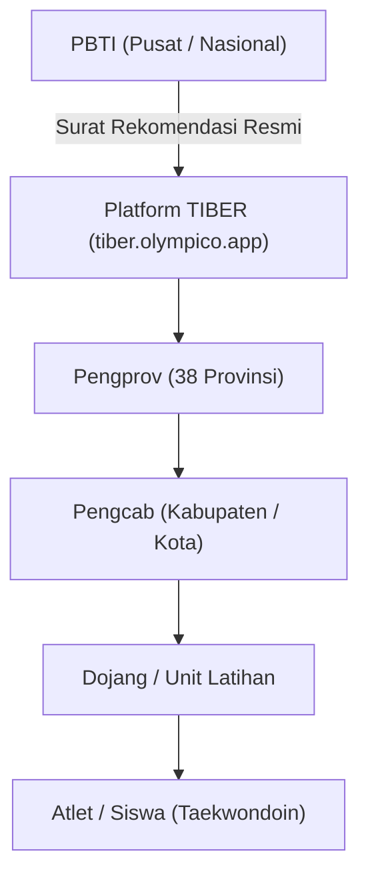
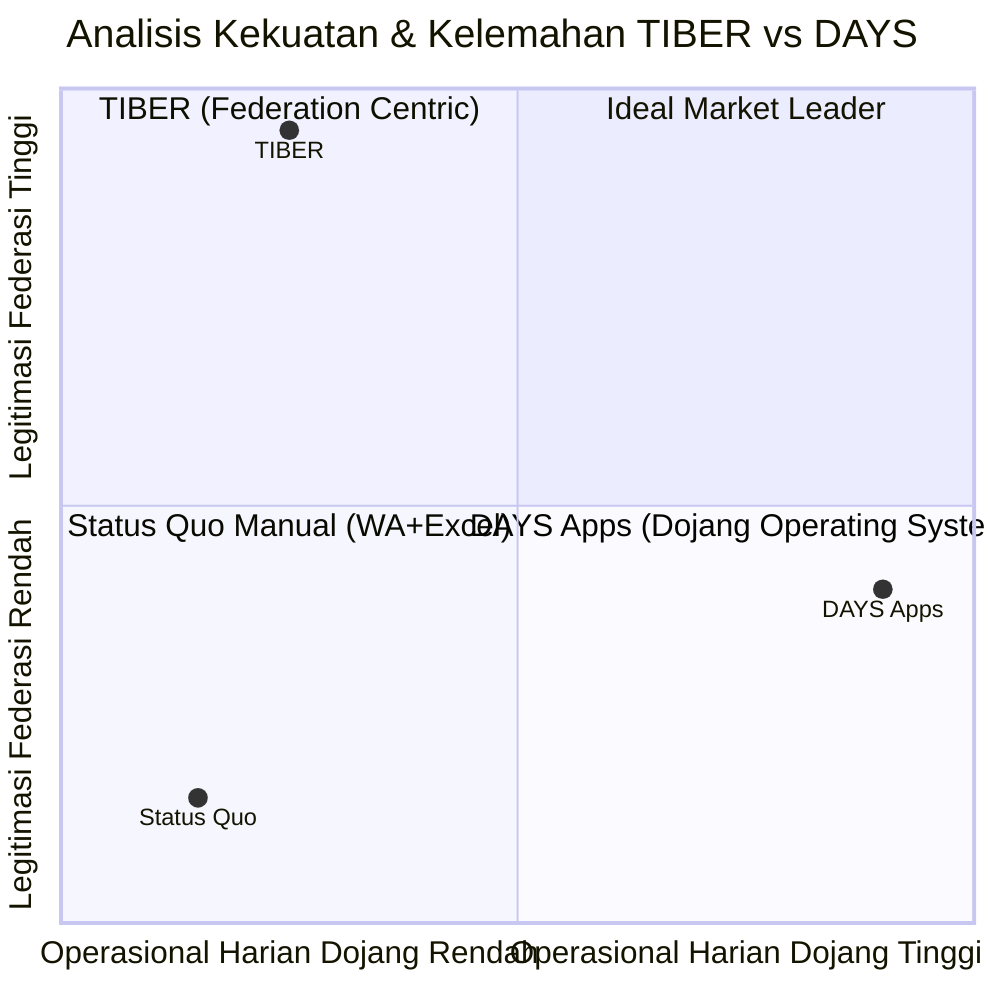

# Competitor Deep-Dive: TIBER (Taekwondo Indonesia Berprestasi)

Dokumen ini membedah secara mendalam aplikasi **TIBER** (`tiber.olympico.app`), posisinya sebagai pemegang surat rekomendasi resmi PBTI untuk Ujian Kenaikan Tingkat (UKT), serta implikasi strategisnya terhadap arsitektur produk **DAYS Apps**.

---

## 1. Profil Kompetitor & Ringkasan Entitas

* **Nama Produk:** TIBER (Taekwondo Indonesia Berprestasi)
* **Entitas Pengembang:** Kerjasama mitra teknologi (Olympico) dengan Pengurus Besar Taekwondo Indonesia (PBTI)
* **Akses Resmi:** [tiber.olympico.app](https://tiber.olympico.app)
* **Status Legalitas:** **Direkomendasikan secara resmi oleh PBTI** sebagai platform digitalisasi Ujian Kenaikan Tingkat (UKT) dan pangkalan data anggota Taekwondo tingkat nasional.
* **Cakupan Pengguna:** 38 Pengprov, ratusan Pengcab, ribuan Dojang, serta puluhan ribu praktisi Taekwondo di seluruh Indonesia.

---

## 2. Fitur & Kapabilitas Utama TIBER

### 2.1 Pendaftaran & Manajemen UKT Digital
* Menggantikan formulir pendaftaran ujian manual (kertas fisik) dan file Excel yang sebelumnya dikirimkan dojang ke Pengcab.
* Dojang mendaftarkan daftar calon peserta UKT lengkap dengan tingkatan sabuk yang dituju (Geup 10 hingga Geup 1, serta persiapan Poom/Dan).
* Memproses verifikasi status aktif anggota sebelum dinyatakan berhak mengikuti ujian.

### 2.2 Digital Scoring & Penilaian Penguji
* Penguji resmi PBTI / Pengcab dapat menginput skor penilaian selama pelaksanaan UKT berlangsung secara digital.
* Mengurangi keterlambatan rekapitulasi nilai ujian fisik di lapangan.

### 2.3 E-Sertifikat Nasional & Verifikasi QR Code Publik
* Sertifikat kelulusan UKT diterbitkan dengan **Nomor Registrasi Resmi PBTI** dan **QR Code unik**.
* Siapa pun (atlet, orang tua, panitia kejuaraan) dapat memindai QR code di situs publik TIBER tanpa perlu login untuk memverifikasi keaslian sabuk atlet.

### 2.4 Pangkalan Data Nasional & Sistem Pembayaran Event
* Manajemen profil pelatih berlisensi, wasit nasional, dan pemilik dojang.
* Pembayaran biaya administrasi UKT / KTA yang terintegrasi ke kas federasi.

---

## 3. Analisis SWOT: Posisi TIBER di Pasar

### 3.1 Kekuatan TIBER (Strengths)
1. **Dukungan Institusi PBTI:** Rekomendasi resmi PBTI memberikan TIBER efek monopoli (*institutional moat*) untuk pengesahan sertifikat UKT tingkat nasional. Dojang yang ingin sertifikatnya diakui PBTI diwajibkan melewati jalur ini.
2. **Jaringan Nasional Terbuka:** Akses langsung ke seluruh struktur Pengcab dan Pengprov se-Indonesia.
3. **Standarisasi Database:** Format data atlet dan tingkatan sabuk seragam secara nasional.

### 3.2 Kelemahan TIBER (Weaknesses & Celah Pasar)
1. **Bukan Sistem Operasional Harian (Event-Centric):** TIBER hanya dibuka dojang **3 sampai 4 kali setahun saat periode UKT**. TIBER tidak dirancang untuk menangani aktivitas harian dojang (senin–sabtu).
2. **Tidak Ada Manajemen SPP Bulanan Dojang:** TIBER mengelola uang ujian federasi, bukan tagihan SPP bulanan dojang, uang kas unit ekskul sekolah, atau honor harian sabeum.
3. **Absen Harian & Keterlibatan Ortu Sangat Minim:** Tidak ada fast-scan QR check-in kedatangan anak dan tidak ada integrasi notifikasi otomatis ke WhatsApp orang tua.
4. **Tidak Menangani Multi-Ranting Ekskul:** Klub besar di Indonesia memiliki unit-unit latihan di banyak sekolah dengan kas terpisah; TIBER melihat dojang sebagai satu entitas administratif kaku.

---

## 4. Implikasi Strategis untuk DAYS Apps

### Apa yang TIDAK BOLEH Dilakukan DAYS:
* **Jangan mencoba menggantikan (*replace*) nomor sertifikat resmi PBTI.** Melawan sistem sertifikasi federasi akan menimbulkan resistensi dari Sabeum yang membutuhkan pengakuan resmi PBTI untuk atletnya.

### Apa yang HARUS Dilakukan DAYS:
1. **Posisikan DAYS sebagai "Dojang Operating System":**
   DAYS adalah sistem harian yang dipakai Sabeum, murid, dan orang tua **setiap hari sepanjang tahun** untuk:
   - Absensi kehadiran cepat dengan notifikasi WhatsApp ke orang tua.
   - Penagihan SPP bulanan otomatis via QRIS.
   - Manajemen ranting ekskul sekolah dan bagi hasil pelatih.
   - Toko penjualan Dobok dan perlengkapan latihan.

2. **Jadikan DAYS sebagai "Feeder / Jembatan" ke TIBER:**
   - DAYS mencatat jam kehadiran siswa sepanjang 3–4 bulan latihan.
   - Saat PBTI membuka periode UKT di TIBER, Sabeum cukup menekan tombol di DAYS:
     > **`[Export Daftar Calon UKT ke Format TIBER PBTI]`**
   - Data nama, NIK, tanggal lahir, sabuk asal, dan bukti kehadiran langsung terekspor rapi sesuai format impor TIBER, menghemat waktu Sabeum berjam-jam.

---

## 5. Rangkuman Skor Parameter Audit TIBER

| Dimensi Parameter | Skor (1–5) | Catatan Kritis |
| :--- | :---: | :--- |
| **Hierarki Sabuk & Legalitas Sertifikat** | **5.0** | Memegang standar resmi PBTI dengan QR verifikasi publik. |
| **Presensi Harian Matras** | **1.5** | Tidak memiliki fitur fast check-in harian di sesi latihan dojang. |
| **Komunikasi WhatsApp ke Orang Tua** | **1.5** | Belum ada integrasi bot notifikasi kehadiran harian ke ortu. |
| **Penagihan SPP Bulanan Dojang** | **1.0** | Tidak melayani penagihan SPP dojang; hanya pembayaran event UKT. |
| **Manajemen Multi-Ranting Ekskul** | **2.0** | Entitas kaku, tidak cocok untuk hierarki klub dengan 15 ranting sekolah. |
| **Kurikulum Video Poomsae Harian** | **2.5** | Fokus pada ujian, belum menjadi media belajar mandiri murid di rumah. |
| **Kemudahan Bagi Pemilik Dojang Harian** | **2.5** | Membantu saat UKT, namun tidak menyelesaikan masalah operasional mingguan. |
