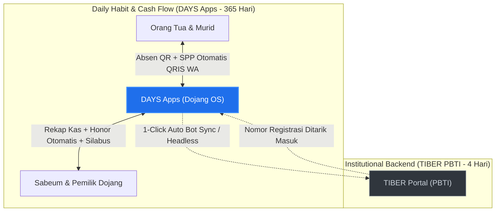

# Strategic Blueprint: Men-disrupsi TIBER & Menguasai Ekosistem Dojang

Dokumen ini menguraikan analisis strategi produk, ekonomi platform, dan manuver pasar agar **DAYS Apps (Dojang Taekwondo Application System)** dapat mematahkan monopoli institusional **TIBER (PBTI)** dan menjadikannya tidak relevan di tingkat operasional dojang.

---

## 1. Problem Statement: Membedah Kekuatan & Titik Lemah TIBER

### 1.1 Kekuatan Semu TIBER
* **Kekuatan:** Memegang surat rekomendasi resmi dari PBTI untuk Ujian Kenaikan Tingkat (UKT) dan e-sertifikat nasional.
* **Sifat Kekuatan:** *Top-Down Institutional Mandate* (berasal dari relasi regulasi politik, bukan kecintaan pengguna).

### 1.2 Titik Lemah Kritis TIBER (The Achilles' Heel)
1. **Low Frequency of Use (Event-Centric):** Hanya dibuka dojang **3 sampai 4 kali setahun** menjelang UKT. Sisa 360 hari lainnya, aplikasi ini tidak disentuh.
2. **Nol Solusi Masalah Dapur Dojang:** Tidak menyelesaikan problem terbesar pemilik dojang: orang tua menunggak SPP, kas unit ekskul bocor, dan buku absen kertas yang hilang.
3. **No Intimate Parental Touchpoints:** Tidak memiliki integrasi WhatsApp harian untuk memberi tahu orang tua saat anak mereka sampai di dojang.
4. **Kerapuhan Politik Organisasi:** Sistem yang bersandar pada rekomendasi kepengurusan federasi rentan kehilangan relevansi saat kepengurusan berganti periode (Munas PBTI).

---

## 2. Peta Arsitektur Disrupsi: "The Disintermediation Loop"

---

## 3. Enam Pilar Strategi Disrupsi

### Pilar 1: Disintermediasi Antarmuka (Headless TIBER)
* **Tujuan:** Buat Sabeum dan orang tua tidak pernah perlu membuka antarmuka TIBER.
* **Taktik:**
  - Bangun formulir pendaftaran UKT internal di DAYS dengan validasi otomatis (kehadiran ≥24 sesi).
  - Saat pendaftaran TIBER dibuka, DAYS menyediakan tombol: **`[Otomatis Sinkronisasi ke TIBER PBTI]`**.
  - Menggunakan script otomasi / API bridging untuk memasukkan data calon peserta langsung ke sistem TIBER di balik layar (*headless execution*).
  - Nomor sertifikat resmi yang terbit di TIBER langsung disedot kembali ke profil siswa di DAYS.
* **Hasil:** TIBER tereduksi menjadi *database bisu di latar belakang*, sementara *customer relationship* 100% dipegang oleh DAYS.

---

### Pilar 2: Monopoli Perputaran Kas & Operasional 365 Hari
* **Tujuan:** Menguasai 95% aliran finansial dojang yang diabaikan oleh TIBER.
* **Taktik:**
  - Integrasikan **WhatsApp Billing + QRIS Dinamis**: Tagihan SPP terbit tiap tanggal 1, langsung terkirim ke WhatsApp orang tua dengan link bayar QRIS yang lunas otomatis.
  - Sediakan fitur **Dojang Store** untuk pemesanan seragam Dobok, sabuk baru, dan pelindung Hogu.
  - Sediakan kalkulator **Bagi Hasil Honor Sabeum Ranting**.
* **Hasil:** Dojang tidak bisa hidup tanpa DAYS karena seluruh sistem kas, gaji pelatih, dan pembayaran siswa terhubung ke DAYS.

---

### Pilar 3: Taekwondoin Digital Passport (Mengikis Esensi Selembar Kertas)
* **Tujuan:** Memberikan bukti pencapaian anak yang jauh lebih membanggakan daripada sekadar e-sertifikat PDF TIBER.
* **Taktik:**
  - Setiap kenaikan tingkat di DAYS dilengkapi dengan **Paspor Digital Interaktif**:
    1. Video rekaman ujian Poomsae anak.
    2. Riwayat log jam latihan fisik selama berbulan-bulan.
    3. Catatan evaluasi langsung dari Sabeum Kepala.
  - Tautan paspor dapat diakses publik dengan visual estetik, siap dibagikan orang tua ke media sosial (Instagram, TikTok, WhatsApp).
* **Hasil:** Orang tua melihat nilai nyata dari proses belajar anak di DAYS, bukan sekadar nomor registrasi kaku di TIBER.

---

### Pilar 4: Ekosistem Kejuaraan Terbuka (Open Circuit Integration)
* **Tujuan:** Menjadikan DAYS syarat utama pendaftaran atlet di turnamen-turnamen prestisius non-monopoli.
* **Taktik:**
  - Bermitra dengan promotor kejuaraan terbuka (Piala Menpora, Walikota Cup, Kejuaraan Nasional Antar-Klub).
  - Terapkan fitur **"Tournament Matchmaking & Weigh-in Engine"** di DAYS: panitia turnamen memverifikasi kelas berat dan sabuk atlet langsung dari profil DAYS.
* **Hasil:** Atlet wajib memiliki profil DAYS aktif agar dapat bertanding di sirkuit turnamen kompetitif.

---

### Pilar 5: Aliansi Militan Pelatih Akar Rumput (Grassroots Moat)
* **Tujuan:** Memenangkan hati Sabeum yang muak dengan beban administratif.
* **Taktik:**
  - Memberikan tier gratis / sangat murah untuk unit dojang rintisan.
  - Membantu Sabeum menagih SPP secara profesional tanpa rasa canggung (*"Aplikasi yang mengingatkan secara sopan, bukan Sabeum yang menagih manual"*).
* **Hasil:** Jika ada pihak yang mencoba memaksakan platform alternatif, ribuan pelatih akan menolak karena DAYS telah menyelesaikan masalah finansial mereka.

---

### Pilar 6: Bottom-Up Federation Flip
* **Tujuan:** Memaksa PBTI membuka API resmi atau menjadikan DAYS mitra utama nasional.
* **Taktik:**
  - Capai milestone **500 dojang dan 50.000 atlet aktif harian**.
  - TIBER hanya memiliki data anggota pasif saat ujian, sedangkan DAYS memegang data *real-time fitness, daily activity,* dan retensi atlet Taekwondo terbesar di Indonesia.
  - Tawarkan ke PBTI integrasi resmi: data nasional PBTI akan selalu akurat secara otomatis jika mengambil data harian dari DAYS.

---

## 4. Matriks Perbandingan Strategis: DAYS vs TIBER

| Fitur / Parameter | Pendekatan TIBER | Pendekatan DAYS (Disrupsi) | Keunggulan Pemenang |
| :--- | :--- | :--- | :--- |
| **Pemicu Penggunaan (Trigger)** | Kewajiban administratif saat UKT (3-4x/thn). | Rutinitas latihan harian, presensi, & SPP (Tiap hari). | **DAYS** (Frekuensi menang mutlak) |
| **Pengalaman Orang Tua** | Hanya login saat daftar & cek sertifikat. | Notifikasi WA saat anak sampai dojang + bayar SPP 1 klik. | **DAYS** (Keterlibatan tinggi) |
| **Arus Kas yang Dikelola** | Biaya administrasi UKT & KTA PBTI. | SPP bulanan dojang, toko seragam, honor pelatih, kas unit. | **DAYS** (Volume uang jauh lebih besar) |
| **Legalitas Sertifikat** | Didukung surat rekomendasi resmi PBTI. | Sertifikat lokal dojang + *Auto-sync* ke TIBER. | **TIBER** (Diakomodasi oleh fitur jembatan DAYS) |
| **Dukungan Ranting Ekskul** | Kaku, berbasis entitas dojang formal. | Fleksibel: 1 Klub induk kelola puluhan unit sekolah. | **DAYS** (Sesuai kultur lokal Indonesia) |

---

## 5. Rencana Aksi Produk Segera (Action Items)

1. **Rancang Modul "UKT Candidate Exporter" di DAYS:** Buat skema database yang memetakan kolom-kolom data yang dibutuhkan formulir TIBER (NIK, Nomor KTA, Sabuk Asal, Tanggal Ujian).
2. **Kembangkan "WhatsApp Daily Attendance Notification":** Prioritaskan integrasi WhatsApp API agar orang tua merasakan langsung nilai tambah DAYS sejak hari pertama anak latihan.
3. **Bangun Profil Publik Atlet Berbasis URL Unik:** Setiap atlet memiliki halaman bio digital (misal: `days.app/atlet/nama-id`) yang menampilkan rekam jejak sabuk, medali, dan validasi dojang.
