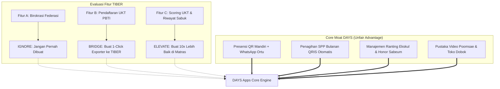

# Product Decision Guide: Meniru vs Membedakan Diri terhadap TIBER

Dokumen ini adalah pedoman arsitektur produk untuk menentukan fitur apa saja dari **TIBER** yang layak diadaptasi, diabaikan, atau dijadikan jembatan (*feeder*) oleh tim pengembang **DAYS Apps**.

---

## 1. Filosofi Strategi: "Asymmetric Competition"

Meniru TIBER secara identik (1:1 feature copy) adalah strategi yang salah karena:
1. **Perbedaan DNA:** TIBER dibangun dari perspektif *birokrasi federasi (top-down)*. DAYS dibangun dari perspektif *kebutuhan operasional klub/dojang (bottom-up)*.
2. **Asimetri Nilai:** Pemilik dojang tidak membayar software untuk menyenangkan federasi; mereka membayar software yang **menghemat waktu mereka dan menaikkan pendapatan kas dojang**.

---

## 2. Matriks Rinci Keputusan Fitur (Feature Decision Matrix)

| Fitur di TIBER | Status untuk DAYS | Rasionalitas Teknis & Bisnis | Implementasi di DAYS |
| :--- | :---: | :--- | :--- |
| **Hierarki Pengprov / Pengcab** | ❌ **IGNORE** | Sangat birokratis dan tidak memberikan nilai operasional harian bagi dojang. | **Dieliminasi total.** Fokus hanya pada hirarki internal: *Dojang Pusat $\rightarrow$ Ranting Sekolah $\rightarrow$ Sabeum $\rightarrow$ Murid*. |
| **Klaim Nomor Sertifikat PBTI** | ❌ **IGNORE** | Berisiko hukum/regulasi jika diklaim sepihak tanpa rekomendasi resmi federasi. | **Tidak diterbitkan sepihak.** DAYS menerbitkan sertifikat internal klub, dan nomor PBTI disinkronisasi dari TIBER. |
| **Form Pendaftaran UKT** | 🔄 **BRIDGE** | TIBER mewajibkan pendaftaran lewat portalnya; meniru form pendaftaran terpisah hanya membuat Sabeum kerja dua kali. | **1-Click TIBER Exporter:** Tombol yang mengekspor data murid yang memenuhi syarat (hadir ≥24x) ke format CSV/Excel TIBER. |
| **Lembar Scoring Ujian Penguji** | 🟢 **ELEVATE** | Form ujian di atas matras sangat dibutuhkan Sabeum untuk mempercepat kelulusan tanpa kertas. | **Digital Scoring Pad:** Antarmuka tablet touch-friendly untuk menguji Poomsae, Kyorugi, dan Fisik dengan kalkulasi nilai otomatis. |
| **Database Profil & Sabuk Atlet** | 🟢 **ELEVATE** | TIBER hanya punya nama dan nomor sertifikat kaku. | **Taekwondoin Digital Passport:** Profil publik estetik lengkap dengan rekaman video jurus, riwayat kehadiran, dan badge prestasi. |
| **Presensi Check-in Harian** | 💎 **OWN (CORE)** | TIBER tidak punya; ini adalah pemicu interaksi harian murid dan dojang. | **Fast QR Scanner (<1.5 detik):** Murid tap kartu, notifikasi instan masuk ke WhatsApp orang tua. |
| **Penagihan SPP Bulanan** | 💎 **OWN (CORE)** | TIBER tidak melayani; ini adalah sumber oksigen utama bisnis dojang. | **Automated WhatsApp Invoicing + QRIS Dinamis:** Rekonsiliasi kas otomatis tanpa kirim bukti transfer. |
| **Manajemen Multi-Ranting Ekskul** | 💎 **OWN (CORE)** | TIBER kaku; klub lokal punya belasan unit latihan di sekolah dengan kas terpisah. | **Multi-Unit Hierarchy:** 1 Akun Klub menaungi banyak unit ranting sekolah dengan pembagian hak akses ketat. |
| **Toko Perlengkapan (Dobok/Hogu)** | 💎 **OWN (CORE)** | TIBER tidak punya; penjualan seragam dan alat adalah margin profit penting dojang. | **Integrated Dojang Pro-Shop:** Katalog dobok, sabuk, pelindung tangan/kaki, dan target kick. |

---

## 3. Spesifikasi Rinci 2 Fitur yang Di-ELEVATE

### 3.1 Digital Scoring Pad (Penilaian UKT di Pinggir Matras)
* **Kebutuhan Penguji:** Di hari H ujian sabuk, penguji biasanya memegang papan ujian kertas dengan pulpen, lalu menghitung rata-rata nilai secara manual (rawan salah hitung).
* **Solusi DAYS:**
  - Sabeum Penguji membuka mode **"Live UKT Session"** di tablet/ponsel.
  - Memilih nomor matras (Matras A / Matras B).
  - Murid dipanggil berdasarkan nomor urut; penguji memberi skor 1–100 pada:
    1. *Gibon Donjak (Kuda-kuda, pukulan, tangkisan)*
    2. *Taegeuk / Poomsae*
    3. *Kyorugi / Step Sparring*
    4. *Fisik & Kedisiplinan (Push-up, kelenturan)*
  - Begitu tombol **"Lulus"** ditekan, tingkatan Geup murid di sistem DAYS otomatis naik ke level berikutnya, dan grafik kelulusan langsung tampil di layar proyektor dojang.

### 3.2 Taekwondoin Digital Passport
* **Kebutuhan Orang Tua:** Orang tua zaman sekarang ingin memamerkan pencapaian anak mereka di media sosial.
* **Solusi DAYS:**
  - URL publik unik: `days.app/p/[slug-atlet]`
  - Menampilkan:
    - Sabuk saat ini dengan animasi visual sabuk Taekwondo.
    - Riwayat tanggal kenaikan tingkat dari sabuk putih hingga sabuk terakhir.
    - Cuplikan video pendek 15 detik gerakan Poomsae anak saat ujian.
    - Total sesi latihan yang telah diselesaikan (*"Telah menyelesaikan 142 jam latihan Taekwondo"*).
    - Tombol *"Bagikan ke WhatsApp Status / Instagram Story"*.

---

## 4. Kesimpulan Rekomendasi Eksekusi

1. **Sprint 1–3 (Bulan 1):** Jangan sentuh urusan TIBER sama sekali. Fokus 100% pada **Presensi Scan QR + WhatsApp Ortu + Penagihan SPP QRIS**. Ini adalah fondasi retensi dan monetisasi dojang.
2. **Sprint 4–5 (Bulan 2):** Bangun **Multi-Unit Ranting Ekskul + Dojang Pro-Shop (Seragam & Alat)**.
3. **Sprint 6 (Menjelang Musim UKT):** Bangun **Digital Scoring Pad + 1-Click TIBER Exporter**. Saat musim UKT tiba, Sabeum merasakan keajaiban: data murid selama 3 bulan latihan langsung siap kirim ke TIBER tanpa ketik ulang satu pun.
