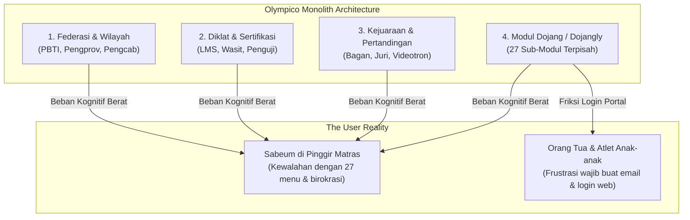
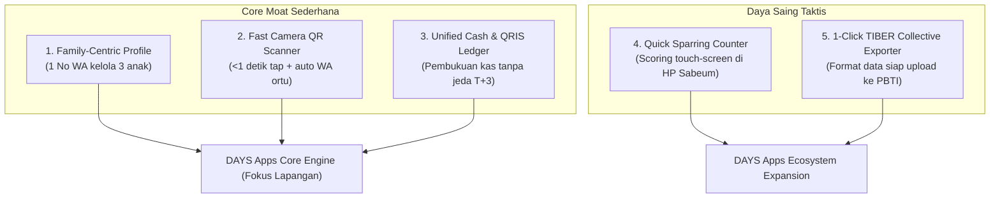

# Deep Teardown & Kelemahan Arsitektur Olympico / Dojangly (TIBER)

Dokumen ini memuat analisis forensik produk dan arsitektur terhadap platform **Olympico / Dojangly** (penyedia infrastruktur teknologi **TIBER** dan modul PBTI), berdasarkan dokumentasi resmi produk per 13 Oktober 2026. Analisis ini menyoroti kelemahan sistemik (*structural weaknesses*) dan menjadi landasan perancangan keunggulan kompetitif bagi **DAYS Apps**.

---

## 1. Executive Summary & Cakupan Monolitik Olympico

Olympico mengoperasikan arsitektur *all-in-one multi-tenant enterprise* yang melayani empat level sekaligus:
1. **Modul Federasi & Wilayah:** Command Center PBTI Nasional, Pengurus Provinsi (Pengprov), dan Pengurus Cabang (Pengcab).
2. **Modul Diklat & Sertifikasi Pelatih:** LMS online, kuis modul, rubrik penguji, dan e-sertifikat PBTI.
3. **Modul Kejuaraan & Pertandingan:** Pendaftaran kelas (Kyorugi, Poomsae, Freestyle, Breaking, Festival), timbang badan, bagan otomatis (*single elimination*), kode juri lapangan, dan papan skor videotron.
4. **Modul Dojang (Dojangly):** Platform manajemen klub dengan 27 sub-modul (termasuk absensi, iuran bulanan, toko dobok, tabungan, donasi, inventaris, dan wawasan AI).

Meskipun terlihat sangat lengkap secara fungsional di atas kertas, analisis dokumentasi manual resmi membuktikan bahwa sistem ini memiliki **cacat fundamental dalam hal pengalaman pengguna akar rumput (*grassroots UX*) dan ketahanan infrastruktur di lapangan**.

---

## 2. Bedah 6 Kelemahan Fatal Sistemik

### 2.1 Kelemahan 1: The Sibling & Multi-Child Identity Trap
* **Bukti Teknis di Manual:**
  * *Panduan Diklat (hal. 23):* *"Jangan memakai satu email untuk banyak peserta. Email adalah identitas akun. Bila dua peserta memakai email yang sama, sertifikat dan nilai akan tertumpuk pada satu akun dan sulit dipisahkan."*
  * *Panduan Modul Dojang (hal. 4, 10, & 12):* Setiap anggota wajib memiliki email unik agar bisa login ke portal.
* **Analisis Cacat Arsitektur:**
  Arsitektur basis data Olympico menggunakan `email` sebagai *unique foreign key* utama identitas pengguna (*1 email = 1 member*). Ini adalah kesalahan fatal untuk domain olahraga bela diri anak:
  - Mayoritas atlet Taekwondo pemula berusia **5 sampai 12 tahun** yang **belum memiliki email pribadi**.
  - Banyak keluarga mendaftarkan **2 sampai 3 anak sekaligus (kakak-beradik / sibling)** di dojang yang sama.
  - Orang tua terpaksa membuat email Gmail baru untuk anak usia 6 tahun hanya agar bisa terdaftar di Dojangly.
* **Dampak Bisnis:** Resistensi tinggi dari orang tua murid saat proses pendaftaran awal (*high onboarding drop-off*).

---

### 2.2 Kelemahan 2: Total Internet Dependency (Zero Offline-First Resilience)
* **Bukti Teknis di Manual:**
  * *Panduan Kejuaraan (hal. 24):* *"Berat sudah diisi tapi tidak tersimpan? Koneksi internet terputus saat menyimpan. Catat di kertas, lalu input ulang setelah sinyal kembali."*
  * *Panduan Kejuaraan (hal. 33):* *"Bagaimana kalau internet mati di lapangan? Catat skor di kertas, lalu input ulang setelah koneksi kembali sebelum partai berikutnya dimulai."*
  * *Panduan Modul Dojang (hal. 19):* *"Apakah absensi bisa dicatat tanpa internet? Catat di kertas lalu masukkan setelah koneksi kembali."*
  * *Panduan Diklat (hal. 34):* *"Bisakah menilai tanpa internet? Tidak; pastikan jaringan di ruang penilaian stabil."*
* **Analisis Cacat Arsitektur:**
  Olympico dibangun sebagai aplikasi web konvensional yang mengandalkan koneksi HTTP *client-server* aktif terus-menerus. Tidak ada arsitektur *Local-First (IndexedDB / SQLite local caching + Background Sync)*.
  - Fasilitas olahraga Taekwondo di Indonesia (GOR kabupaten, aula sekolah pinggiran, basement gedung) sering kali **fakir sinyal atau sinyal terputus**.
  - Ketika sinyal hilang, sistem langsung lumpuh total dan memaksa panitia kembali ke zaman batu (*kertas dan pulpen*).

---

### 2.3 Kelemahan 3: Heavy Web Portal Friction vs WhatsApp Dominance
* **Bukti Teknis di Manual:**
  * *Panduan Modul Dojang (hal. 20–21, 38–40, 48–50):* Seluruh aktivitas orang tua (melihat tagihan SPP, melakukan pembayaran, memantau absensi anak, mengunduh sertifikat, mengumpulkan PR video) mewajibkan orang tua membuka peramban web dan login ke portal `olympico.app`.
* **Analisis Cacat Arsitektur:**
  Dojangly gagal mengadopsi budaya komunikasi lokal Indonesia yang 99% hidup di **WhatsApp**.
  - Orang tua milenial sibuk; mereka tidak mau mengingat email dan password akun tambahan.
  - Tagihan yang hanya tampil di dalam web portal tersembunyi berakibat pada tunggakan iuran yang tetap tinggi karena orang tua lupa membuka portal.

---

### 2.4 Kelemahan 4: Political Sandbagging & Ketergantungan Izin Pengcab
* **Bukti Teknis di Manual:**
  * *Panduan Modul Dojang (hal. 6, 9, & 27):* Dojang yang baru mendaftar **tidak dapat menggunakan menu UKT dan Kejuaraan** sebelum diverifikasi dan diaktifkan izinnya oleh Pengurus Cabang (Pengcab) wilayahnya:
  > *"Dojang belum terhubung ke Pengcab... Belum bisa membuat UKT sendiri. Silakan hubungi Pengcab untuk mengaktifkan izin ini."*
* **Analisis Cacat Arsitektur:**
  Desain *top-down permission gatekeeper* menyandera dojang independen. 
  - Jika pengurus Pengcab di kota tersebut sedang konflik politik internal, lambat bekerja, atau tidak melek teknologi, dojang-dojang di bawahnya ikut lumpuh dan tidak bisa menjalankan aktivitas resmi di aplikasi.
  - Dojang merasa kehilangan otonomi klub (*club sovereignty*).

---

### 2.5 Kelemahan 5: Dual-Bookkeeping Kas Tunai vs T+3 Bank Settlement Delays
* **Bukti Teknis di Manual:**
  * *Panduan Modul Dojang (hal. 22–24):* Pembayaran tunai di dojang dicatat sebagai arsip kas, tetapi **TIDAK menambah saldo dojang yang bisa dicairkan**.
  * Dana pembayaran online baru masuk ke saldo yang bisa ditarik setelah masa tunggu **T+3 hari kerja** (belum termasuk akhir pekan dan hari libur nasional).
  * Pencairan dana mewajibkan proses verifikasi email 6 digit dan pencocokan rekening yang ketat.
* **Analisis Cacat Arsitektur:**
  Ekonomi dojang bela diri membutuhkan likuiditas cepat:
  - Pelatih sering kali harus membelikan konsumsi atlet, membayar sewa gedung per hari latihan, atau membagikan honor sabeum asisten secara langsung.
  - Penahanan dana T+3 dan pemisahan kaku pembukuan kas fisik menciptakan friksi manajemen keuangan yang membuat Sabeum pusing melakukan rekonsiliasi harian.

---

### 2.6 Kelemahan 6: Enterprise Bloat & Cognitive Overload
* **Bukti Teknis di Manual:**
  * *Panduan Modul Dojang (hal. 61–73, 82–84):* Terdapat fitur yang sangat jarang digunakan oleh dojang operasional, seperti:
    - Pembelian saldo **Kredit AI Insight** (yang diakui di manual: *"hasil analisis terasa terlalu umum... kredit habis di tengah bulan"*).
    - Modul **Tabungan Anggota** terpisah.
    - Modul **Donasi & Penggalangan Dana**.
    - Modul **Peminjaman Inventaris Matras/Protektor**.
    - Modul **AI Agent Chatbot Customer Service**.
* **Analisis Cacat Arsitektur:**
  Dojangly menderita penyakit klasik software enterprise: **terlalu banyak fitur (feature creep)** yang membuat antarmuka menjadi rumit, navigasi berbelit, dan waktu belajar pengguna (*learning curve*) menjadi sangat curam.

---

## 3. Komparasi Solusi Teknis: Dojangly vs DAYS Apps

| Dimensi Arsitektur | Pendekatan Olympico / Dojangly | Solusi Rekayasa Unggulan DAYS Apps |
| :--- | :--- | :--- |
| **Model Identitas Akun** | 1 Email = 1 Anggota kaku (merugikan anak & keluarga). | **Family Account Architecture:** 1 Nomor WhatsApp/Akun Ortu menaungi multi-anak (Kakak-Adik) dalam satu dasbor. |
| **Ketahanan Jaringan** | 100% Cloud-Dependent (Koneksi putus $\rightarrow$ catat di kertas). | **Local-First PWA (IndexedDB / SQLite Sync):** Presensi, scoring sparring, dan catatan timbang badan berjalan 100% tanpa internet. |
| **Kanal Komunikasi Ortu** | Wajib buka browser dan login ke portal web. | **Headless WhatsApp Gateway:** Tagihan, invoice, kartu hadir, dan video rekaman ujian dikirim langsung ke WhatsApp. |
| **Model Pembukuan Kas** | Kas tunai vs saldo online terpisah kaku + pencairan T+3. | **Unified Single Ledger:** Rekonsiliasi kas tunai & QRIS satu atap dengan pencairan instan (*Same-Day / D+0*). |
| **Otonomi Klub vs Federasi** | Tersandera approval manual Pengcab. | **Autonomous Dojang First:** Dojang langsung aktif dan beroperasi 100% mandiri sejak detik pertama pendaftaran. |
| **Kompleksitas Antarmuka** | 27 modul padat dengan sistem kredit AI tambahan. | **Streamlined 3-Pillar UI:** Fokus pada **Presensi Cepat, SPP Lancar, dan Kurikulum Sabuk**. |

---

## 4. Peta Peningkatan Prioritas Produk DAYS Apps

Berdasarkan temuan manual kompetitor, DAYS Apps harus fokus mengeksekusi fitur-fitur pembeda berikut:

### Prioritas 1: Family-Centric Multi-Child Architecture
* Satu profil orang tua (berbasis nomor WhatsApp) dapat mengelola profil beberapa anak sekaligus.
* Invoice SPP terbit secara agregat (*Family Invoice*), sehingga orang tua cukup membayar satu kali transaksi QRIS untuk seluruh anaknya.

### Prioritas 2: Zero-App Onboarding & WhatsApp Real-Time Notification
* Orang tua tidak perlu menginstal aplikasi atau mengingat kata sandi portal web.
* Setiap kali anak memindai kartu QR di dojang, bot WhatsApp resmi DAYS langsung mengirim pesan:
  > *"Halo Ayah/Ibu, Ananda Dimas telah tiba di Dojang Taekwondo pukul 16.05 WIB. Selamat berlatih!"*

### Prioritas 3: 1-Click TIBER Collective Exporter
* DAYS tidak perlu melawan sistem TIBER PBTI.
* Mengacu pada manual *TIBER Kolektif (hal. 76–79)*, DAYS menyediakan fitur ekspor satu klik:
  > **`[Unduh File Excel Format TIBER Kolektif PBTI]`**
* Format kolom, format tanggal, dan kode sabuk langsung cocok 100% dengan kebutuhan portal TIBER, menghemat waktu Sabeum berjam-jam saat musim aktivasi PBTI tiba.

### Prioritas 4: Quick Sparring & Internal Match Counter
* Mengacu pada rumitnya alur kejuaraan Dojangly (52 halaman manual), DAYS menghadirkan **Quick Sparring Counter**:
  - Pelatih membuka aplikasi di ponsel/tablet.
  - Tap layar untuk poin sudut biru (*Chung*) dan sudut merah (*Hong*).
  - Ronde dan waktu berjalan langsung di layar ponsel.
  - Selesai sparring, hasil tersimpan otomatis ke rekam jejak performa atlet tanpa birokrasi pendaftaran kelas yang rumit.

---

[← 01-strategy-disrupting-tiber.md](file:///c:/Users/susen/Documents/githublab/days/content/ideas/competitor%20review/tiber/01-strategy-disrupting-tiber.md) | [Overview Parameters](file:///c:/Users/susen/Documents/githublab/days/content/ideas/competitor%20review/market-competitor-parameters.md) | [02-feature-parity-vs-differentiation.md →](file:///c:/Users/susen/Documents/githublab/days/content/ideas/competitor%20review/tiber/02-feature-parity-vs-differentiation.md)
