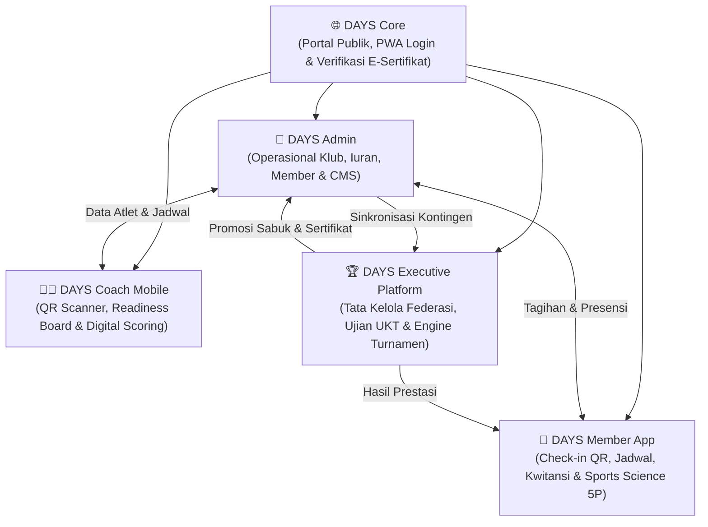
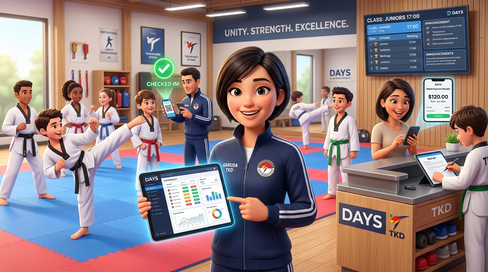

# 🥋 DAYS — Enterprise Martial Arts Management Ecosystem

> **Official Portal & Website:** [https://dojang.warsootech.com](https://dojang.warsootech.com)  
> 📍 **Navigasi Cepat:** [🏠 Overview](00-overview.md) • [🏗️ 01-Arsitektur](01-architecture-and-techstack.md) • [💎 02-Nilai & Monetisasi](02-value-system-and-monetization.md) • [🗺️ 03-Roadmap](03-roadmap.md) • [⚡ Fitur (FR-01 s/d 07)](features/FR-01-user-authentication.md) • [📸 Showcase UI](modules/days-admin/SHOWCASE.md)

## 1. Problem Statement

Operasional ekosistem beladiri (khususnya Taekwondo) di Indonesia saat ini masih terfragmentasi, manual, dan rentan terhadap inefisiensi birokrasi pada seluruh lapis pemangku kepentingan:

1. **Tingkat Unit Dojang (Klub/Dojang Grassroots):**
   - Presensi murid dan pelatih masih mengandalkan buku tulis atau spreadsheet manual yang rawan hilang dan sulit direkap.
   - Penagihan iuran bulanan tidak terpantau secara real-time; pengurus harus menagih manual via WhatsApp, menyebabkan tingginya angka tunggakan (*unpaid dues*).
   - Data biodata, berat/tinggi badan, dan riwayat sabuk murid tersebar di berbagai catatan terpisah.
   - Promosi dojang terbatas pada media sosial personal tanpa adanya profil website profesional atau verifikasi keanggotaan resmi.

2. **Tingkat Pelatih Lapangan (Sabeum / Coach):**
   - Waktu latihan habis untuk absensi manual nama per nama.
   - Tidak memiliki visibilitas terhadap kesiapan fisik murid (*athlete readiness*) sebelum sesi latihan intensif atau sparring, meningkatkan risiko cedera.
   - Penilaian simulasi pertandingan (*Kyorugi*), jurus (*Poomsae*), dan pemecahan (*Kyukpa*) hanya dicatat di kertas tanpa riwayat statistik perkembangan atlet.
   - Kurikulum pengajaran tidak seragam antar-pelatih dalam satu dojang.

3. **Tingkat Murid & Orang Tua (Member / Parent):**
   - Murid dan orang tua sering lupa jadwal latihan atau perubahan sesi mendadak.
   - Ketidakjelasan status pembayaran tagihan iuran dan tagihan event, serta ketiadaan bukti pembayaran/kwitansi digital resmi.
   - Atlet tidak memiliki sarana mencatat beban latihan (*Session-RPE*), pemulihan nutrisi/tidur, dan riwayat cedera secara mandiri.

4. **Tingkat Penyelenggara Event & Ujian (Komite UKT / EO Kejuaraan):**
   - Technical meeting pembuatan bagan turnamen (*drawing*) memakan waktu hingga larut malam karena dilakukan secara manual atau semi-otomatis tanpa proteksi bentrok antar-rekan satu kontingen.
   - Penimbangan badan (*weigh-in*) dan antrean panggilan atlet (*call room*) sering kacau, menyebabkan *arena downtime* (gelanggang kosong menunggu atlet).
   - Penerbitan sertifikat hasil UKT/kejuaraan memakan waktu berminggu-minggu karena proses pengetikan satu per satu.
   - Klub luar/tamu kesulitan mendaftar jika dipaksa membuat akun dojang terlebih dahulu.

5. **Tingkat Federasi Cabang & Wilayah (Pengcab / Pengprov / PBTI):**
   - Ketiadaan data sensus terpadu; sulit memvalidasi keaktifan dojang (*ghost dojangs*) dan jumlah riil praktisi beladiri di wilayah yurisdiksi.
   - Maraknya sengketa mutasi atlet ilegal menjelang Pekan Olahraga Daerah (Porprov/PON) akibat lemahnya audit trail dokumen kepindahan atlet.

---

## 2. Value Proposition & System Differentiation

DAYS ([dojang.warsootech.com](https://dojang.warsootech.com)) hadir sebagai **Sistem Operasi Beladiri Terpadu (Unified Multi-Sided Sports OS)** yang menyatukan 5 peran sentral ke dalam satu arsitektur terintegrasi:

*Gambar 1.1: Ilustrasi Ekosistem Terpadu DAYS — Menghubungkan Manajemen Dojang, Presensi QR Pelatih, Pembayaran Iuran Digital Wali Murid, dan Papan Nilai Kejuaraan.*

### Nilai Pembeda Kunci (Unfair Advantages):
1. **Single Source of Truth Atlet:** Profil atlet, rekam jejak berat/tinggi badan, riwayat sabuk, dan lisensi PBTI terpusat. Ketika mendaftar UKT atau kejuaraan, data di-*lookup* secara instan tanpa re-entry.
2. **Integrated Sports Science:** Memadukan metodologi *Athlete Readiness 5P* (Tidur, Energi, Nyeri Otot, Stres, Kesiapan Mental) dan kalkulasi *Session-RPE* ke level dojang grassroots.
3. **Dual-Mode Hybrid Tournament Engine:** Memfasilitasi pendaftaran atlet internal dojang secara otomatis sekaligus menerima kontingen eksternal via import template Excel terstandardisasi.
4. **Instant Zero-Downtime Event Operations:** Algoritma auto-drawing bagan netral, live scoreboard TV arena beresolusi tinggi, mitigasi protes wasit digital, dan export *1-Click Official Result Book PDF* tepat saat penutupan acara.
5. **Geospatial Governance & Health Index:** Peta sebaran dojang wilayah dan algoritma *Predictive Dojang Health Index* (0–100) berbasis *Monthly Active Users* (MAU) presensi riil.

---

## 3. Matriks Transformasi Operasional (Before vs. After DAYS)

Untuk membuktikan signifikansi kegunaan sistem bagi para pengambil keputusan (Dojang Owner, Pelatih, Wali Murid, EO, dan Pengcab), berikut perbandingan terukur sebelum dan sesudah implementasi DAYS:

| Aspek Operasional | Metode Tradisional / Manual | Solusi Terpadu DAYS | Dampak Terukur (Impact) |
| :--- | :--- | :--- | :--- |
| **Presensi & Sesi Latihan** | Catatan buku fisik / kertas robek; pelatih membuang 15 menit per sesi untuk memanggil nama. | Scan QR otomatis via ponsel pelatih (<1 detik per murid) dengan audio-visual feedback. | **Menghemat 12–15 jam/bulan** waktu pelatih untuk fokus melatih teknik & sparring. |
| **Penagihan Iuran Bulanan** | Tagihan manual via WhatsApp personal; bukti transfer dicek manual di mutasi m-banking; banyak lupa bayar. | Invoice digital terbit otomatis tanggal 1, pengingat WhatsApp terintegrasi, pembayaran instan QRIS/VA, kwitansi digital ber-QR. | **Pemulihan tunggakan 40–60%** dalam 30 hari; arus kas dojang sehat tanpa rasa canggung menagih. |
| **Pemantauan Kondisi Atlet** | Pelatih tidak tahu anak begadang/kelelahan; risiko cedera tinggi saat sparring kontak keras. | Log harian mandiri *Athlete Readiness 5P* di ponsel atlet; Coach dashboard menampilkan status *Traffic Light* (Hijau/Kuning/Merah). | **Menekan risiko cedera hingga 45%** dan mempersonalisasi beban latihan (*Session-RPE*). |
| **Drawing Bagan Kejuaraan** | Drawing manual di kertas/Excel hingga larut malam; rawan protes atlet satu klub saling gugur di babak awal. | Algoritma *Smart Bracket Generator* (<5 detik untuk 1.000 atlet) dengan proteksi anti-bentrok rekan satu dojang (*club separation*). | **Nol protes kontingen**; Technical Meeting selesai 3 jam lebih cepat. |
| **Operasional Gelanggang GOR** | Wasit mencatat di kertas; panitia bolak-balik panggil atlet via pengeras suara; GOR molor 3–4 jam (denda overtime sewa). | Live digital scoring sync via WebSockets ke TV Display arena; monitor antrean atlet di call room ponsel. | **Nol denda overtime sewa GOR** (hemat Rp 3–6 juta per event); jadwal selesai tepat waktu. |
| **Penerbitan Sertifikat (UKT/Event)** | Ketik manual satu per satu berminggu-minggu; sertifikat kertas rawan dipalsukan. | Batch generate ratusan E-Sertifikat PDF ber-QR verifikasi publik resmi dalam 1 klik. | Selesai tepat saat upacara penutupan kejuaraan. |

---

## 4. Target User Personas

| Persona | Peran Utama | Kebutuhan & Masalah Utama | Modul Penggunaan |
| :--- | :--- | :--- | :--- |
| **Sabeum Handoko (Pemilik & Pelatih Kepala Dojang)** | Owner / Head Coach | Memantau kas iuran, mengurangi tunggakan, mendistribusikan jadwal pelatih, dan mengelola banyak cabang latihan. | **Dojang Admin** & **Coach App** |
| **Sabeum Rendy (Pelatih Lapangan)** | Field Instructor | Presensi cepat, memantau kondisi fisik atlet sebelum sparring berat, scoring digital saat uji tanding internal. | **Coach App** |
| **Bima (Atlet Kyorugi Remaja)** | Kompetitor / Siswa | Jadwal latihan akurat, mencatat berat badan harian, log nyeri otot/cedera, dan memantau bagan pertandingan. | **Member App** |
| **Ibu Sinta (Orang Tua Murid)** | Wali Murid | Memastikan anak hadir latihan, membayar iuran secara transparan, menerima kwitansi digital, dan melihat foto latihan. | **Member App** & **Core Portal** |
| **Master Wijaya (Ketua Komisi Pertandingan / EO)** | Tournament Director | Menjalankan turnamen 1.000+ peserta tanpa molor, drawing adil, live scoring TV tanpa hardware mahal, buku hasil instan. | **Executive Tournament** |
| **Ir. Bambang (Ketua Pengcab Taekwondo)** | Regulator Federasi | Mengetahui jumlah pasti dojang aktif, menghentikan sengketa mutasi atlet, memungut retensi daerah berbasis MAU riil. | **Executive Federasi** |

---

## 5. Core Success Metrics & Business KPIs

### A. Key Performance Indicators (Teknis & Operasional)
- **Drawing Latency:** Algoritma auto-drawing menyelesaikan bagan 1.000 peserta dalam `< 5 detik`.
- **Scoreboard Sync Latency:** Live streaming poin dari terminal operator ke Scoreboard TV `< 150 ms` via WebSocket lokal/cloud.
- **QR Scan Throughput:** Pemindaian QR absensi atau checkpoint timbang badan memakan waktu `< 2 detik` per orang.
- **Result Book Generation:** Ekspor PDF Buku Hasil Resmi 100+ halaman selesai dalam `< 10 detik`.
- **System Uptime:** Uptime SLA minimal `99.9%` selama jam operasional event kejuaraan.

### B. Business & Monetization Metrics
- **Dojang Dues Recovery Rate:** Penurunan angka tunggakan iuran anggota minimal `40%` dalam 30 hari pasca onboarding.
- **Administrative Time Saved:** Menghemat hingga `70%` jam kerja administrasi dojang dan meja pertandingan turnamen.
- **MAU Retention:** Rasio retensi pengguna aktif bulanan di atas `85%` pada dojang binaan.
- **Event Adoption Viral Loop:** Rata-rata 1 kejuaraan terbuka yang menggunakan sistem mengonversi minimal `15%` kontingen tamu menjadi pelanggan aktif Dojang Admin.

---

## 6. Peta Dokumen & Indeks Arsitektur Sistem

Seluruh spesifikasi sistem DAYS dirancang secara modular dan dapat ditelusuri melalui matriks dokumen di bawah ini:

| No | Modul / Dokumen | Tipe Spesifikasi | Deskripsi Ringkas |
| :---: | :--- | :--- | :--- |
| **00** | [Ikhtisar Sistem (Overview)](00-overview.md) | Dokumen Induk | Problem statement, value proposition, transformasi operasional, dan KPI. |
| **01** | [Arsitektur & Tech Stack](01-architecture-and-techstack.md) | Arsitektur Teknis | Topologi sistem, ERD database PostgreSQL, keamanan RBAC, & latensi arena. |
| **02** | [Sistem Nilai & Monetisasi](02-value-system-and-monetization.md) | Analisis Bisnis | Unit economics dojang Indonesia, mitigasi denda GOR, COGS, dan pricing SaaS. |
| **FR-01** | [Autentikasi & Smart RBAC](features/FR-01-user-authentication.md) | Spesifikasi Fitur | Single sign-on gerbang tunggal dengan multi-role routing otomatis. |
| **FR-02** | [Manajemen Operasional Dojang](features/FR-02-dojang-operational-management.md) | Spesifikasi Fitur | Registrasi atlet, kartu sabuk, penagihan iuran QRIS, dan profil website. |
| **FR-03** | [Coach Scanner & Digital Scoring](features/FR-03-coach-scanner-and-scoring.md) | Spesifikasi Fitur | Scan presensi kamera PWA, scoring latihan, dan evaluasi kurikulum. |
| **FR-04** | [Sports Science & Member Hub](features/FR-04-athlete-readiness-and-member-hub.md) | Spesifikasi Fitur | Readiness 5P, Session-RPE, kartu QR murid, dan riwayat medali. |
| **FR-05** | [Tournament Engine & Live Arena](features/FR-05-tournament-bracket-and-live-scoring.md) | Spesifikasi Fitur | Algoritma drawing sistem gugur, timbang badan, dan scoreboard TV. |
| **FR-06** | [Tata Kelola Federasi & E-Sertifikat](features/FR-06-federation-governance-and-e-cert.md) | Spesifikasi Fitur | Peta GIS Pengcab, kliring mutasi atlet resmi, dan sertifikat ber-QR. |
| **FR-07** | [Manajemen Pelatih & Honor Sesi](features/FR-07-coach-and-freelance-management.md) | Spesifikasi Fitur | Pelatih tetap vs lepas, substitusi jadwal, dan honorarium pay-per-session. |
| **UI** | [Showcase Visual DAYS Admin](modules/days-admin/SHOWCASE.md) | Bukti Antarmuka | Galeri screenshot dan interaksi modul manajemen klub operasional. |
| **03** | [Roadmap Pengembangan Produk](03-roadmap.md) | Rencana Rilis | MVP Milestone, Phase 1 (Turnamen/Sports Science), & Phase 2 (Skala). |

---

## Navigasi Dokumen

[Ikhtisar Sistem (Overview)](00-overview.md) | [01-Arsitektur & Tech Stack →](01-architecture-and-techstack.md) | [02-Sistem Nilai & Monetisasi →](02-value-system-and-monetization.md) | [03-Roadmap Produk →](03-roadmap.md)
