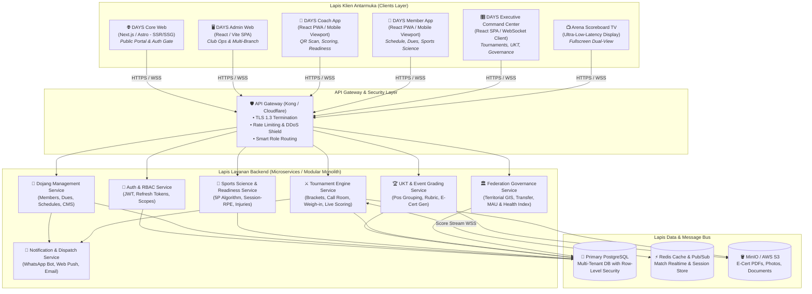
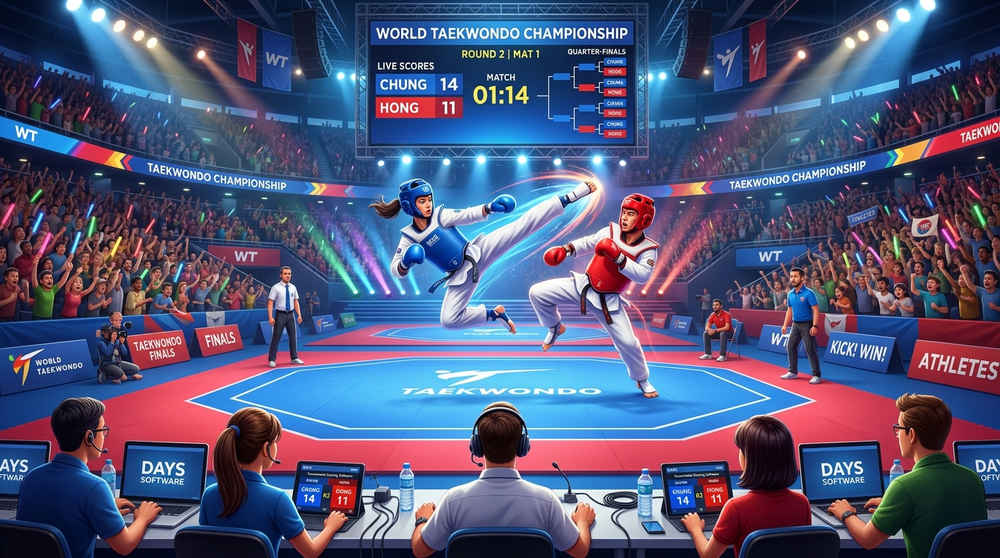
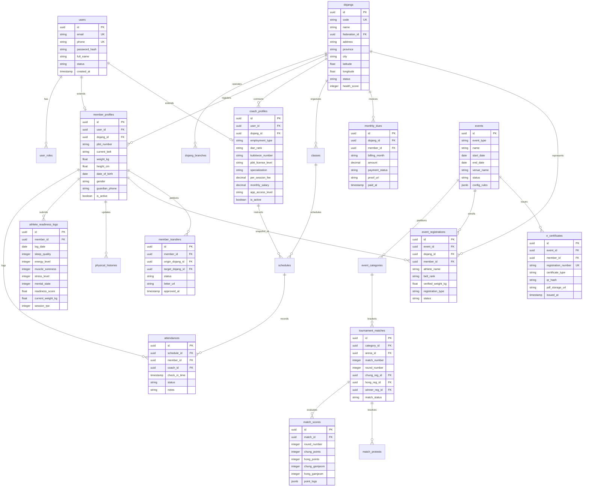

# 🏗️ Arsitektur Sistem & Tech Stack — DAYS

> **Official Portal & Website:** [https://dojang.warsootech.com](https://dojang.warsootech.com)  
> 📍 **Navigasi Cepat:** [🏠 Overview](00-overview.md) • [🏗️ 01-Arsitektur](01-architecture-and-techstack.md) • [💎 02-Nilai & Monetisasi](02-value-system-and-monetization.md) • [🗺️ 03-Roadmap](03-roadmap.md) • [⚡ Fitur (FR-01 s/d 06)](features/FR-01-user-authentication.md) • [📸 Showcase UI](modules/days-admin/SHOWCASE.md)

## 1. Arsitektur Topologi Sistem (System Topology)

Ekosistem **DAYS** ([dojang.warsootech.com](https://dojang.warsootech.com)) mengusung arsitektur *Modular Micro-Frontend with Unified High-Resilience Backend*. Sistem memisahkan pengalaman pengguna ke dalam portal publik yang ringan, mobile apps untuk aktivitas lapangan, dan modul web komando untuk pengelolaan administrasi dan event skala besar:

*Gambar 2.1: Ilustrasi Digital Arena Kejuaraan — Mengintegrasikan Terminal Scoring Meja Wasit, Live LED Scoreboard TV Arena, dan Smart Bracket Engine.*

---

## 2. Skema Database Terintegrasi (Entity-Relationship Diagram)

---

## 3. Tech Stack & Ekosistem Pustaka

| Layer | Teknologi / Pustaka | Alasan Pemilihan & Kegunaan |
| :--- | :--- | :--- |
| **Public Frontend (Core)** | **Next.js 15 (App Router) / React 19** | Server-Side Rendering (SSR) & Static Generation untuk SEO optimal, landing page cepat dimuat, dan metadata dinamis. |
| **Admin & Executive Web** | **Vite + React SPA + TypeScript + Tailwind CSS** | Kompilasi kilat, bundling efisien, typed security tinggi, komponen rich UI dashboard komando. |
| **Mobile PWA (Coach & Member)** | **React PWA + Tailwind CSS + Lucide Icons + Workbox** | Instalasi 1-klik PWA pada smartphone tanpa biaya komisi App Store/Play Store, akses kamera scanner offline-ready. |
| **Backend & Microservices** | **Go (Golang) / Node.js (NestJS)** | Kecepatan concurrency tinggi untuk engine drawing & socket scoring (Go), dan produktivitas modular CRUD (NestJS). |
| **Database Primer** | **PostgreSQL 16 (PostGIS Extension)** | Integritas transaksi ACID, Row-Level Security (RLS) multi-tenant, dan PostGIS untuk peta geospasial territorial federasi. |
| **Cache & Real-Time Engine** | **Redis 7 + Redis Pub/Sub + WebSockets** | Latensi sub-100ms untuk synchronizer live score terminal arena ke TV display venue dan scoreboard publik. |
| **File Storage & Asset Delivery** | **MinIO S3 / AWS S3 + Cloudflare CDN** | Penyimpanan dokumen surat mutasi atlet, foto bukti iuran, dan e-sertifikat PDF beresolusi tinggi. |
| **Document & PDF Generator** | **Chromium Headless / Puppeteer / PDFKit** | Rendering presisi dokumen legal Result Book Kejuaraan PBTI dan E-Sertifikat ber-QR anti pemalsuan. |
| **Integrasi Pihak Ketiga** | **Midtrans / Xendit (Payment Gateway)**, **Wablas / Fonnte (WA API)** | Pembayaran otomatis iuran via QRIS/VA dan notifikasi antrean partai / tagihan WhatsApp. |

---

## 4. Model Keamanan, RBAC, & Privasi Data

### 4.1 Mekanisme Autentikasi & Sesi
- **Token Format:** Dual-token mechanism menggunakan **Access Token JWT** (masa aktif 15 menit) dan **Refresh Token HttpOnly Cookie** (masa aktif 30 hari).
- **Single Sign-On (Smart Role Routing):** Satu endpoint autentikasi terpusat (`/api/v1/auth/login`) yang mengembalikan token berisi klaim peran (`roles`) dan langsung mendisposisikan klien ke rute aplikasi yang berwenang.

### 4.2 Matriks Hak Akses (Role-Based Access Control / RBAC)

| Peran (Role) | Core Portal | Dojang Admin | Coach App | Member App | Executive Platform |
| :--- | :---: | :---: | :---: | :---: | :---: |
| **Super Admin Ekosistem** | Full | Full | Full | Full | Full |
| **Pengurus Federasi (Pengcab/Pengprov)** | Read | Read (Binaan) | - | - | Full (Modul Federasi) |
| **Tournament Director / Panitia UKT** | Read | - | - | - | Full (Modul Event & Turnamen) |
| **Dojang Owner / Admin** | Read | Full (Unit Sendiri) | Read | Read | Kontingen Sendiri |
| **Pelatih / Coach (Sabeum)** | Read | Presensi/Laporan | Full | Read | Wasit / Sudut Arena |
| **Atlet / Murid (Member)** | Read | - | - | Full (Pribadi) | Lihat Bagan / Hasil |
| **Orang Tua / Wali Murid** | Read | - | - | Tagihan & Jadwal | Lihat Pertandingan Anak |
| **Publik Tanpa Login** | Read-Only | Denied | Denied | Denied | Display TV & Cek E-Cert |

### 4.3 Privasi Data & Enkripsi
1. **Enkripsi At-Rest:** Seluruh data pribadi sensitif (nomor kontak darurat, rekam medis cedera, NIK/PBTI) dienkripsi menggunakan AES-256 pada level storage database.
2. **Enkripsi In-Transit:** Wajib TLS 1.3 dengan sertifikat SSL Cloudflare Full (Strict) untuk seluruh payload HTTP dan WebSocket.
3. **Data Isolation (Multi-Tenancy):** Pemisahan data per `dojang_id` ditegakkan pada tingkat query ORM dan PostgreSQL Row-Level Security (RLS) guna mencegah kebocoran data antar-dojang.

---

## 5. Ketahanan Jaringan Lapangan (Field Network Resilience & Arena Offline-Mode)

Tantangan terbesar kompetisi beladiri di Indonesia adalah **kualitas sinyal seluler yang buruk di dalam Gedung Olahraga (GOR) tertutup**. DAYS mengatasi masalah ini dengan pendekatan arsitektur khusus:

1. **Local Edge WebSocket Broker:** Pada turnamen besar, unit komando lokal (Raspberry Pi / Mini PC on-premise) dapat berperan sebagai edge gateway lokal sehingga scoring meja wasit dan scoreboard TV tetap tersinkronisasi dalam hitungan milidetik (*sub-50ms*) tanpa bergantung pada koneksi internet publik.
2. **Offline-First PWA Caching:** PWA Coach dan Wasit menyimpan antrean penilaian (*scoring logs*) di IndexedDB terenkripsi. Ketika koneksi terputus, pertandingan tetap berjalan, dan data otomatis disinkronisasi ke PostgreSQL cloud saat koneksi pulih (*auto-reconnection reconciliation*).
3. **Dual-Display TV Engine:** Scoreboard TV beroperasi pada mode fullscreen HTML5 Canvas berbasis hardware acceleration, tahan terhadap lag refresh rate browser dan kompatibel dengan kabel HDMI maupun Miracast nirkabel.

---

## Navigasi Dokumen

[← 00-Ikhtisar Sistem](00-overview.md) | [02-Sistem Nilai & Monetisasi →](02-value-system-and-monetization.md) | [03-Roadmap Produk →](03-roadmap.md)
