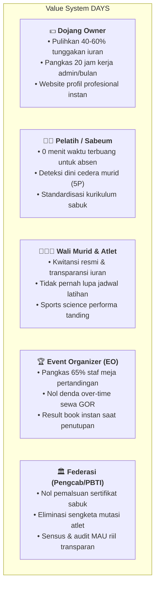
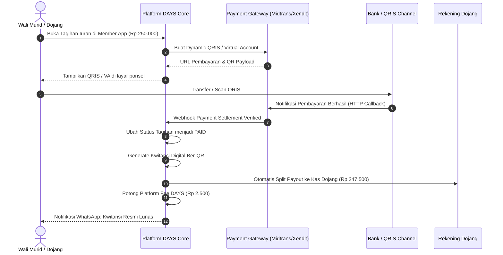

# 💎 Value System, Cost Structure & Subscription Model — DAYS

> **Official Portal & Website:** [https://dojang.warsootech.com](https://dojang.warsootech.com)

Dokumen ini membedah arsitektur finansial, sistem nilai (*value creation*), estimasi biaya infrastruktur operasional (*COGS & OPEX*), rekomendasi harga wajar di pasar beladiri Indonesia, serta mekanisme penagihan dan distribusi pendapatan (*settlement workflow*).

---

## 1. Analisis Value System & Return on Investment (ROI)

Platform DAYS bukan sekadar alat pencatat presensi, melainkan **mesin penyelamat arus kas dan efisiensi tenaga kerja** bagi seluruh pemangku kepentingan.

### Kalkulasi ROI Riil bagi Pemilik Dojang:
- **Kondisi Umum Dojang (50-100 murid @ Rp 250.000/bulan):**
  - Omzet bulanan bruto: Rp 12.500.000 – Rp 25.000.000.
  - Rata-rata tunggakan bulanan akibat lupa bayar: **15% – 25%** (senilai **Rp 1.875.000 – Rp 6.250.000** setiap bulan!).
- **Dampak Implementasi DAYS:**
  - Melalui pengingat WhatsApp otomatis dan transparansi tagihan di aplikasi Member, minimal **50% dari tunggakan tersebut berhasil dipulihkan** (dojang mendapatkan kembali **Rp 900.000 – Rp 3.100.000 kas segar per bulan**).
  - **Kesimpulan ROI:** Biaya langganan DAYS sebesar Rp 149.000 – Rp 299.000/bulan menghasilkan laba bersih *return-on-investment* **300% – 1.000%** bagi pemilik dojang.

---

## 2. Struktur Biaya Operasional (Cost Structure / COGS & OPEX)

Untuk mengoperasikan DAYS secara menguntungkan dengan margin kotor (*gross margin*) di atas **80%**, berikut adalah estimasi pengeluaran per 100 dojang aktif (~8.000 MAU atlet):

| Komponen Biaya (Cost Component) | Vendor / Spesifikasi | Estimasi Biaya Bulanan (IDR) | Sifat Biaya |
| :--- | :--- | :--- | :--- |
| **Compute & API Cluster** | Cloud VPS (4 Core, 16GB RAM, SSD NVMe) | Rp 650.000 – Rp 1.200.000 | Fixed / Semi-Variable |
| **Database & Cache Cluster** | Managed PostgreSQL 16 + Redis 7 | Rp 800.000 – Rp 1.500.000 | Semi-Variable |
| **Object Storage (S3 CDN)** | MinIO / AWS S3 + Cloudflare CDN (Foto & PDF) | Rp 300.000 – Rp 600.000 | Variable (Usage-based) |
| **WhatsApp Notification Gateway** | WhatsApp Unofficial/BSP (Fonnte/Wablas) | Rp 350.000 – Rp 750.000 | Fixed per Dojang sender |
| **PDF Rendering Worker** | Headless Chrome Worker (Result Book & Certs) | Rp 400.000 – Rp 800.000 | Semi-Variable |
| **Total Estimasi OPEX Bulanan** | *(Kapasitas s/d 100 Dojang & 10 Turnamen)* | **Rp 2.500.000 – Rp 4.850.000** | **Margin Kotor > 85%** |

---

## 3. Matriks Harga Wajar (Fair Market Pricing) di Indonesia

Berdasarkan daya beli ekosistem beladiri Indonesia, harga wajar dibagi ke dalam 4 pilar komersial:

### A. Lisensi Dojang SaaS (Langganan Bulanan / Tahunan)

| Paket Langganan | Kuota Murid Aktif | Fitur Utama | Harga Wajar Bulanan | Harga Wajar Tahunan *(Diskon 20%)* |
| :--- | :---: | :--- | :---: | :---: |
| **GRATIS (Starter)** | s/d 25 Murid | • Presensi QR dasar • Profil dojang di direktori publik • Database murid sederhana | **Rp 0** *(Free Forever)* | **Rp 0** |
| **PRO DOJANG** | s/d 100 Murid | • Seluruh fitur DAYS Admin, Coach & Member • Manajemen iuran & kwitansi digital ber-QR • Sports Science Athlete Readiness 5P • CMS Website profil dojang mandiri | **Rp 149.000 – Rp 199.000** */ bulan* | **Rp 1.490.000 – Rp 1.990.000** */ tahun* |
| **ACADEMY ELITE** | s/d 300 Murid | • Seluruh fitur Pro + Multi-Cabang (s/d 3 lokasi) • Multi-instruktur & honor pelatih • Laporan analitik retensi & demografi • Prioritas sinkronisasi kontingen turnamen | **Rp 299.000 – Rp 399.000** */ bulan* | **Rp 2.990.000 – Rp 3.990.000** */ tahun* |
| **ENTERPRISE FRANCHISE** | Murid Unlimited | • Lokasi cabang tanpa batas • Integrasi custom domain dojang (`club.com`) • Dedicated backup & SLA support VIP | **Rp 699.000 – Rp 999.000** */ bulan* | **Rp 6.990.000 – Rp 9.990.000** */ tahun* |

---

### B. Lisensi Turnamen & Ujian (Pay-Per-Event)

Turnamen beladiri memiliki perputaran uang tunai yang sangat besar (Rp 150 Juta – Rp 900 Juta per event). Menjual per event adalah strategi menghasilkan arus kas instan (*high-margin cash injection*):

| Paket Event | Sasaran Event | Batasan & Deliverables | Rentang Harga Wajar per Event |
| :--- | :--- | :--- | :---: |
| **1. UKT Grading Pack** | Ujian Kenaikan Tingkat Dojang / Pengcab | • Tablet scoring penguji per pos ujian • Fast QR check-in peserta • Otomasi penerbitan e-sertifikat ber-QR | **Rp 5.000 – Rp 7.500** */ peserta ujian* |
| **2. Turnamen Internal (Club Fest)** | Kejuaraan internal antarrating / festival dojang | • Maksimal 300 peserta • 1 – 2 Gelanggang aktif • Auto-drawing bagan & e-sertifikat juara | **Rp 1.500.000 – Rp 3.000.000** */ event* |
| **3. Turnamen Regional (Kejurcab / Open)** | Kejurcab Pengcab atau Open Tournament regional | • 500 – 1.000 peserta • 3 – 4 Gelanggang aktif simultan • Checkpoint timbang badan, Call room, Live scoreboard TV, 1-Click Result Book PDF | **Rp 7.500.000 – Rp 15.000.000** */ event* |
| **4. Turnamen Nasional (Kejurnas / Open Besar)** | Kejuaraan Nasional, Piala Kemenpora, EO Profesional | • Unlimited peserta (>1.000 – 3.000+ atlet) • 5 – 8 Gelanggang aktif • Dual-mode Excel parser kontingen tamu • White-label TV display & pendampingan tim IT on-site | **Rp 25.000.000 – Rp 50.000.000** */ event* |

---

### C. Lisensi Tata Kelola Federasi (B2G / Pengcab / Pengprov PBTI)

| Model Lisensi Federasi | Lingkup Deliverables | Nilai Investasi Wajar |
| :--- | :--- | :---: |
| **Federation Governance Suite (Setup)** | Implementasi sistem peta geospasial territorial cabang, modul mutasi atlet online, sensus dojang, dan integrasi subdomain resmi Pengcab/Pengprov. | **Rp 25.000.000 – Rp 60.000.000** *(one-time setup)* |
| **Annual Retainer SLA & MAU Audit** | Cloud maintenance, garansi backup data atlet daerah, patch pembaruan regulasi WT, dan sertifikasi digital berkala. | **Rp 15.000.000 – Rp 35.000.000** */ tahun* |

---

## 4. Mekanisme Operasional Penagihan & Arus Dana (Settlement Workflow)

Untuk memastikan sistem berjalan mandiri tanpa campur tangan penagihan manual, DAYS mengimplementasikan alur otomatis berikut:

### Mekanisme Penagihan SaaS Dojang:
1. **Siklus Tagihan (Billing Cycle):**
   - Tagihan langganan SaaS dojang digenerate setiap tanggal 1 atau tanggal aktivasi awal.
   - Tersedia masa tenggang (*grace period*) selama 5 hari kalender sebelum akun diturunkan ke mode *read-only* (data murid tidak pernah dihapus).
2. **Kalkulasi Kuota Murid Aktif (MAU-based Metering):**
   - Kuota dihitung berdasarkan *Active Murid* (murid yang memiliki riwayat presensi atau pembayaran iuran dalam 30 hari terakhir). Murid berstatus cuti/alumni tidak memakan kuota lisensi.
3. **Mekanisme Payout Pembayaran Iuran Murid:**
   - Ketika wali murid membayar iuran via QRIS/VA DAYS, dana otomatis dialirkan ke rekening bank dojang melalui sistem *escrow / split-payment* (H+1 hari kerja) dengan potongan biaya transaksi flat yang transparan (misal Rp 2.500 per transaksi).

---

## Navigasi Dokumen

[← Ikhtisar Sistem (Overview)](00-overview.md) | [Arsitektur & Tech Stack →](01-architecture-and-techstack.md)
