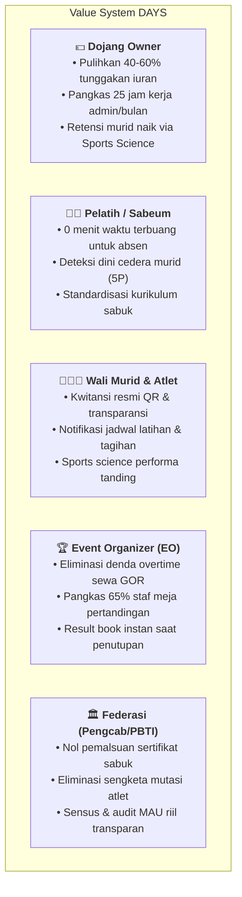
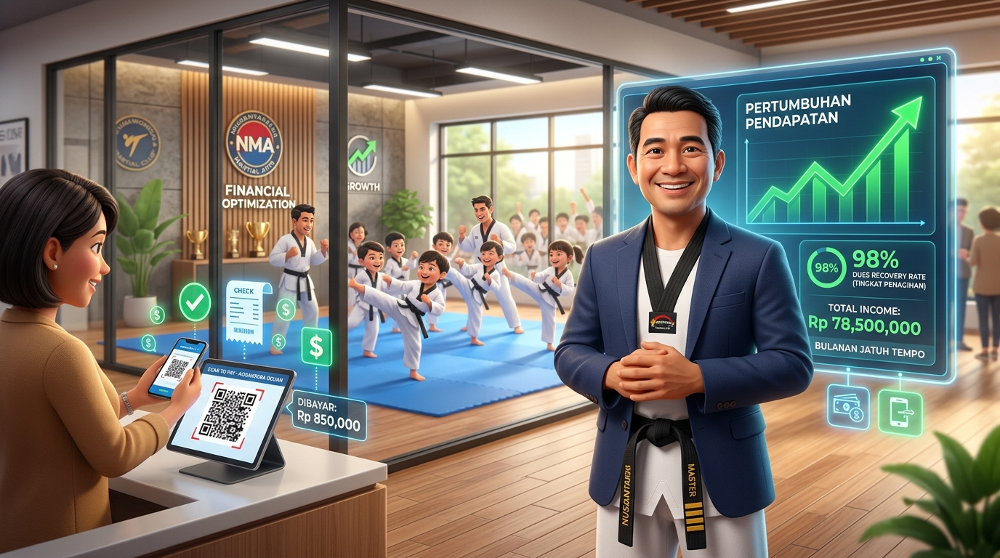
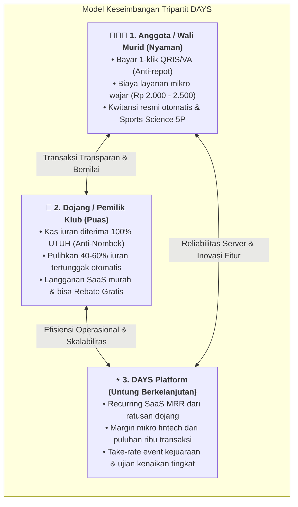
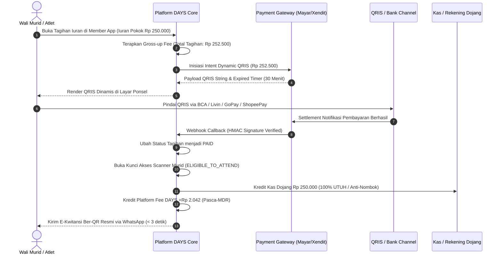

# 💎 Value System, Cost Structure & Subscription Model — DAYS

> **Official Portal & Website:** [https://dojang.warsootech.com](https://dojang.warsootech.com)  
> 📍 **Navigasi Cepat:** [🏠 Overview](00-overview.md) • [🏗️ 01-Arsitektur](01-architecture-and-techstack.md) • [💎 02-Nilai & Monetisasi](02-value-system-and-monetization.md) • [🗺️ 03-Roadmap](03-roadmap.md) • [⚡ Fitur (FR-01 s/d 06)](features/FR-01-user-authentication.md) • [📸 Showcase UI](modules/days-admin/SHOWCASE.md)

Dokumen ini membedah arsitektur finansial, sistem nilai (*value creation*), kalkulasi penghematan operasional berbasis data riil industri beladiri Indonesia, estimasi infrastruktur (*COGS & OPEX*), rekomendasi harga wajar, serta alur penagihan otomatis (*settlement workflow*).

---

## 1. Analisis Value System & Return on Investment (ROI)

Platform DAYS bukan sekadar alat pencatat presensi, melainkan **mesin penyelamat arus kas dan efisiensi operasional** bagi seluruh pemangku kepentingan olahraga beladiri.




*Gambar 3.1: Ilustrasi Optimalisasi Finansial Dojang — Pemilik Klub Memantau Pertumbuhan Kas, 98% Tingkat Penagihan Iuran, dan Pembayaran Instan QRIS.*

---

## 2. Kalkulasi Unit Economics Riil di Pasar Indonesia

Untuk membuktikan kelayakan komersial dan daya tarik investasi, berikut analisis berbasis data riil lapangan:

### A. Segmentasi 3 Model Dojang di Indonesia & Potensi Penyelamatan Kas

| Karakteristik | Model 1: Satelit Sekolah / Ekskul | Model 2: Grassroots Balai Warga / GOR | Model 3: Commercial Elite Academy |
| :--- | :--- | :--- | :--- |
| **Profil Siswa** | 40 – 80 murid (SD/SMP/SMA) | 70 – 150 murid (Umum & Pelajar) | 150 – 400+ murid (Prestasi & Private) |
| **Tarif Iuran Bulanan** | Rp 75.000 – Rp 120.000 / bln | Rp 175.000 – Rp 275.000 / bln | Rp 350.000 – Rp 750.000 / bln |
| **Omzet Bruto Bulanan** | Rp 3.000.000 – Rp 9.600.000 | Rp 12.250.000 – Rp 41.250.000 | Rp 52.500.000 – Rp 300.000.000 |
| **Rata-Rata Tunggakan Riil** | 20% – 30% (karena lupa/manual) | 18% – 25% (tertahan di wali murid) | 8% – 15% (karena kesibukan orang tua) |
| **Nilai Tunggakan Hilang/Bulan** | **Rp 600.000 – Rp 2.800.000** | **Rp 2.200.000 – Rp 10.300.000** | **Rp 4.200.000 – Rp 45.000.000** |
| **Kas Terselamatkan via DAYS** | **Rp 300.000 – Rp 1.400.000** | **Rp 1.100.000 – Rp 5.150.000** | **Rp 2.500.000 – Rp 27.000.000** |
| **Biaya SaaS DAYS / Bulan** | Rp 0 (Free Starter) | Rp 149.000 – Rp 199.000 (Pro) | Rp 299.000 – Rp 699.000 (Elite) |
| **Net ROI bagi Owner Dojang** | **Gratis (Efisiensi 100%)** | **550% – 2.500% ROI per bulan** | **830% – 3.800% ROI per bulan** |

### B. Unit Economics Turnamen Riil & Eliminasi Denda Sewa GOR

Turnamen beladiri memiliki perputaran arus kas yang sangat masif namun kerap mengalami kebocoran biaya akibat manajemen waktu yang buruk:

- **Studi Kasus Kejuaraan Terbuka (1.000 Atlet Kyorugi & Poomsae):**
  - **Pendapatan Pendaftaran:** 1.000 atlet x Rp 350.000 = **Rp 350.000.000**.
  - **Sewa Gedung Olahraga (GOR):** Rp 20.000.000 / 2 hari (batas sewa s/d 21:00 WIB).
  - **Kebocoran Konvensional:** Drawing manual & antrean timbang badan acak menyebabkan pertandingan molor hingga pukul 01:30 dini hari (4,5 jam overtime). Biaya penalti denda pengelola GOR rata-rata **Rp 1.500.000 – Rp 2.000.000 per jam**.
  - **Total Denda Overtime yang Harus Dibayar:** **Rp 6.750.000 – Rp 9.000.000 per kejuaraan!**
- **Solusi DAYS Executive Tournament:**
  - Auto-drawing terdistribusi merata dalam 5 detik, antrean *call room* terpantau di layar TV dan ponsel atlet, serta scoring nirkabel tanpa jeda formulir fisik.
  - Turnamen rampung pukul 19:30 WIB (**1,5 jam sebelum batas waktu sewa habis**).
  - **Dampak Finansial:** Panitia **menghemat 100% denda overtime GOR (Rp 6,7 – 9 Juta terselamatkan)** dan menghemat 65% konsumsi/honor lembur petugas meja pertandingan.

### C. Efisiensi Jam Kerja Staf & Pencegahan Murid Drop Out (Churn)
1. **Penghematan Jam Kerja Administrasi:**
   - Rekap absensi manual, menyocokkan mutasi rekening, dan membuat kwitansi manual memakan rata-rata **25 jam kerja/bulan**.
   - Dengan DAYS, proses ini berjalan otomatis 100%. Setara dengan **menghemat biaya gaji 1 staf admin part-time (Rp 1.500.000 – Rp 2.500.000/bulan)**.
2. **Pencegahan Churn Murid (Lifetime Value):**
   - Rata-rata dojang kehilangan 15–20% murid per tahun akibat orang tua merasa "anaknya tidak berkembang / tidak diperhatikan".
   - Dengan visualisasi *Sports Science 5P* dan riwayat kenaikan sabuk digital, orang tua melihat transparansi progres anak. Menurunkan churn sebesar 5 murid per tahun mempertahankan **Rp 10.500.000 – Rp 15.000.000 *Lifetime Value* per tahun** bagi kas dojang.

---

## 3. Struktur Biaya Operasional (Cost Structure / COGS & OPEX)

Untuk mengoperasikan DAYS secara menguntungkan dengan margin kotor (*gross margin*) di atas **85%**, berikut estimasi pengeluaran per 100 dojang aktif (~8.000 MAU atlet):

| Komponen Biaya (Cost Component) | Vendor / Spesifikasi | Estimasi Biaya Bulanan (IDR) | Sifat Biaya |
| :--- | :--- | :--- | :--- |
| **Compute & API Cluster** | Cloud VPS (4 Core, 16GB RAM, SSD NVMe) | Rp 650.000 – Rp 1.200.000 | Fixed / Semi-Variable |
| **Database & Cache Cluster** | Managed PostgreSQL 16 + Redis 7 | Rp 800.000 – Rp 1.500.000 | Semi-Variable |
| **Object Storage (S3 CDN)** | MinIO / AWS S3 + Cloudflare CDN (Foto & PDF) | Rp 300.000 – Rp 600.000 | Variable (Usage-based) |
| **WhatsApp Notification Gateway** | WhatsApp Official BSP / Unofficial (Fonnte/Wablas) | Rp 350.000 – Rp 750.000 | Fixed per Dojang sender |
| **PDF Rendering Worker** | Headless Chrome Worker (Result Book & Certs) | Rp 400.000 – Rp 800.000 | Semi-Variable |
| **Total Estimasi OPEX Bulanan** | *(Kapasitas s/d 100 Dojang & 10 Turnamen)* | **Rp 2.500.000 – Rp 4.850.000** | **Margin Kotor > 85%** |

---

## 4. Matriks Skema Harga Ideal Tripartit (Fair Market & Sustainable Pricing)

Untuk menciptakan ekosistem yang berkelanjutan di Indonesia, skema harga DAYS dibangun di atas prinsip **Keseimbangan Tripartit (Tripartite Equilibrium)**:
1. **Anggota Nyaman:** Biaya transaksi mikro sangat terjangkau (Rp 2.000 – Rp 2.500), proses instan tanpa upload slip transfer, kwitansi resmi WhatsApp ber-QR, dan akses sports science.
2. **Dojang Puas:** Arus kas iuran masuk **100% utuh tanpa potongan (Anti-Nombok)**, tunggakan terselamatkan 40–60%, dan langganan SaaS fleksibel bahkan dapat digratiskan via volume rebate.
3. **DAYS Untung:** Menghasilkan 2 pilar pendapatan berulang (*Predictable SaaS MRR* + *High-Volume Transaction Fintech Margin*) serta lonjakan omzet berkala dari lisensi event & ujian.



---

### A. Lapisan 1: Skema Transaksi Finansial Iuran & Commerce (Smart Convenience Fee)

Untuk menjaga kas dojang tetap utuh tanpa terpotong biaya *Merchant Discount Rate* (MDR), sistem menerapkan formula **Gross-up Smart Convenience Fee** yang dibebankan transparan kepada pembayar:

| Komponen Transaksi | Kanal QRIS Instan *(Prioritas Utama)* | Kanal Virtual Account *(BCA / Mandiri / BRI)* |
| :--- | :--- | :--- |
| **Iuran Pokok Dojang (*Base Amount*)** | Rp 150.000 *(contoh)* | Rp 150.000 *(contoh)* |
| **Biaya Layanan Sistem (*Convenience Fee*)** | **+ Rp 2.500** | **+ Rp 4.000** |
| **Total Dibayar Siswa / Wali** | **Rp 152.500** | **Rp 154.000** |
| **Beban Gateway / COGS DAYS** | ~Rp 458 *(MDR 0,3% BI)* | ~Rp 2.200 *(Flat VA aggregator)* |
| **Diterima Kas Dojang (*Net Payout*)** | **Rp 150.000 (100% Utuh / Anti-Nombok)** | **Rp 150.000 (100% Utuh / Anti-Nombok)** |
| **Margin Bersih DAYS per Transaksi** | **+ Rp 2.042 / transaksi** | **+ Rp 1.800 / transaksi** |

> 📌 **Mengapa Skema Ini Diterima Seluruh Pihak?**
> - **Wali Murid:** Mengeluarkan tambahan Rp 2.500 jauh lebih murah dibanding biaya transfer antarbank konvensional (Rp 6.500) atau biaya bensin/parkir jika membayar tunai ke dojang. Mereka terbebas dari kewajiban memotret bukti transfer.
> - **Dojang:** Tidak menanggung potongan MDR sepeser pun. Kas masuk tetap bulat dan rekonsiliasi kasir berjalan otomatis.
> - **DAYS:** Memperoleh margin transaksi yang terakumulasi masif seiring bertumbuhnya basis atlet aktif.

---

### B. Lapisan 2: Lisensi Dojang SaaS (Langganan Bulanan / Tahunan)

#### 1. Ringkasan Paket & Struktur Biaya

| Paket Langganan | Kuota Murid | Sasaran Dojang | Biaya Bulanan | Biaya Tahunan *(Hemat 20%)* |
| :--- | :---: | :--- | :--- | :--- |
| **STARTER** | s/d 25 Murid | Dojang rintisan & ekskul sekolah pemula | **Rp 0** *(Gratis Selamanya)* | **Rp 0** |
| **PRO DOJANG** | s/d 100 Murid | Dojang reguler mandiri 1 lokasi | **Rp 149.000** | **Rp 1.430.000** |
| **ACADEMY ELITE** | s/d 300 Murid | Akademi prestasi & multi-cabang (s/d 3 lokasi) | **Rp 299.000** | **Rp 2.870.000** |
| **ENTERPRISE** | Unlimited | Jaringan waralaba & pengcab cabang besar | **Rp 699.000** | **Rp 6.710.000** |

#### 2. Skema Insentif Revolusioner: Rebate Bebas Biaya SaaS (*Volume Exemption*)
Untuk memicu adopsi digital secara agresif, DAYS memberikan fasilitas **Cashback / Diskon Lisensi SaaS**:
- Jika dojang pada paket **PRO** memproses minimal **75 transaksi iuran/bulan via QRIS DAYS**, dojang mendapatkan **Rebate Biaya SaaS sebesar 100% (Gratis Lisensi Bulan Berikutnya)**.
- *Logika Finansial DAYS:* Dari 75 transaksi QRIS, DAYS telah meraup laba kotor transaksi `75 x Rp 2.042 = Rp 153.150` (sudah menutup nilai langganan Rp 149.000). Pemilik dojang termotivasi aktif mewajibkan muridnya membayar digital!

#### 3. Matriks Komparasi Fitur Lengkap (Feature Matrix)

| Fitur Utama | Starter (Gratis) | Pro Dojang | Academy Elite | Enterprise |
| :--- | :---: | :---: | :---: | :---: |
| **Maksimum Murid Aktif** | 25 Murid | 100 Murid | 300 Murid | **Tanpa Batas** |
| **Jumlah Cabang Latihan** | 1 Lokasi | 1 Lokasi | Hingga 3 Lokasi | **Tanpa Batas** |
| **Presensi QR Scanner (Coach PWA)** | ✅ | ✅ | ✅ | ✅ |
| **Aplikasi Murid & Wali (Member App)** | ✅ | ✅ | ✅ | ✅ |
| **Manajemen Iuran & Invoice Otomatis** | ❌ *(Manual)* | ✅ | ✅ | ✅ |
| **Kwitansi Digital Ber-QR Resmi WA** | ❌ | ✅ | ✅ | ✅ |
| **Pembayaran QRIS & Virtual Account** | ❌ | ✅ | ✅ | ✅ |
| **Sports Science Readiness 5P & RPE** | ❌ | ✅ | ✅ | ✅ |
| **CMS Website Profil Dojang Mandiri** | Profil Direktori | Subdomain DAYS | Subdomain DAYS | **Custom Domain Sendiri** |
| **Pendaftaran Kontingen Turnamen 1-Klik** | ❌ | ✅ | ✅ | ✅ |
| **Manajemen Multi-Pelatih & Honor** | ❌ | 1 Pelatih Utama | Hingga 5 Pelatih | **Tanpa Batas** |
| **Laporan Analitik Retensi & Churn** | Dasar | Standar | Lengkap | Kustom / Advanced |
| **Dukungan Bantuan Teknis** | Komunitas / FAQ | WhatsApp Support | Prioritas 1x24 Jam | **Dedicated Account Manager** |

---

### C. Lapisan 3: Lisensi Turnamen & Ujian (Pay-Per-Event)

| Paket Event | Sasaran Event | Batasan & Deliverables | Rentang Biaya Layanan DAYS |
| :--- | :--- | :--- | :---: |
| **1. UKT Grading Pack** | Ujian Kenaikan Tingkat Dojang / Pengcab | • Scoring penguji per pos via tablet<br>• Fast QR check-in & barcode sabuk<br>• Otomasi penerbitan e-sertifikat ber-QR | **Rp 5.000**<br>*/ peserta ujian* |
| **2. Turnamen Internal (Club Fest)** | Kejuaraan internal antarrating / festival dojang | • Maksimal 300 peserta<br>• 1 – 2 Gelanggang aktif<br>• Auto-drawing bagan & e-sertifikat juara | **Rp 1.500.000 – Rp 3.000.000**<br>*/ event* |
| **3. Turnamen Regional (Kejurcab / Open)** | Kejurcab Pengcab atau Open Tournament regional | • 500 – 1.000 peserta<br>• 3 – 4 Gelanggang aktif simultan<br>• Checkpoint timbang badan, Call room, Live scoreboard TV, 1-Click Result Book PDF | **Rp 7.500.000 – Rp 15.000.000**<br>*/ event* |
| **4. Turnamen Nasional (Kejurnas / Open Besar)** | Kejuaraan Nasional, Piala Kemenpora, EO Profesional | • Unlimited peserta (>1.000 – 3.000+ atlet)<br>• 5 – 8 Gelanggang aktif<br>• Dual-mode Excel parser kontingen tamu<br>• White-label TV display & pendampingan tim IT on-site | **Rp 25.000.000 – Rp 50.000.000**<br>*/ event* |

---

### D. Lapisan 4: Lisensi Tata Kelola Federasi (B2G / Pengcab / Pengprov PBTI)

| Model Lisensi Federasi | Lingkup Deliverables | Nilai Investasi Wajar |
| :--- | :--- | :---: |
| **Federation Governance Suite (Setup)** | Implementasi sistem peta geospasial territorial cabang, modul mutasi atlet online, sensus dojang, dan integrasi subdomain resmi Pengcab/Pengprov. | **Rp 25.000.000 – Rp 60.000.000**<br>*(one-time setup)* |
| **Annual Retainer SLA & MAU Audit** | Cloud maintenance, garansi backup data atlet daerah, patch pembaruan regulasi WT, dan sertifikasi digital berkala. | **Rp 15.000.000 – Rp 35.000.000**<br>*/ tahun* |

---

## 5. Mekanisme Operasional Penagihan & Alur Kas (*Settlement Workflow*)



---

## 6. Simulasi Finansial Komparatif 3 Aktor (Kasus Dojang 80 Murid)

Untuk membuktikan kelayakan operasional, berikut simulasi kalkulasi matematis pada 1 dojang mandiri tipikal:

```
Asumsi Parameter Operasional:
- Basis Murid Aktif: 80 anak
- Tarif Iuran Bulanan: Rp 175.000 / murid
- Omzet Bruto Bulanan: 80 x Rp 175.000 = Rp 14.000.000 / bulan
- Rasio Tunggakan Konvensional (Sebelum DAYS): 20% (Rp 2.800.000 tertahan tiap bulan)

1. DAMPAK FINANSIAL BAGI ANGGOTA (Wali Murid):
   • Membayar: Rp 177.500 / bulan (Iuran Rp 175.000 + Biaya Layanan Rp 2.500).
   • Pengeluaran Ekstra: Rp 2.500 (Setara 1/3 biaya transfer antarbank).
   • Manfaat Langsung: Bukti lunas instan, bebas sengketa kwitansi hilang, 
     notifikasi jadwal latihan terpusat, dan grafik Sports Science anak terpantau.

2. DAMPAK FINANSIAL BAGI PEMILIK DOJANG:
   • Kas Iuran Diterima Bersih: Rp 14.000.000 (100% utuh tanpa potongan MDR).
   • Pemulihan Arus Kas (Via WA Reminder Otomatis): Menyelamatkan 70% tunggakan = +Rp 1.960.000 / bulan.
   • Penghematan Jam Kerja Staf: Pangkas 25 jam kerja rekap manual (senilai Rp 1.500.000).
   • Biaya SaaS Paket Pro: Rp 149.000 / bulan.
   • Net Finansial Gain Dojang: (+Rp 1.960.000) - Rp 149.000 = +Rp 1.811.000 keuntungan kas bersih baru/bulan.
   • ROI Dojang: > 1.200% per bulan!

3. DAMPAK FINANSIAL BAGI PLATFORM DAYS:
   • Pendapatan SaaS Bulanan: Rp 149.000 / bulan.
   • Pendapatan Margin Transaksi QRIS: 80 x Rp 2.042 = Rp 163.360 / bulan.
   • Total Pendapatan Kotor DAYS per Dojang: Rp 312.360 / bulan.
   • Dengan 100 Dojang Terhubung:
     - Gross MRR DAYS: Rp 31.236.000 / bulan.
     - Estimasi OPEX Cloud & WA Gateway: Rp 3.850.000 / bulan.
     - Laba Bersih Operasional (EBITDA): Rp 27.386.000 / bulan (Gross Margin 87,6%).
```

---

## Navigasi Dokumen

[← 01-Arsitektur & Tech Stack](01-architecture-and-techstack.md) | [00-Ikhtisar Sistem](00-overview.md) | [03-Roadmap Pengembangan Produk →](03-roadmap.md) | [Spesifikasi Fitur Pertama (FR-01) →](features/FR-01-user-authentication.md)
