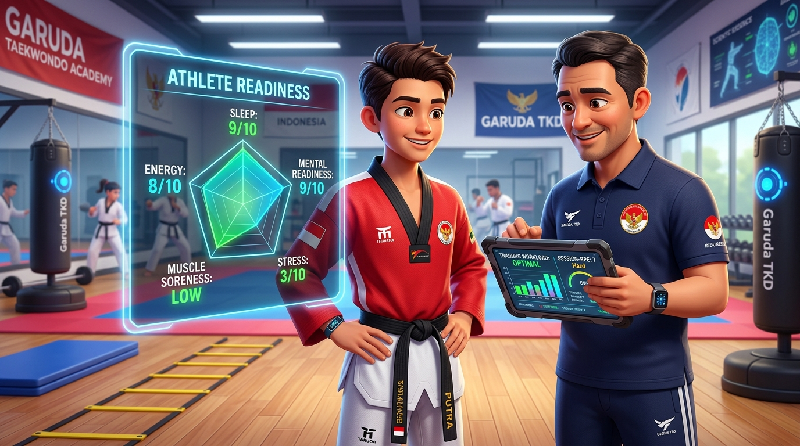

# 🗺️ Roadmap Pengembangan Produk — DAYS

> **Official Portal & Website:** [https://dojang.warsootech.com](https://dojang.warsootech.com)  
> 📍 **Navigasi Cepat:** [🏠 Overview](00-overview.md) • [🏗️ 01-Arsitektur](01-architecture-and-techstack.md) • [💎 02-Nilai & Monetisasi](02-value-system-and-monetization.md) • [🗺️ 03-Roadmap](03-roadmap.md) • [⚡ Fitur (FR-01 s/d 06)](features/FR-01-user-authentication.md) • [📸 Showcase UI](modules/days-admin/SHOWCASE.md)

Roadmap implementasi sistem **DAYS** dirancang secara bertahap untuk memaksimalkan kecepatan penetrasi pasar (*speed-to-market*), memvalidasi retensi pengguna dojang, dan mengeksekusi monetisasi melalui kejuaraan dan tata kelola federasi.

---

## 🎯 MVP Milestone (Minggu 1 – 4): Core Foundation & Operasional Dojang

Target: Meluncurkan fondasi operasional dojang harian dan alur autentikasi lintas peran.

- [x] **Single Sign-On (Smart Role Redirect):** Gerbang login tunggal di `https://dojang.warsootech.com/login` yang secara cerdas mendisposisikan peran Admin, Coach, Member, dan Executive.
- [x] **Dojang Management Core (Admin):**
  - Database anggota, pendaftaran baru, dan riwayat sabuk.
  - Manajemen lokasi cabang, kelas latihan, dan jadwal.
  - Konfirmasi iuran bulanan dan rekapitulasi tunggakan manual/transfer bank.
- [x] **Aplikasi Pelatih (Coach Mobile):**
  - Pemindaian absensi cepat via kamera QR scanner ponsel.
  - Jadwal mengajar harian pelatih.
- [x] **Aplikasi Anggota (Member Mobile):**
  - Kartu QR kehadiran digital personal.
  - Tampilan jadwal terdekat dan status tagihan iuran bulanan.
- [x] **Portal Publik (Core):**
  - Landing page profil, direktori dojang terdaftar, dan form pendaftaran trial.

---

## 🚀 Phase 1: Post-MVP & High-Value Monetization (Minggu 5 – 8)

Target: Membuka keran pendapatan B2B via Turnamen & Sports Science, serta automasi finansial.

*Gambar R.1: Ilustrasi Penerapan Sports Science & Athlete Readiness 5P — Pelatih dan Atlet Memantau Radar Kesiapan Fisik dan Beban Latihan secara Real-Time.*

- [ ] **Tournament & Competition Engine (Executive Modul 3):**
  - Dual-Mode Intake: Sinkronisasi kontingen internal dojang & Import parser file Excel/CSV kontingen tamu.
  - Generator bagan pertandingan sistem gugur otomatis (*Single Elimination Bracket Drawing*) dengan algoritma seeded terpisah.
  - Digital Weigh-in checkpoint & Call room marshalling monitor.
  - Live scoring terminal arena & Scoreboard TV display penonton via WebSockets.
  - Ekspor 1-Click Official Result Book PDF berstandar PBTI.
- [ ] **Sports Science & Athlete Readiness (Coach & Member):**
  - Formulir kesiapan harian 5P (Tidur, Energi, Nyeri, Stres, Mental) & berat badan aktual.
  - Squad Readiness Board lampu lalu lintas (Hijau, Kuning, Merah) pada aplikasi Coach.
  - Log Session-RPE beban latihan dan riwayat cedera atlet.
- [ ] **Payment Gateway Integration:**
  - Penerimaan pembayaran otomatis via QRIS, Virtual Account (BCA, BRI, Mandiri), dan E-Wallet untuk iuran dojang serta pendaftaran kejuaraan.
- [ ] **Otomasi Sertifikat & Ujian (UKT Modul 2):**
  - Terminal scoring tablet penguji per pos ujian.
  - Batch generator ratusan e-sertifikat ber-QR yang dapat diverifikasi publik tanpa login di `https://dojang.warsootech.com/e-certs`.

---

## 🔮 Phase 2: Scale, Ecosystem Moat & Federation Expansion (Minggu 9 – 16)

Target: Penetrasi tingkat federasi wilayah (Pengcab/Pengprov/PBTI) dan adopsi skala nasional.

- [ ] **Federation Governance Suite (Executive Modul 1):**
  - Territorial Geospatial Heatmap: Peta sebaran dojang per kabupaten/kota/kecamatan.
  - Digital Member Mutation Clearance: Workflow pengajuan, rekomendasi pengcab, dan audit kepindahan atlet antar-klub bebas sengketa.
  - Sensus MAU (Monthly Active Users) & Algoritma Predictive Dojang Health Index Score (0–100).
- [ ] **Integrasi Hardware Sensor Nirkabel (Electronic Scoring System - ESS/PSS):**
  - Kompatibilitas penerimaan sinyal wireless body protector (Dae do / KPNP protocol adapter) ke layar Scoreboard TV DAYS.
- [ ] **Automated WhatsApp Notification Bot:**
  - Pengingat otomatis jatuh tempo iuran ke wali murid via WhatsApp API.
  - Notifikasi antrean atlet di call room turnamen ("Atlet Bima, 2 partai lagi menuju Arena 2").
- [ ] **Multi-Sport Engine Expansion:**
  - Penyesuaian aturan penilaian dan bagan untuk cabang beladiri serumpun: Pencak Silat (IPSI), Karate (FORKI), dan Wushu.

---

## 📸 Referensi Antarmuka & Showcase Visual

Antarmuka fungsional modul MVP telah didokumentasikan secara visual dan dapat dilihat pada:
- **[Showcase Visual DAYS Admin](modules/days-admin/SHOWCASE.md):** Galeri interaktif manajemen klub, kasir iuran, kalender jadwal latihan, dan kartu atlet.

---

## Navigasi Dokumen

[← 02-Sistem Nilai & Monetisasi](02-value-system-and-monetization.md) | [00-Ikhtisar Sistem](00-overview.md) | [Showcase Visual DAYS Admin](modules/days-admin/SHOWCASE.md) | [Spesifikasi Fitur (FR-01) →](features/FR-01-user-authentication.md)
