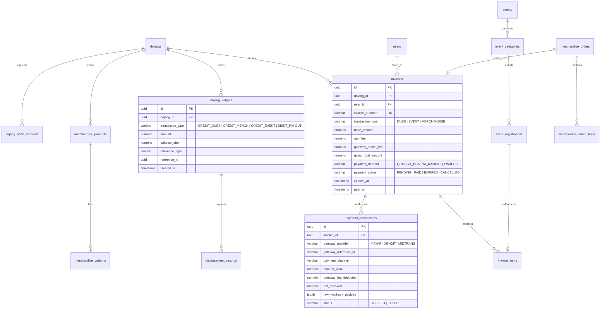
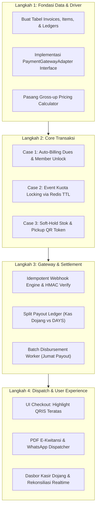

# FR-08: Payment Gateway Engine, Split-Settlement & Multi-Commerce Transaksional (Iuran, Event, Merchandise)

Modul ini mendefinisikan mesin transaksi finansial terpadu (*Unified Payment Engine*) pada ekosistem DAYS ([dojang.warsootech.com](https://dojang.warsootech.com)) untuk menangani 3 kasus transaksi utama:
1. **Iuran Bulanan Siswa ke Dojang (*Recurring Member Dues*)**
2. **Pendaftaran & Pembayaran Event (*Pay-per-Event: UKT & Turnamen*)**
3. **Pemesanan Merchandise Fisik (*In-Dojang Store & Pickup*)**

---

## 1. User Story

- **As a** Wali Murid atau Atlet (Member),
  **I want to** membayar tagihan iuran bulanan, biaya pendaftaran event/UKT, dan seragam dobok/merchandise secara instan via QRIS, Virtual Account, atau E-Wallet dalam satu aplikasi tanpa perlu konfirmasi manual atau kirim slip transfer WhatsApp,
  **So that** proses transaksi transparan, kwitansi resmi langsung terbit, barcode tiket/pengambilan langsung aktif, dan status kehadiran latihan tidak terkunci.

- **As an** Owner / Bendahara Dojang,
  **I want to** menerima dana pembayaran iuran dan penjualan perlengkapan secara utuh tanpa terpotong biaya admin transaksi yang tidak terduga, serta mencairkan saldo kas dojang secara terjadwal ke rekening bank,
  **So that** arus kas klub sehat, rekonsiliasi keuangan berjalan 100% otomatis, dan terbebas dari sengketa bukti transfer palsu.

- **As an** Event Organizer / Pengcab (EO Kejuaraan & Ujian),
  **I want to** memastikan pembayaran atlet mengunci kuota gelanggang secara real-time dan nomor partai tanding/pos penguji otomatis ter-assign setelah status pembayaran terverifikasi lunas,
  **So that** tidak terjadi atlet siluman (*unpaid participants*) yang masuk ke bagan pertandingan.

---

## 2. Acceptance Criteria (Gherkin Format)

```gherkin
Feature: Unified Multi-Commerce Payment Engine

  # =========================================================================
  # CASE 1: IURAN BULANAN SISWA (MONTHLY DUES)
  # =========================================================================
  Scenario: Pembayaran iuran bulanan via Dynamic QRIS dengan formula anti-nombok
    Given siswa memiliki tagihan iuran bulan berjalan sebesar Rp 250.000 dengan status "UNPAID"
    When wali murid memilih kanal pembayaran "QRIS" di aplikasi Member
    Then sistem menerapkan formula gross-up: total tagihan menjadi Rp 255.000 (Iuran Rp 250.000 + Biaya Layanan Rp 5.000)
    And sistem membuat Payment Intent ke gateway dan menampilkan gambar Dynamic QRIS dengan expiry time 30 menit
    When siswa berhasil memindai dan membayar via m-banking
    And webhook gateway mengirimkan event "payment.settled" ke backend DAYS
    Then sistem mengubah status tagihan menjadi "PAID"
    And kas internal dojang bertambah Rp 250.000 utuh
    And akun pendapatan DAYS bertambah platform fee +Rp 3.000
    And status akses presensi QR scanner murid berubah aktif ("ELIGIBLE_TO_ATTEND")
    And kwitansi digital resmi ber-QR terbit dan terkirim otomatis via WhatsApp

  # =========================================================================
  # CASE 2: PEMBAYARAN EVENT & UKT (PAY-PER-EVENT)
  # =========================================================================
  Scenario: Pendaftaran turnamen dengan temporary slot locking & auto-ticket
    Given kejuaraan "Piala Kemenpora Open" kategori "Kyorugi Prestasi Cadet Putra U-45kg" tersisa 1 slot kuota
    When atlet memulai proses pendaftaran dan memilih metode "Virtual Account Mandiri"
    Then sistem membuat reservasi sementara pada Redis dengan TTL 15 menit (slot terkunci sementara)
    And total tagihan VAMandiri menjadi Rp 357.500 (Pendaftaran Rp 350.000 + Biaya Transaksi Rp 7.500)
    When atlet menyelesaikan transfer sebelum batas waktu 15 menit
    Then status registrasi berubah menjadi "CONFIRMED"
    And kuota kategori turnamen resmi berkurang 1 secara permanen
    And sistem men-generate "Nomor Punggung / Barcode ID Card Atlet" dan menyinkronkan data atlet ke Tournament Engine
    And kas panitia event bertambah Rp 342.500 dan komisi platform DAYS tercatat +Rp 7.500

  Scenario: Pembayaran event kedaluwarsa (Expired Slot Release)
    Given atlet memilih slot kategori turnamen dan mendapatkan Virtual Account dengan batas waktu 15 menit
    When atlet tidak melakukan pembayaran hingga menit ke-16
    Then timer Redis habis dan sistem mengubah status registrasi menjadi "EXPIRED"
    And slot kategori turnamen otomatis dikembalikan (+1 kuota tersedia) untuk atlet lain
    And nomor Virtual Account di-invalidasi di payment gateway

  # =========================================================================
  # CASE 3: PEMBELIAN MERCHANDISE (PHYSICAL STORE & PICKUP)
  # =========================================================================
  Scenario: Checkout seragam Dobok dengan stok fisik lokal dojang & pengambilan mandiri
    Given dojang memiliki stok fisik seragam "Dobok Poomsae Diamond Size 160" sebanyak 3 pcs
    When murid memasukkan seragam seharga Rp 350.000 ke keranjang dan memilih "Ambil di Dojang"
    Then sistem memotong stok sementara (*soft hold*) sebesar 1 unit
    When murid menyelesaikan pembayaran via QRIS sebesar Rp 355.000
    Then stok fisik gudang dojang resmi berkurang menjadi 2 pcs
    And sistem menerbitkan "QR Code Token Pengambilan Barang" di Member App
    When murid mendatangi kantor dojang dan staf memindai QR Token tersebut via Coach/Admin App
    Then status pesanan berubah dari "READY_FOR_PICKUP" menjadi "COMPLETED"
    And notifikasi bukti serah terima barang terkirim ke WhatsApp wali murid

  # =========================================================================
  # CASE 4: REKONSILIASI & DISBURSEMENT (PENCAIRAN DANA KAS DOJANG)
  # =========================================================================
  Scenario: Pencairan terjadwal saldo kas dojang (Auto-Payout Mingguan)
    Given dojang memiliki saldo aktif terkumpul sebesar Rp 12.500.000 pada hari Jumat pukul 00:00 WIB
    When batch cron disbursement mingguan berjalan
    Then sistem memotong biaya transfer BI-FAST sebesar Rp 2.500 dari total saldo
    And sistem mengirim instruksi payout sebesar Rp 12.497.500 ke rekening bank terdaftar milik Dojang
    And status payout berubah menjadi "PROCESSING" hingga menerima callback "disbursement.success"
    And jurnal mutasi kas dojang tercatat seimbang (*zero balance mismatch*)
```

---

## 3. Spesifikasi Arsitektur & Skema Database Terpadu



---

## 4. Spesifikasi Endpoint API Lengkap

### 4.1 Inisiasi Pembayaran Transaksi (`POST /api/v1/payments/create-intent`)
Endpoint terpusat untuk memproses pembayaran seluruh tipe transaksi (Iuran, Event, Merchandise).

- **Headers:**
  - `Authorization: Bearer <jwt_access_token>`
  - `Content-Type: application/json`
  - `X-Idempotency-Key: <unique_uuid4>`

#### JSON Request Payload (Case 1: Iuran Bulanan):
```json
{
  "transaction_type": "DUES",
  "dojang_id": "8c59f77e-293e-4d45-93b5-77a3d2427b31",
  "student_id": "e2f1839a-7c3a-4467-83d8-e71bb5d9cc02",
  "billing_period": "2026-10",
  "payment_channel": "QRIS",
  "item_details": {
    "title": "Iuran Bulanan Taekwondo - Oktober 2026",
    "base_amount": 250000
  }
}
```

#### JSON Request Payload (Case 2: Pendaftaran Event / UKT):
```json
{
  "transaction_type": "EVENT",
  "dojang_id": "8c59f77e-293e-4d45-93b5-77a3d2427b31",
  "event_id": "31b2e45f-1547-4952-b883-7c3857e4e1a0",
  "category_id": "cat-kyorugi-cadet-u45",
  "athlete_id": "e2f1839a-7c3a-4467-83d8-e71bb5d9cc02",
  "payment_channel": "VA_MANDIRI",
  "item_details": {
    "title": "Registrasi Kejuaraan Kemenpora Cup - Cadet U-45kg",
    "base_amount": 350000
  }
}
```

#### JSON Request Payload (Case 3: Pembelian Merchandise):
```json
{
  "transaction_type": "MERCHANDISE",
  "dojang_id": "8c59f77e-293e-4d45-93b5-77a3d2427b31",
  "fulfillment_method": "IN_DOJANG_PICKUP",
  "payment_channel": "QRIS",
  "cart_items": [
    {
      "product_id": "prod-dobok-diamond-160",
      "quantity": 1,
      "unit_price": 350000
    },
    {
      "product_id": "prod-belt-poom-redblack",
      "quantity": 1,
      "unit_price": 75000
    }
  ]
}
```

#### JSON Response (201 Created):
```json
{
  "success": true,
  "message": "Payment intent created successfully",
  "data": {
    "invoice_number": "INV/DAYS/202610/00492",
    "transaction_type": "DUES",
    "pricing_breakdown": {
      "base_amount": 250000,
      "app_fee": 3000,
      "gateway_fee": 2000,
      "total_amount": 255000
    },
    "payment_channel": "QRIS",
    "payment_details": {
      "qr_string": "00020101021226670016ID.CO.MAYAR.WWW0118936009110000000000...",
      "qr_image_url": "https://api.days.warsootech.com/v1/qr/render/INV-00492.png",
      "va_number": null,
      "deep_link_url": null,
      "expires_at": "2026-10-16T15:38:37Z"
    }
  }
}
```

#### JSON Error Responses:
```json
// 400 Bad Request
{
  "success": false,
  "error_code": "INVALID_CHANNEL",
  "message": "Metode pembayaran yang dipilih tidak aktif atau di luar jangkauan nominal minimum."
}

// 409 Conflict (Event Kuota Penuh atau Stok Merchandise Habis)
{
  "success": false,
  "error_code": "SLOT_OR_INVENTORY_EXHAUSTED",
  "message": "Slot kuota kategori turnamen ini baru saja terisi penuh oleh peserta lain atau stok barang habis."
}
```

---

### 4.2 Webhook Ingestion Receiver (`POST /api/v1/payments/webhooks/gateway`)
Menerima payload callback dari penyedia Payment Gateway (Mayar / Xendit / Midtrans).

- **Headers:**
  - `X-Callback-Signature: <hmac_sha256_hash>`
  - `Content-Type: application/json`

#### JSON Request Payload (Contoh Callback Mayar):
```json
{
  "event": "payment.received",
  "timestamp": "2026-10-16T15:15:20Z",
  "data": {
    "id": "pay_982341908234",
    "invoice_id": "INV/DAYS/202610/00492",
    "status": "SETTLED",
    "amount": 255000,
    "fee": 1981,
    "net_amount": 253019,
    "payment_channel": "QRIS",
    "settled_at": "2026-10-16T15:15:18Z"
  }
}
```

#### JSON Response (200 OK):
```json
{
  "status": "OK",
  "received": true,
  "processed_at": "2026-10-16T15:15:21Z"
}
```

---

### 4.3 Verifikasi Pengambilan Barang Merchandise (`POST /api/v1/dojang/merchandise/pickup-verify`)
Digunakan oleh Admin Dojang / Pelatih untuk memindai token QR pengambilan seragam/dobok murid.

- **Headers:**
  - `Authorization: Bearer <jwt_access_token>` (Role: `DOJANG_ADMIN` / `COACH`)
  - `Content-Type: application/json`

#### JSON Request:
```json
{
  "pickup_token": "DAYS-PICKUP-89B72F",
  "notes": "Seragam diserahkan oleh Sabeum Arya kepada wali murid"
}
```

#### JSON Response (200 OK):
```json
{
  "success": true,
  "message": "Barang berhasil diverifikasi dan diserahkan kepada murid.",
  "data": {
    "order_id": "ord-88392",
    "student_name": "Kenzo Al-Fatih",
    "items_delivered": [
      {
        "product_name": "Dobok Poomsae Diamond",
        "variant": "Size 160",
        "quantity": 1
      }
    ],
    "delivered_at": "2026-10-16T16:00:00Z"
  }
}
```

---

## 5. Alur Tahapan Eksekusi Teknis (Implementation Steps)



### Tahap 1: Struktur Database & Driver Abstraction
1. **Migration Schema:** Terapkan skema tabel PostgreSQL: `invoices`, `payment_transactions`, `dojang_ledgers`, `merchandise_orders`, dan `event_registrations`.
2. **Adapter Driver Pattern:** Buat kelas abstrak `PaymentGatewayInterface` dengan implementasi awal `MayarAdapter` (Phase 1) dan stub untuk `XenditAdapter` (Phase 2), sehingga pergantian vendor payment gateway di masa depan tidak mengubah controller aplikasi.
3. **Engine Kalkulasi Biaya Transparan:** Konfigurasikan formula gross-up di backend untuk menghitung biaya admin secara dinamis per kanal pembayaran (QRIS, VA, E-Wallet).

### Tahap 2: Implementasi Khusus Per Kasus
1. **Case 1 (Iuran Bulanan Siswa):**
   - Bangun *Monthly Billing Generator Cron* (berjalan setiap tanggal 1 pukul 00:01 WIB).
   - Buat relasi ke modul kehadiran: jika iuran berstatus `PAID`, sistem mengaktifkan status kartu QR siswa `ELIGIBLE_TO_ATTEND`.
2. **Case 2 (Pembayaran Event & UKT):**
   - Terapkan mekanisme penguncian kuota berbasis Redis (`SET key:event:slot <val> EX 900 NX`). Jika atlet tidak menyelesaikan pembayaran dalam 15 menit, slot kuota dilepas kembali secara otomatis.
   - Saat lunas, trigger event ke `TournamentEngine` untuk menyematkan nomor partai tanding atau jadwal timbang badan.
3. **Case 3 (Pembelian Merchandise):**
   - Terapkan manajemen persediaan (*inventory tracking*) berbasis varian (ukuran dobok, warna sabuk).
   - Terbitkan `pickup_token` ber-QR di aplikasi Member yang hanya bisa diverifikasi oleh scanner Admin/Coach Dojang di lokasi latihan.

### Tahap 3: Webhook, Idempotency & Split Ledger
1. **HMAC Signature Check:** Verifikasi keaslian webhook gateway untuk mencegah transaksi palsu.
2. **Idempotency Guard:** Cek status transaksi di database sebelum mengeksekusi logika bisnis; abaikan event callback duplikat dari gateway.
3. **Ledger Double-Entry Bookkeeping:** Setiap mutasi sukses mencatat 2 jurnal: kredit ke kas internal Dojang (dana utuh) dan kredit ke kas pendapatan DAYS (platform fee).

### Tahap 4: Otomasi Penarikan Saldo & Dispatching
1. **Disbursement Worker:** Buat antrean pencairan terjadwal (*Scheduled Payout*) setiap hari Jumat, memotong biaya transfer BI-FAST flat Rp 2.500, dan mentransfer dana ke rekening bank pemilik dojang.
2. **WhatsApp Notification & PDF Generator:** Terbitkan kwitansi resmi ber-QR dan kirim otomatis ke nomor WhatsApp wali murid dalam < 5 detik pasca-pembayaran.

---

## 6. Edge Cases & Failure Modes

1. **Jaringan Terputus Saat Scan QRIS (*User Paid but Webhook Delayed*):**
   Jika webhook gateway terlambat diterima sementara siswa sudah menyelesaikan transfer di m-banking, aplikasi Member menyediakan tombol *"Cek Status Pembayaran Manual"*. Sistem akan melakukan pengecekan aktif via REST API ke gateway (`GET /v1/payment/{id}`) untuk memperbarui status transaksi tanpa menunggu webhook.
2. **Stok Barang Habis Bersamaan (*Race Condition Checkout*):**
   Jika dua wali murid menekan tombol bayar seragam terakhir pada milidetik yang sama, transaksi pertama yang memperoleh kunci Redis akan lanjut ke gateway, sedangkan transaksi kedua langsung ditolak dengan pesan: *"Maaf, stok seragam ukuran ini baru saja habis"*.
3. **Pembatalan Event / Refund Policy:**
   Jika sebuah kejuaraan dibatalkan oleh pihak penyelenggara, sistem menyediakan endpoint batch reversal yang mengembalikan saldo ke akun virtual atlet atau transfer balik bank secara terpantau (*Audit Logged*).

---

## 7. Keamanan, Enkripsi & Data Privacy

1. **Anti-Tampering Pricing:** Nominal transaksi selalu dihitung di sisi server (*Backend-authoritative*). Aplikasi klien (mobile/web) dilarang keras mengirimkan parameter nominal rupiah bebas ke API.
2. **Tokenized PII Bank:** Informasi nomor rekening bank pemilik dojang dienkripsi menggunakan AES-256 pada level database.
3. **PCI-DSS Compliance Boundary:** DAYS tidak pernah menyimpan nomor kartu kredit/debit atau PIN bank siswa. Seluruh pengolahan nomor transaksi sensitif dialihkan sepenuhnya ke halaman terproteksi milik Payment Gateway resmi berizin Bank Indonesia.

---

## Navigasi Modul & Fitur

[← FR-07: Pelatih & Freelance](FR-07-coach-and-freelance-management.md) | [Ikhtisar Sistem](../00-overview.md) | [Roadmap Produk →](../03-roadmap.md) | [Nilai & Monetisasi](../02-value-system-and-monetization.md)
