# 🥋 DOOJANG.ID Admin Dojang — Official Marketing Kit & Product Deck

> **Sistem Manajemen Dojang All-in-One untuk Pelatih, Pengurus, dan Pemilik Dojang Taekwondo**  
> Satu dasbor untuk mengelola anggota, presensi, iuran, jadwal latihan, event & UKT, hingga website dojang — tanpa buku absen, tanpa spreadsheet, tanpa rekap manual.

---

## 🎯 Mengapa DOOJANG.ID Admin? (Problem vs. Solution)

| ❌ Kendala Dojang Tradisional | ✅ Solusi dengan DOOJANG.ID Admin |
| :--- | :--- |
| **Absensi di Buku Tulis**: Rekap kehadiran murid hilang, tidak akurat, dan sulit dianalisis. | **Presensi Digital Siswa & Pelatih**: Check-in cepat per kelas/jadwal, riwayat kehadiran tersimpan rapi dan terhubung ke laporan. |
| **Iuran Bulanan Tidak Terlacak**: Siapa yang sudah/belum bayar harus dicek manual lewat chat WhatsApp. | **Konfirmasi & Input Iuran Terpusat**: Status bayar per murid, bukti transfer, dan rekap tunggakan dalam satu layar. |
| **Data Anggota Tersebar**: Biodata, sabuk, kontak wali ada di berbagai catatan. | **Database Anggota Terpusat**: Profil lengkap atlet, tingkat sabuk, ulang tahun, dan data pelatih/sabeum. |
| **Daftar Event Ribet**: Mengumpulkan data peserta kejuaraan/UKT lewat formulir kertas dan chat. | **Pendaftaran Kontingen Digital**: Pilih anggota dari database dojang, kirim ke panitia, pantau status verifikasi (ping-pong revisi). |
| **Sulit Memantau Pertumbuhan**: Tidak tahu apakah murid bertambah atau banyak yang berhenti. | **Laporan & Analitik**: Pertumbuhan anggota, tren kehadiran, demografi & retensi, hingga statistik tempat latihan. |
| **Tidak Punya Website**: Promosi dojang hanya lewat media sosial. | **CMS Website Dojang**: Website profil dojang mandiri yang dikelola dari dasbor yang sama. |

---

## 👥 Target Pengguna & Hak Akses

| Peran | Akses Utama |
| :--- | :--- |
| **Super Admin / Pemilik Dojang** | Seluruh fitur termasuk Toko & Bisnis, Publikasi, Tingkat Sabuk. |
| **Admin Dojang** | Pendaftaran anggota, iuran, event, manajemen latihan, CMS, pengaturan. |
| **Instructor / Pelatih (Sabeum)** | Dashboard, momen latihan, presensi siswa, data anggota, laporan harian. |
| **Staff / Wasit / Penguji** | Peran pendukung pada event dan penilaian. |

---

## 🏛️ Posisi dalam Ekosistem DOOJANG.ID

Admin Dojang adalah **Source of Truth** — data member dan dojang di sini menjadi sumber data bagi modul Event/Kompetisi (Executive) dan pengawasan federasi (Partner).

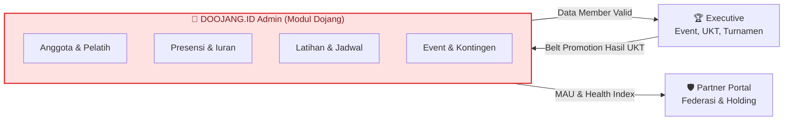

---

## ⚡ Alur Operasional Harian Dojang

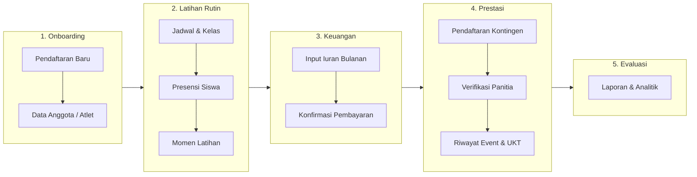

---

 

# 📚 SHOWCASE PER MENU MODULE

---

## 1. 📊 Dashboard & Momen Latihan

> **Untuk**: Pelatih, Admin, Pemilik Dojang · **Route**: `/` dan `/training-moments`

* **Kelebihan Menjual**: Satu layar ringkasan kondisi dojang hari ini — jumlah anggota aktif, kehadiran, iuran, dan agenda terdekat. **Momen Latihan** mengabadikan dokumentasi sesi latihan untuk dibagikan ke wali murid dan media sosial.
* **Dampak Bisnis**: Pemilik langsung tahu "kesehatan" dojang tanpa membuka banyak laporan; momen latihan meningkatkan kedekatan dengan orang tua dan retensi murid.

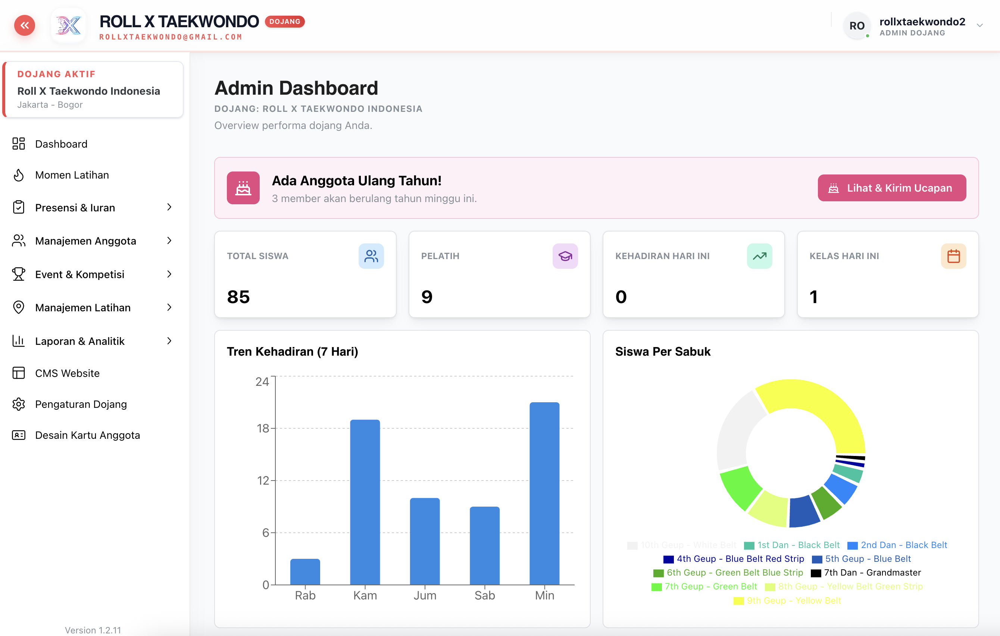  
*Gambar 1: Dashboard Admin Dojang — ringkasan anggota, kehadiran, dan aktivitas terkini.*

---

## 2. ✅ Presensi & Iuran

> **Untuk**: Pelatih (presensi), Admin (iuran) · **Route**: `/attendance`, `/instructor-attendance`, `/payments`, `/monthly-dues`

| Fitur | Route | Manfaat |
| :--- | :--- | :--- |
| **Presensi Siswa** | `/attendance` | Check-in murid per kelas/jadwal, data kehadiran langsung masuk laporan. |
| **Presensi Pelatih** | `/instructor-attendance` | Rekam kehadiran pelatih sebagai dasar honor & evaluasi. |
| **Konfirmasi Iuran** | `/payments` | Verifikasi bukti transfer iuran dari wali/murid. |
| **Input Iuran** | `/monthly-dues` | Catat iuran bulanan, pantau tunggakan per anggota. |

* **Kelebihan Menjual**: Presensi dan iuran terhubung — dojang bisa melihat korelasi murid yang jarang hadir dengan tunggakan, sekaligus menjadi basis penghitungan **MAU** (murid aktif bulanan) untuk federasi.
* **Dampak Bisnis**: Arus kas dojang lebih sehat, tunggakan berkurang, tidak ada lagi sengketa "saya sudah bayar".

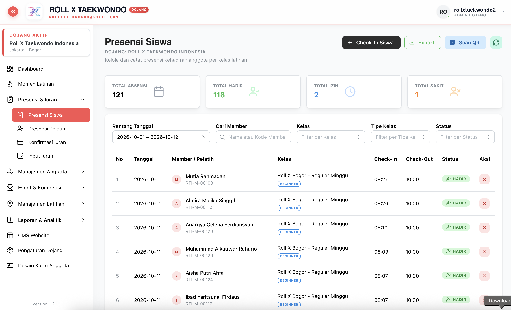  
*Gambar 2: Presensi Siswa — pencatatan kehadiran digital per kelas.*

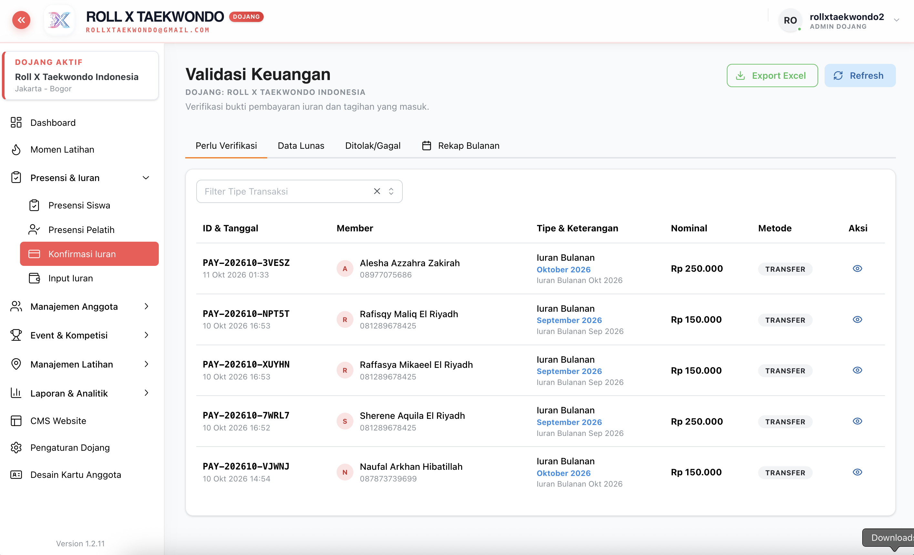  
*Gambar 3: Konfirmasi & Input Iuran — status pembayaran bulanan seluruh anggota.*

---

## 3. 👥 Manajemen Anggota

> **Untuk**: Admin, Pelatih · **Route**: `/registrations`, `/members`, `/members/birthdays`, `/instructors`, `/belt-ranks`

| Fitur | Route | Manfaat |
| :--- | :--- | :--- |
| **Pendaftaran Baru** | `/registrations` | Terima & setujui calon anggota baru secara digital. |
| **Data Anggota/Atlet** | `/members` | Profil lengkap: sabuk, BB/TB, kontak wali, riwayat. |
| **Ulang Tahun** | `/members/birthdays` | Pengingat ulang tahun untuk ucapan personal ke murid. |
| **Data Pelatih/Sabeum** | `/instructors` | Direktori pelatih, lisensi, dan status aktif. |
| **Tingkat Sabuk** | `/belt-ranks` | Master tingkatan sabuk (Geup/Dan) — Super Admin. |

* **Kelebihan Menjual**: Satu profil anggota yang menjadi *single source of truth* — dipakai otomatis saat mendaftar event/UKT (BB, TB, sabuk di-*lookup*, bukan input ulang), dan diperbarui otomatis saat lulus kenaikan sabuk.
* **Dampak Bisnis**: Hemat jam administrasi, data valid untuk pelaporan ke federasi, dan fitur ulang tahun menjadi alat retensi yang murah.

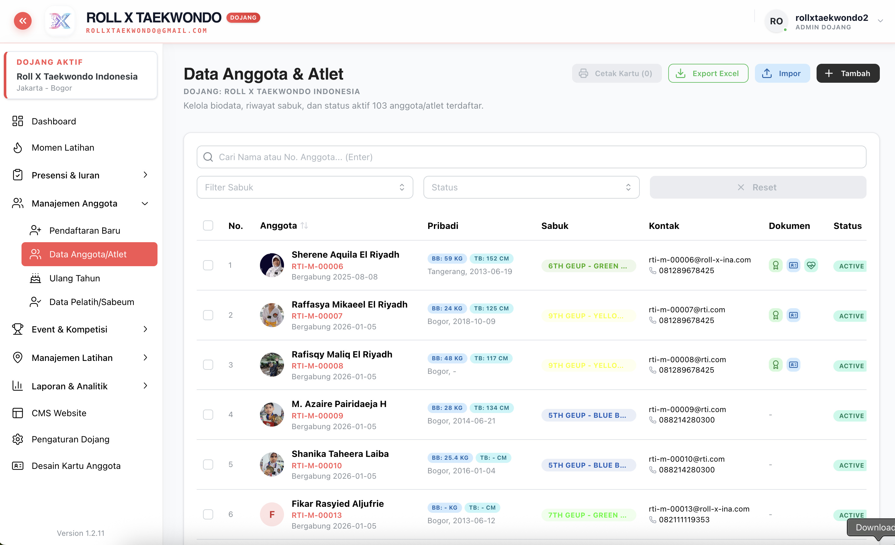  
*Gambar 4: Data Anggota/Atlet — database terpusat murid dengan sabuk dan status keanggotaan.*

---

## 4. 🏆 Event & Kompetisi

> **Untuk**: Admin Dojang · **Route**: `/events-discovery`, `/events`, `/events/history`, `/events/schedule`, `/events/brackets`

| Fitur | Route | Manfaat |
| :--- | :--- | :--- |
| **Pendaftaran Kontingen** | `/events-discovery` | Temukan event aktif dan daftarkan atlet dojang sebagai satu kontingen. |
| **Event Internal / UKT** | `/events` | Kelola UKT dan event internal dojang sendiri. |
| **Riwayat Event & UKT** | `/events/history` | Arsip partisipasi, hasil, dan kelulusan sabuk. |
| **Jadwal Pertandingan** | `/events/schedule` | Lihat jam bertanding atlet dojang di setiap arena. |
| **Bagan & Pool** | `/events/brackets` | Pantau posisi atlet di bagan pertandingan. |

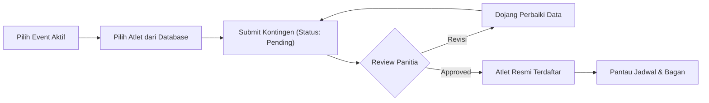

* **Kelebihan Menjual**: Alur **ping-pong** revisi yang transparan — panitia memberi catatan, dojang memperbaiki hanya data yang bermasalah, data valid tetap terkunci aman. Tidak perlu lagi kirim ulang berkas lewat chat.
* **Dampak Bisnis**: Pendaftaran kejuaraan selesai dalam hitungan menit, minim salah kategori, dan seluruh jejak prestasi atlet tersimpan.

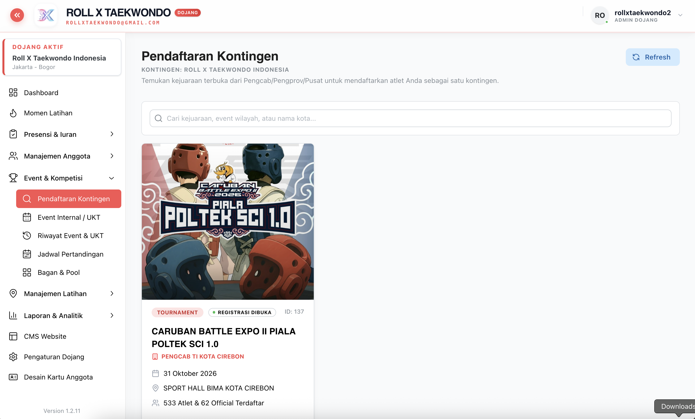  
*Gambar 5: Pendaftaran Kontingen — pilih atlet dari database dojang dan pantau status verifikasi.*

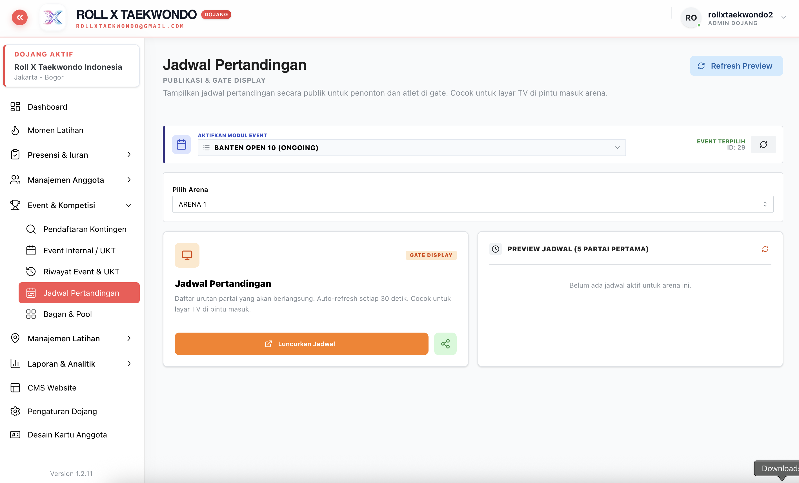  
*Gambar 6: Jadwal Pertandingan & Bagan — pantau waktu dan lawan atlet secara real-time.*

---

## 5. 📍 Manajemen Latihan

> **Untuk**: Admin Dojang · **Route**: `/locations`, `/classes`, `/schedules`

| Fitur | Route | Manfaat |
| :--- | :--- | :--- |
| **Lokasi** | `/locations` | Kelola banyak tempat latihan (GOR, sekolah, aula) beserta alamat. |
| **Kelas** | `/classes` | Definisi kelas berdasarkan usia/tingkat (Anak, Remaja, Dewasa, Poomsae, Kyorugi). |
| **Jadwal** | `/schedules` | Penjadwalan rutin per lokasi, kelas, dan pelatih. |

* **Kelebihan Menjual**: Mendukung dojang multi-lokasi — satu admin mengatur semua cabang latihan dengan jadwal yang tidak bentrok, dan jadwal langsung menjadi dasar presensi.
* **Dampak Bisnis**: Ekspansi ke lokasi baru tanpa menambah beban administrasi.

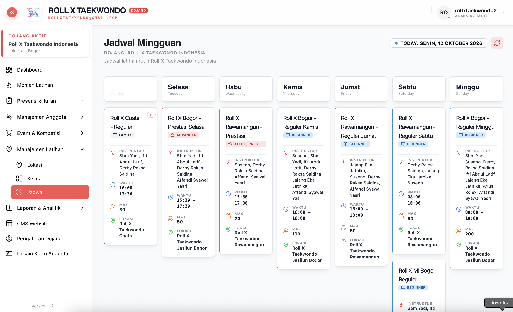  
*Gambar 7: Jadwal Latihan — pengaturan kelas, lokasi, dan pelatih dalam satu tampilan.*

---

## 6. 🛍️ Toko & Bisnis · 📰 Publikasi

> **Untuk**: Super Admin / Pemilik · **Route**: `/store`, `/news`, `/blogs`

* **Toko & Bisnis (`/store`)**: Penjualan seragam (dobok), pelindung, dan merchandise — sumber pendapatan tambahan di luar iuran.
* **Publikasi (`/news`, `/blogs`)**: Berita kegiatan dan artikel blog untuk membangun reputasi dan SEO dojang.
* **Dampak Bisnis**: Diversifikasi pendapatan dan branding dojang sebagai institusi profesional.

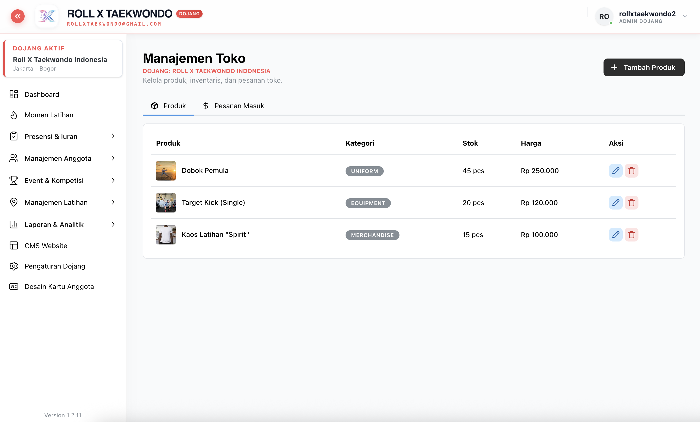  
*Gambar 8: Penjualan Toko — pencatatan produk dan transaksi dojang.*

---

## 7. 📈 Laporan & Analitik

> **Untuk**: Pelatih (laporan dasar), Admin (laporan lanjutan) · **Route**: `/daily-schedules`, `/periodic-stats`, `/attendance-growth`, `/member-growth`, `/instructor-growth`, `/member-demographics`, `/location-stats`

| Laporan | Route | Pertanyaan yang Dijawab |
| :--- | :--- | :--- |
| **Jadwal Latihan Harian** | `/daily-schedules` | Siapa berlatih di mana hari ini? |
| **Statistik Bulanan** | `/periodic-stats` | Bagaimana performa dojang bulan ini? |
| **Perkembangan Latihan** | `/attendance-growth` | Apakah tren kehadiran naik atau turun? |
| **Perkembangan Anggota** | `/member-growth` | Berapa anggota baru vs yang keluar? |
| **Perkembangan Pelatih** | `/instructor-growth` | Bagaimana kontribusi dan keaktifan pelatih? |
| **Demografi & Retensi** | `/member-demographics` | Komposisi usia, gender, sabuk, dan loyalitas murid? |
| **Statistik Tempat Latihan** | `/location-stats` | Lokasi mana yang paling ramai/efektif? |

* **Kelebihan Menjual**: Keputusan berbasis data — bukan perkiraan. Data yang sama otomatis menjadi bahan **Dojang Health Index** dan **MAU** yang dipantau federasi/partner.
* **Dampak Bisnis**: Deteksi dini penurunan murid, optimasi jadwal, dan laporan siap tampil untuk pengurus cabang.

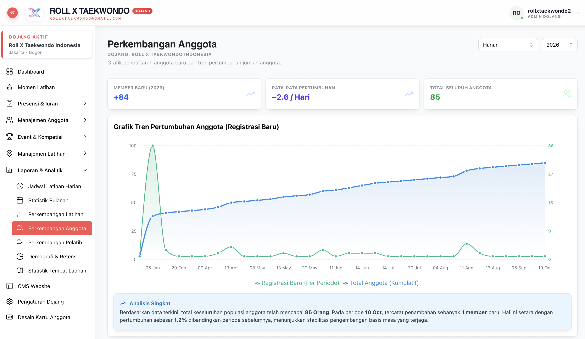  
*Gambar 9: Perkembangan Anggota — tren pertumbuhan murid per periode.*

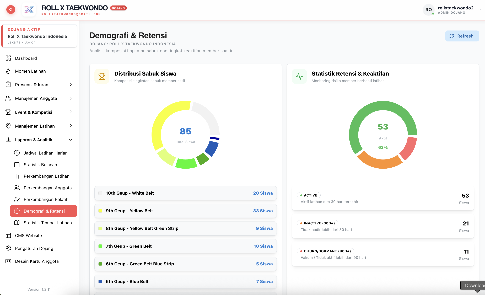  
*Gambar 10: Demografi & Retensi — komposisi dan loyalitas anggota dojang.*

---

## 8. 🌐 CMS Website · ⚙️ Pengaturan · 🪪 Kartu Anggota

> **Untuk**: Admin Dojang · **Route**: `/cms/website`, `/dojang-settings`, `/member-card-design`

| Fitur | Route | Manfaat |
| :--- | :--- | :--- |
| **CMS Website** | `/cms/website` | Kelola halaman profil, galeri, dan informasi publik website dojang. |
| **Pengaturan Dojang** | `/dojang-settings` | Identitas, logo, kontak, dan konfigurasi dojang. |
| **Desain Kartu Anggota** | `/member-card-design` | Desain kartu anggota bermerek dojang untuk dicetak/digital. |

* **Dampak Bisnis**: Citra profesional di mata calon murid & orang tua — website, kartu anggota, dan identitas konsisten tanpa jasa desainer.

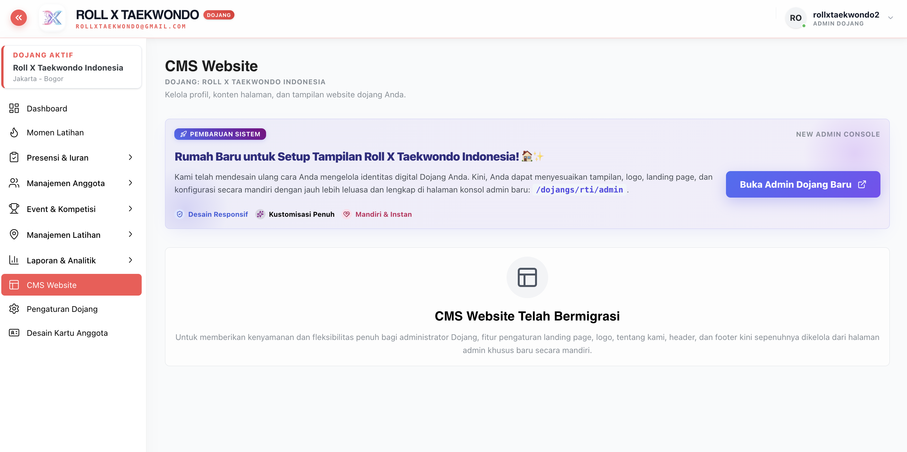  
*Gambar 11: CMS Website — pengelolaan konten website publik dojang.*

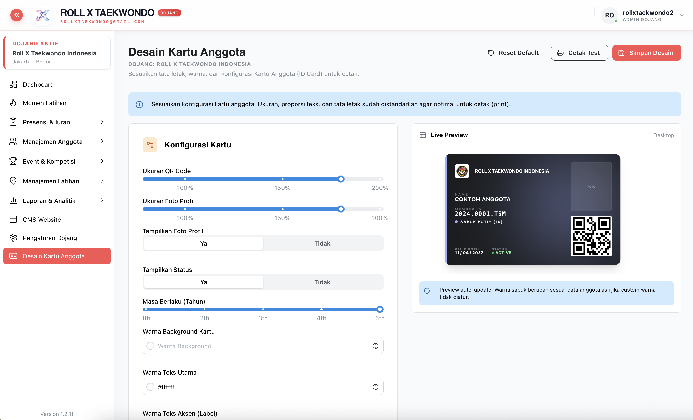  
*Gambar 12: Desain Kartu Anggota — kartu anggota bermerek dojang.*

---

## 📊 Matriks Fitur Lengkap Menu Admin Dojang

| Kelompok Menu | Fitur Kunci | Manfaat Utama |
| :--- | :--- | :--- |
| **Dashboard & Momen** | Dashboard, Momen Latihan | Gambaran harian dan dokumentasi latihan. |
| **Presensi & Iuran** | Presensi Siswa/Pelatih, Konfirmasi & Input Iuran | Kedisiplinan dan arus kas terpantau. |
| **Manajemen Anggota** | Pendaftaran, Data Anggota, Ulang Tahun, Pelatih, Sabuk | Database tunggal murid & pelatih. |
| **Event & Kompetisi** | Kontingen, UKT, Riwayat, Jadwal, Bagan | Pendaftaran event cepat dan arsip prestasi. |
| **Manajemen Latihan** | Lokasi, Kelas, Jadwal | Operasional multi-lokasi tertata. |
| **Toko & Bisnis** | Penjualan Toko | Pendapatan tambahan. |
| **Publikasi** | Berita, Blog | Branding & SEO dojang. |
| **Laporan & Analitik** | 7 laporan pertumbuhan & demografi | Keputusan berbasis data. |
| **CMS & Pengaturan** | Website, Pengaturan, Kartu Anggota | Identitas dan citra profesional. |

---

## 💼 Nilai Bisnis & ROI

1. **Hemat Waktu Administrasi**: Presensi, iuran, dan laporan bulanan otomatis — pelatih fokus melatih.
2. **Pendapatan Lebih Terjaga**: Tunggakan iuran terlihat jelas dan dapat ditindaklanjuti lebih cepat.
3. **Retensi Murid Naik**: Momen latihan, ulang tahun, dan laporan retensi membantu menjaga hubungan dengan wali murid.
4. **Siap Terhubung Federasi**: Data member valid otomatis siap untuk pendaftaran UKT/kejuaraan dan pelaporan ke Pengcab/Pengprov.
5. **Skalabel**: Dari satu lokasi hingga banyak cabang dalam satu akun.

---

## 🚀 Langkah Selanjutnya (Next Steps)

Siap men-digitalisasi dojang Anda? Hubungi tim kami untuk **demo langsung**, **migrasi data anggota dari Excel**, dan **onboarding pelatih** — dojang Anda bisa berjalan di DOOJANG.ID dalam hitungan hari.
